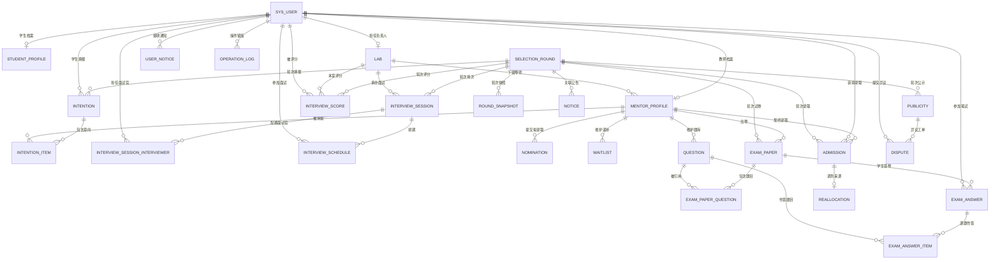

# 03 Database｜学生实训室进组选拔平台

> 版本：v1.0（阶段 1 定稿待确认）
> 表数量：26 张。所有状态值以本文档为准，`04_API.md` 与 `flow/` 必须与之一致。

## 1. 设计规约

- 主键统一 `id`，类型 `BIGINT`，`AUTO_INCREMENT`。
- 每表必须含 `gmt_create`、`gmt_modified`（`DATETIME`，自动填充）。
- 状态、布尔、类型标识一律 `TINYINT`，含义在字段 COMMENT 中逐一列明，禁止只写部分取值。
- 分数、权重一律 `DECIMAL(5,2)`；名额、人数一律 `INT`。
- 高频查询字段（`round_id`、`student_id`、`mentor_id`、`lab_id`、`status`）建普通索引；业务唯一性建唯一索引。
- 多对多关系显式建中间表（`intention_item` 为意向与导师的多对多）。
- 引擎 `InnoDB`，字符集 `utf8mb4`，排序规则 `utf8mb4_general_ci`。
- 不建物理外键，关系由应用层保证，避免分库与批量导入受阻。

## 2. 实体清单

| 实体 | 表名 | 说明 |
|---|---|---|
| 用户账号 | sys_user | 学生 / 教师 / 管理员统一账号，学校统一创建 |
| 学生档案 | student_profile | 学业、技能、经历、时间投入与个人陈述，与账号一对一 |
| 实训室 | lab | 实训室档案、开放日安排、总名额、负责人 |
| 导师档案 | mentor_profile | 教师业务档案：所属实训室、个人名额、已占用名额 |
| 选拔轮次 | selection_round | 3 轮的时间窗、状态、四维权重 |
| 意向主表 | intention | 一个学生一轮一份填报，含两个调剂意愿 |
| 意向明细 | intention_item | 最多 3 条平行导师意向，不分先后 |
| 面试场次 | interview_session | 以实训室为单位组织的面试场次 |
| 面试场次面试官 | interview_session_interviewer | 场次与面试官（本室导师）的多对多关联 |
| 面试排期 | interview_schedule | 学生与场次的对应关系 |
| 面试评分 | interview_score | 四维分数 + 系统总分 + 手动覆写，按导师独立记录 |
| 拟录取 | nomination | 导师勾选的拟录取名单 |
| 递补名单 | waitlist | 导师维度的递补顺位 |
| 录取结果 | admission | 学生最终去向，含确认状态 |
| 调剂记录 | reallocation | 三级优先调剂的过程留痕 |
| 公告 | notice | 宣讲、开放日、公示、通知四类公告 |
| 公示批次 | publicity | 公示时间窗与状态 |
| 异议工单 | dispute | 公示期异议提交与处理 |
| 站内通知 | user_notice | 面向个人的通知与已读状态 |
| 操作日志 | operation_log | 名额调整、顺位调整、调剂等关键操作留痕 |
| 轮次快照 | round_snapshot | 每轮结束固化名单，供回溯、审计与导出 |
| 题库 | question | 导师个人题库，支持单选 / 多选 / 判断 / 填空 |
| 在线试卷 | exam_paper | 导师面向本人意向学生发布的在线笔试卷 |
| 试卷题目 | exam_paper_question | 试卷与题库题目的关联，含题号与分值 |
| 在线答卷 | exam_answer | 学生答卷主表，一份试卷每生一份 |
| 答卷明细 | exam_answer_item | 逐题作答内容与自动判分结果 |

## 3. 表结构

### 3.1 sys_user 用户账号

| 字段 | 类型 | 允许空 | 默认值 | 说明 |
|---|---|---|---|---|
| id | BIGINT | N | 自增 | 主键 |
| user_no | VARCHAR(32) | N | | 学号 / 工号，全局唯一 |
| password | VARCHAR(100) | N | | BCrypt 密文 |
| real_name | VARCHAR(50) | N | | 姓名 |
| user_type | TINYINT | N | | 1 学生 2 教师 3 管理员 |
| gender | TINYINT | Y | 0 | 0 未知 1 男 2 女 |
| phone | VARCHAR(20) | Y | | 手机号 |
| email | VARCHAR(100) | Y | | 邮箱 |
| college | VARCHAR(100) | Y | | 学院 |
| major | VARCHAR(100) | Y | | 专业，仅学生 |
| grade | VARCHAR(20) | Y | | 年级，仅学生 |
| title | VARCHAR(50) | Y | | 职称，仅教师 |
| status | TINYINT | N | 1 | 1 启用 0 禁用 |
| need_change_pwd | TINYINT | N | 1 | 1 需改密 0 不需 |
| last_login_at | DATETIME | Y | | 最后登录时间 |
| gmt_create | DATETIME | N | CURRENT_TIMESTAMP | 创建时间 |
| gmt_modified | DATETIME | N | CURRENT_TIMESTAMP | 更新时间 |

索引：`uk_user_no(user_no)`、`idx_type_status(user_type, status)`

### 3.2 lab 实训室

| 字段 | 类型 | 允许空 | 默认值 | 说明 |
|---|---|---|---|---|
| id | BIGINT | N | 自增 | 主键 |
| lab_code | VARCHAR(32) | N | | 实训室编码，唯一 |
| lab_name | VARCHAR(100) | N | | 实训室名称 |
| department | VARCHAR(100) | Y | | 所属系部，用于公共端筛选与展示 |
| introduction | TEXT | Y | | 简介 |
| research_direction | VARCHAR(500) | Y | | 研究方向 |
| equipment_env | TEXT | Y | | 设备与环境 |
| training_plan | TEXT | Y | | 培养安排 |
| assessment_requirement | TEXT | Y | | 考核要求 |
| open_day_date | DATE | Y | | 开放日日期 |
| open_day_start_time | TIME | Y | | 开放日开始时间 |
| open_day_end_time | TIME | Y | | 开放日结束时间 |
| open_day_location | VARCHAR(200) | Y | | 开放日地点 |
| open_day_note | VARCHAR(500) | Y | | 开放日注意事项 |
| total_quota | INT | N | 0 | 本室总名额 |
| leader_id | BIGINT | Y | | 负责人 sys_user.id（教师） |
| status | TINYINT | N | 1 | 1 开放 0 关闭 |
| gmt_create | DATETIME | N | CURRENT_TIMESTAMP | 创建时间 |
| gmt_modified | DATETIME | N | CURRENT_TIMESTAMP | 更新时间 |

索引：`uk_lab_code(lab_code)`、`idx_leader_id(leader_id)`、`idx_status(status)`

### 3.3 mentor_profile 导师档案

| 字段 | 类型 | 允许空 | 默认值 | 说明 |
|---|---|---|---|---|
| id | BIGINT | N | 自增 | 主键 |
| user_id | BIGINT | N | | 关联 sys_user.id，教师 |
| lab_id | BIGINT | N | | 所属实训室 |
| research_direction | VARCHAR(500) | Y | | 研究方向 |
| research_projects | VARCHAR(1000) | Y | | 在研项目，公共端导师详情展示 |
| quota | INT | N | 0 | 个人招录名额上限（整个选拔周期） |
| quota_used | INT | N | 0 | 已占用名额（含拟录取占位与待确认） |
| version | INT | N | 0 | 乐观锁版本号 |
| status | TINYINT | N | 1 | 1 在职 0 停用 |
| gmt_create | DATETIME | N | CURRENT_TIMESTAMP | 创建时间 |
| gmt_modified | DATETIME | N | CURRENT_TIMESTAMP | 更新时间 |

索引：`uk_user_id(user_id)`、`idx_lab_id(lab_id)`

约束：`quota_used <= quota`，由条件更新保证。

### 3.4 selection_round 选拔轮次

| 字段 | 类型 | 允许空 | 默认值 | 说明 |
|---|---|---|---|---|
| id | BIGINT | N | 自增 | 主键 |
| round_no | TINYINT | N | | 轮次序号 1 / 2 / 3 |
| round_name | VARCHAR(50) | N | | 轮次名称 |
| status | TINYINT | N | 1 | 1 未开始 2 填报中 3 面试中 4 拟录取确认中 5 已完成 |
| apply_start | DATETIME | N | | 意向填报开始 |
| apply_end | DATETIME | N | | 意向填报结束 |
| interview_start | DATETIME | N | | 面试开始 |
| interview_end | DATETIME | N | | 面试结束 |
| nomination_start | DATETIME | N | | 导师勾选与负责人汇总开始 |
| nomination_submit_end | DATETIME | N | | 名单提交截止；到点系统统一批处理签发，之后不再接受提交 |
| confirm_start | DATETIME | N | | 学生确认开始；批处理完成后开启，早于此刻学生看不到待确认记录 |
| nomination_end | DATETIME | N | | 确认截止；到点未确认批量置逾期 |
| inner_adjust_start | DATETIME | Y | | 阶段 6 内部调剂开始；为空表示本轮不开放本室内部调剂 |
| inner_adjust_end | DATETIME | Y | | 阶段 6 内部调剂结束；必须与开始时间同时配置，且不得晚于 `adjust_start` |
| adjust_start | DATETIME | N | | 统筹调剂开始；教师抢录与管理员兜底仅在此后可用 |
| adjust_end | DATETIME | N | | 统筹调剂结束；之后进入公示准备 |
| weight_attitude | DECIMAL(5,2) | N | 25.00 | 学习态度权重（%） |
| weight_logic | DECIMAL(5,2) | N | 25.00 | 逻辑思维权重（%） |
| weight_programming | DECIMAL(5,2) | N | 25.00 | 编程基础权重（%） |
| weight_time | DECIMAL(5,2) | N | 25.00 | 时间投入权重（%） |
| locked | TINYINT | N | 0 | 批次锁定：1 已锁定，全系统只读；仅最后一轮可置 1 |
| gmt_create | DATETIME | N | CURRENT_TIMESTAMP | 创建时间 |
| gmt_modified | DATETIME | N | CURRENT_TIMESTAMP | 更新时间 |

索引：`uk_round_no(round_no)`、`idx_status(status)`

约束：四维权重合计必须为 100.00。

### 3.5 intention 意向主表

| 字段 | 类型 | 允许空 | 默认值 | 说明 |
|---|---|---|---|---|
| id | BIGINT | N | 自增 | 主键 |
| round_id | BIGINT | N | | 所属轮次 |
| student_id | BIGINT | N | | 学生 sys_user.id |
| accept_inner_adjust | TINYINT | N | 0 | 是否服从实训室内部调剂 1 是 0 否 |
| accept_cross_adjust | TINYINT | N | 0 | 是否服从全院跨实训室调剂 1 是 0 否 |
| pool_consent | TINYINT | N | 0 | 是否同意全院导师在调剂池查看完整档案 1 是 0 否 |
| status | TINYINT | N | 1 | 1 草稿 2 已提交 |
| submit_time | DATETIME | Y | | 提交时间 |
| gmt_create | DATETIME | N | CURRENT_TIMESTAMP | 创建时间 |
| gmt_modified | DATETIME | N | CURRENT_TIMESTAMP | 更新时间 |

索引：`uk_round_student(round_id, student_id)`、`idx_student_id(student_id)`

### 3.6 intention_item 意向明细

| 字段 | 类型 | 允许空 | 默认值 | 说明 |
|---|---|---|---|---|
| id | BIGINT | N | 自增 | 主键 |
| intention_id | BIGINT | N | | 关联 intention.id |
| mentor_id | BIGINT | N | | 导师 mentor_profile.id |
| lab_id | BIGINT | N | | 导师所属实训室（冗余，便于按室查询） |
| gmt_create | DATETIME | N | CURRENT_TIMESTAMP | 创建时间 |
| gmt_modified | DATETIME | N | CURRENT_TIMESTAMP | 更新时间 |

索引：`uk_intention_mentor(intention_id, mentor_id)`、`idx_mentor_id(mentor_id)`、`idx_lab_id(lab_id)`

约束：同一 intention 下最多 3 条，由服务端校验；**不设顺序字段**，体现平行志愿不分先后。

### 3.7 interview_session 面试场次

| 字段 | 类型 | 允许空 | 默认值 | 说明 |
|---|---|---|---|---|
| id | BIGINT | N | 自增 | 主键 |
| round_id | BIGINT | N | | 所属轮次 |
| lab_id | BIGINT | N | | 承办实训室 |
| session_name | VARCHAR(100) | N | | 场次名称 |
| interview_date | DATE | N | | 面试日期 |
| start_time | TIME | N | | 开始时间 |
| end_time | TIME | N | | 结束时间 |
| location | VARCHAR(200) | N | | 面试地点 |
| capacity | INT | N | 0 | 容量 |
| status | TINYINT | N | 1 | 1 草稿 2 已发布 3 已结束 |
| gmt_create | DATETIME | N | CURRENT_TIMESTAMP | 创建时间 |
| gmt_modified | DATETIME | N | CURRENT_TIMESTAMP | 更新时间 |

索引：`idx_round_lab(round_id, lab_id)`、`idx_interview_date(interview_date)`

### 3.7.1 interview_session_interviewer 面试场次面试官

| 字段 | 类型 | 允许空 | 默认值 | 说明 |
|---|---|---|---|---|
| id | BIGINT | N | 自增 | 主键 |
| session_id | BIGINT | N | | 关联 interview_session.id |
| interviewer_id | BIGINT | N | | 面试官，关联 sys_user.id，须为本室在职导师 |
| gmt_create | DATETIME | N | CURRENT_TIMESTAMP | 创建时间 |
| gmt_modified | DATETIME | N | CURRENT_TIMESTAMP | 更新时间 |

索引：`uk_session_interviewer(session_id, interviewer_id)`、`idx_interviewer_id(interviewer_id)`

说明：

- 一个场次至少配置 1 名面试官，数量由服务端校验，无上限。
- 面试官必须是 `mentor_profile.lab_id = interview_session.lab_id` 且 `sys_user.status = 1` 的教师，跨室或已禁用账号一律拒绝（400002）。
- 同一场次同一面试官只出现一次，由唯一键兜底。
- 面试官时段冲突以 `interviewer_id` 关联本表与 `interview_session` 的 `interview_date + start_time ~ end_time` 判定，不新增冗余时间字段。

### 3.8 interview_schedule 面试排期

| 字段 | 类型 | 允许空 | 默认值 | 说明 |
|---|---|---|---|---|
| id | BIGINT | N | 自增 | 主键 |
| round_id | BIGINT | N | | 所属轮次 |
| lab_id | BIGINT | N | | 实训室 |
| mentor_id | BIGINT | N | | 面试导师 `mentor_profile.id` |
| session_id | BIGINT | N | | 面试场次 |
| student_id | BIGINT | N | | 学生 |
| status | TINYINT | N | 1 | 1 待面试 2 已完成 3 缺席 |
| gmt_create | DATETIME | N | CURRENT_TIMESTAMP | 创建时间 |
| gmt_modified | DATETIME | N | CURRENT_TIMESTAMP | 更新时间 |

索引：`uk_round_mentor_student(round_id, mentor_id, student_id)`、`idx_session_id(session_id)`、`idx_student_id(student_id)`、`idx_mentor_id(mentor_id)`

说明：一个学生在一轮内、同一导师只排 1 场；选择 N 位导师则最多 N 条排期，且不得时间冲突。

### 3.9 interview_score 面试评分

| 字段 | 类型 | 允许空 | 默认值 | 说明 |
|---|---|---|---|---|
| id | BIGINT | N | 自增 | 主键 |
| round_id | BIGINT | N | | 所属轮次 |
| lab_id | BIGINT | N | | 实训室 |
| mentor_id | BIGINT | N | | 评分导师 `mentor_profile.id` |
| student_id | BIGINT | N | | 学生 |
| session_id | BIGINT | Y | | 关联面试场次 |
| attitude_score | DECIMAL(5,2) | N | 0.00 | 学习态度（0-100） |
| logic_score | DECIMAL(5,2) | N | 0.00 | 逻辑思维（0-100） |
| programming_score | DECIMAL(5,2) | N | 0.00 | 编程基础（0-100） |
| time_score | DECIMAL(5,2) | N | 0.00 | 时间投入（0-100） |
| system_total | DECIMAL(5,2) | N | 0.00 | 系统按权重计算的总分 |
| manual_total | DECIMAL(5,2) | Y | | 手动覆写总分，NULL 表示未覆写 |
| final_total | DECIMAL(5,2) | N | 0.00 | 实际使用总分 = manual_total 非空取之，否则取 system_total |
| adjust_reason | VARCHAR(500) | Y | | 手动调整理由 |
| comment | VARCHAR(1000) | Y | | 面试评语 |
| scorer_id | BIGINT | N | | 录分人（导师本人） |
| status | TINYINT | N | 1 | 1 草稿 2 已提交 |
| gmt_create | DATETIME | N | CURRENT_TIMESTAMP | 创建时间 |
| gmt_modified | DATETIME | N | CURRENT_TIMESTAMP | 更新时间 |

索引：`uk_round_mentor_student(round_id, mentor_id, student_id)`、`idx_round_lab(round_id, lab_id)`、`idx_scorer_id(scorer_id)`、`idx_mentor_id(mentor_id)`

说明：评分按“导师 + 学生”独立记录，各导师分数独立用于本人拟录取，不做平均。

### 3.10 nomination 拟录取

| 字段 | 类型 | 允许空 | 默认值 | 说明 |
|---|---|---|---|---|
| id | BIGINT | N | 自增 | 主键 |
| round_id | BIGINT | N | | 所属轮次 |
| lab_id | BIGINT | N | | 实训室 |
| mentor_id | BIGINT | N | | 导师 mentor_profile.id |
| student_id | BIGINT | N | | 学生 |
| score_id | BIGINT | N | | 关联 interview_score.id |
| total_score | DECIMAL(5,2) | N | 0.00 | 拟录取时的总分快照 |
| status | TINYINT | N | 1 | 1 草稿 2 已提交 3 已作废 |
| gmt_create | DATETIME | N | CURRENT_TIMESTAMP | 创建时间 |
| gmt_modified | DATETIME | N | CURRENT_TIMESTAMP | 更新时间 |

索引：`uk_round_mentor_student(round_id, mentor_id, student_id)`、`idx_round_student(round_id, student_id)`、`idx_mentor_id(mentor_id)`

约束：同一导师勾选人数 ≤ `mentor_profile.quota`，由名额条件更新保证。

### 3.11 waitlist 递补名单

| 字段 | 类型 | 允许空 | 默认值 | 说明 |
|---|---|---|---|---|
| id | BIGINT | N | 自增 | 主键 |
| round_id | BIGINT | N | | 所属轮次 |
| mentor_id | BIGINT | N | | 导师 |
| student_id | BIGINT | N | | 学生 |
| rank_no | INT | N | | 递补顺位，从 1 开始 |
| is_manual | TINYINT | N | 0 | 是否手工调整 1 是 0 否 |
| adjust_reason | VARCHAR(500) | Y | | 手工调整理由 |
| apply_status | TINYINT | N | 1 | 1 待递补 2 已递补 3 已失效 |
| gmt_create | DATETIME | N | CURRENT_TIMESTAMP | 创建时间 |
| gmt_modified | DATETIME | N | CURRENT_TIMESTAMP | 更新时间 |

索引：`uk_round_mentor_student(round_id, mentor_id, student_id)`、`idx_round_mentor_rank(round_id, mentor_id, rank_no)`

生成时点：批次签发（`POST /api/v1/admin/rounds/{id}/issue`）时，为本轮「本室有面试评分但未被拟录取」的学生按导师分组写入，`rank_no` 按 `final_total` 降序从 1 开始，同分按 `student_id` 升序；重复签发按唯一键跳过，不覆盖已有顺位与 `is_manual` 标记。

### 3.12 admission 录取结果

| 字段 | 类型 | 允许空 | 默认值 | 说明 |
|---|---|---|---|---|
| id | BIGINT | N | 自增 | 主键 |
| round_id | BIGINT | N | | 所属轮次 |
| student_id | BIGINT | N | | 学生 |
| lab_id | BIGINT | N | | 实训室 |
| mentor_id | BIGINT | N | | 导师 |
| source_type | TINYINT | N | 1 | 1 拟录取 2 递补 3 内部调剂 4 跨室调剂 5 座谈安置 |
| pending_type | TINYINT | Y | | 待确认类型：1 拟录取多选一 2 递补待确认 3 异议调整待确认 4 内部调剂待确认；NULL 表示无需确认。**检索一律按 `status = 1`，该字段仅作展示标签** |
| active_flag | TINYINT | Y | | 终局有效标记：`status ∈ {2,3}` 时为 1，`{1,4,5}` 时为 NULL。**待确认期（status=1）必须为 NULL**，否则同轮多条待确认会撞唯一键 |
| nomination_id | BIGINT | Y | | 来源拟录取记录 |
| waitlist_id | BIGINT | Y | | 来源递补记录 |
| reallocation_id | BIGINT | Y | | 来源调剂记录 |
| total_score | DECIMAL(5,2) | Y | | 录取时总分快照 |
| status | TINYINT | N | 1 | 1 待确认 2 已确认 3 已入组 4 已放弃 5 逾期未确认 |
| confirm_deadline | DATETIME | Y | | 确认截止时间 |
| confirm_time | DATETIME | Y | | 确认时间 |
| gmt_create | DATETIME | N | CURRENT_TIMESTAMP | 创建时间 |
| gmt_modified | DATETIME | N | CURRENT_TIMESTAMP | 更新时间 |

索引：`uk_round_mentor_student(round_id, mentor_id, student_id)`、`uk_round_student_active(round_id, student_id, active_flag)`、`idx_student_id(student_id)`、`idx_round_lab(round_id, lab_id)`、`idx_lab_id(lab_id)`、`idx_status(status)`

约束：同一轮次同一导师对同一学生只有一条记录；`uk_round_student_active` 只约束**终局态**（`active_flag = 1`），待确认期（`status = 1`）全部为 NULL，同轮可并存多条待确认供学生选择。状态变更必须同步维护 `active_flag`：进入 2/3 置 1，进入 1/4/5 置 NULL。

### 3.13 reallocation 调剂记录

| 字段 | 类型 | 允许空 | 默认值 | 说明 |
|---|---|---|---|---|
| id | BIGINT | N | 自增 | 主键 |
| round_id | BIGINT | N | | 所属轮次 |
| student_id | BIGINT | N | | 学生 |
| from_lab_id | BIGINT | Y | | 原实训室（座谈安置可为空） |
| to_lab_id | BIGINT | N | | 调剂目标实训室 |
| to_mentor_id | BIGINT | N | | 调剂目标导师 |
| level | TINYINT | N | | 1 内部调剂 2 跨室调剂 3 座谈安置 |
| operator_id | BIGINT | N | | 操作人用户ID（导师 / 负责人 / 管理员） |
| reason | VARCHAR(500) | Y | | 调剂说明 |
| gmt_create | DATETIME | N | CURRENT_TIMESTAMP | 创建时间 |
| gmt_modified | DATETIME | N | CURRENT_TIMESTAMP | 更新时间 |

索引：`idx_round_id(round_id)`、`idx_student_id(student_id)`、`idx_to_mentor_id(to_mentor_id)`

### 3.14 notice 公告

| 字段 | 类型 | 允许空 | 默认值 | 说明 |
|---|---|---|---|---|
| id | BIGINT | N | 自增 | 主键 |
| title | VARCHAR(200) | N | | 标题 |
| notice_type | TINYINT | N | | 1 宣讲 2 开放日 3 公示 4 通知 |
| content | TEXT | N | | 正文 |
| attachment_url | VARCHAR(500) | Y | | 附件地址 |
| status | TINYINT | N | 1 | 1 草稿 2 已发布 3 已下线 |
| publish_time | DATETIME | Y | | 发布时间 |
| publisher_id | BIGINT | N | | 发布人 |
| biz_id | BIGINT | Y | | 业务关联 ID；公示类公告存 `publicity.id`，其余为空 |
| gmt_create | DATETIME | N | CURRENT_TIMESTAMP | 创建时间 |
| gmt_modified | DATETIME | N | CURRENT_TIMESTAMP | 更新时间 |

索引：`idx_type_status(notice_type, status)`、`idx_publish_time(publish_time)`

### 3.15 publicity 公示批次

| 字段 | 类型 | 允许空 | 默认值 | 说明 |
|---|---|---|---|---|
| id | BIGINT | N | 自增 | 主键 |
| round_id | BIGINT | N | | 公示所属轮次 |
| title | VARCHAR(200) | N | | 公示标题 |
| start_time | DATETIME | N | | 公示开始 |
| end_time | DATETIME | N | | 公示结束 |
| status | TINYINT | N | 1 | 1 进行中 2 已结束 3 已确认 |
| publisher_id | BIGINT | N | | 发布人 |
| gmt_create | DATETIME | N | CURRENT_TIMESTAMP | 创建时间 |
| gmt_modified | DATETIME | N | CURRENT_TIMESTAMP | 更新时间 |

索引：`idx_round_id(round_id)`、`idx_status(status)`

### 3.16 dispute 异议工单

| 字段 | 类型 | 允许空 | 默认值 | 说明 |
|---|---|---|---|---|
| id | BIGINT | N | 自增 | 主键 |
| publicity_id | BIGINT | N | | 关联公示批次 |
| student_id | BIGINT | N | | 提交学生 |
| dispute_type | TINYINT | N | | 1 录取结果有误 2 名额分配不公 3 信息登记错误 4 其他 |
| content | VARCHAR(500) | N | | 异议说明，最长 500 字 |
| attachment_url | VARCHAR(1000) | Y | | 附件地址，最多 3 个，逗号分隔 |
| status | TINYINT | N | 1 | 1 待处理 2 处理中 3 已回复 4 已关闭 |
| handler_id | BIGINT | Y | | 处理人 |
| handle_result | TINYINT | Y | | 1 维持原结果 2 调整录取 3 退回重审 |
| handle_opinion | VARCHAR(1000) | Y | | 处理意见 |
| handle_time | DATETIME | Y | | 处理时间 |
| gmt_create | DATETIME | N | CURRENT_TIMESTAMP | 创建时间 |
| gmt_modified | DATETIME | N | CURRENT_TIMESTAMP | 更新时间 |

索引：`idx_publicity_id(publicity_id)`、`idx_student_id(student_id)`、`idx_status(status)`

### 3.17 user_notice 站内通知

| 字段 | 类型 | 允许空 | 默认值 | 说明 |
|---|---|---|---|---|
| id | BIGINT | N | 自增 | 主键 |
| user_id | BIGINT | N | | 接收人 |
| title | VARCHAR(200) | N | | 标题 |
| content | VARCHAR(1000) | N | | 正文 |
| notice_type | TINYINT | N | | 1 系统 2 填报 3 面试 4 确认 5 公示 6 异议 |
| biz_type | VARCHAR(50) | Y | | 业务类型标识 |
| biz_id | BIGINT | Y | | 业务主键 |
| is_read | TINYINT | N | 0 | 0 未读 1 已读 |
| read_time | DATETIME | Y | | 阅读时间 |
| gmt_create | DATETIME | N | CURRENT_TIMESTAMP | 创建时间 |
| gmt_modified | DATETIME | N | CURRENT_TIMESTAMP | 更新时间 |

索引：`idx_user_read(user_id, is_read)`、`idx_gmt_create(gmt_create)`、`uk_biz_user_type(biz_type, biz_id, user_id, notice_type)`

说明：`uk_biz_user_type` 保证同一业务事件对同一用户同一类型只通知一次；提醒类通知使用 `biz_type = 'REMIND'`、`biz_id` 为提醒批次号（`yyyyMMdd`），实现 24 小时内只提醒一次。`biz_type` / `biz_id` 为 NULL 的纯系统通知不受唯一键约束（MySQL 唯一索引允许多个 NULL）。

### 3.18 operation_log 操作日志

| 字段 | 类型 | 允许空 | 默认值 | 说明 |
|---|---|---|---|---|
| id | BIGINT | N | 自增 | 主键 |
| operator_id | BIGINT | N | | 操作人 |
| operator_name | VARCHAR(50) | N | | 操作人姓名快照 |
| biz_type | VARCHAR(50) | N | | 业务类型：QUOTA / WAITLIST / REALLOCATION / ADMISSION 等 |
| biz_id | BIGINT | Y | | 业务主键 |
| action | VARCHAR(100) | N | | 动作描述 |
| before_value | TEXT | Y | | 变更前值 |
| after_value | TEXT | Y | | 变更后值 |
| reason | VARCHAR(500) | Y | | 操作理由 |
| ip | VARCHAR(50) | Y | | 客户端 IP |
| gmt_create | DATETIME | N | CURRENT_TIMESTAMP | 创建时间 |
| gmt_modified | DATETIME | N | CURRENT_TIMESTAMP | 更新时间 |

索引：`idx_biz(biz_type, biz_id)`、`idx_operator_id(operator_id)`、`idx_gmt_create(gmt_create)`

### 3.19 student_profile 学生档案

| 字段 | 类型 | 允许空 | 默认值 | 说明 |
|---|---|---|---|---|
| id | BIGINT | N | 自增 | 主键 |
| user_id | BIGINT | N | | 学生 sys_user.id，唯一 |
| class_name | VARCHAR(50) | Y | | 班级 |
| gpa | DECIMAL(4,2) | Y | | 绩点，0.00–5.00 |
| ranking | INT | Y | | 专业排名 |
| english_level | VARCHAR(50) | Y | | 英语等级，如 CET-6 |
| programming_languages | VARCHAR(200) | Y | | 编程语言，逗号分隔。**提交填报时必填** |
| tech_stack | VARCHAR(300) | Y | | 工具链，逗号分隔 |
| project_experience | TEXT | Y | | 项目经历。**提交填报时必填** |
| competition_experience | TEXT | Y | | 竞赛经历 |
| research_experience | TEXT | Y | | 科研经历 |
| internship_experience | TEXT | Y | | 实习经历 |
| weekly_hours | INT | Y | | 每周可投入小时。**提交填报时必填** |
| available_slots | VARCHAR(200) | Y | | 可投入时段。**提交填报时必填** |
| other_duties | VARCHAR(300) | Y | | 其他组织任职 |
| expected_direction | VARCHAR(200) | Y | | 期望方向，仅参考不参与排序 |
| statement | VARCHAR(2000) | Y | | 共享个人陈述，300–800 字。**提交填报时必填** |
| gmt_create | DATETIME | N | CURRENT_TIMESTAMP | 创建时间 |
| gmt_modified | DATETIME | N | CURRENT_TIMESTAMP | 更新时间 |

索引：`uk_user_id(user_id)`

约束：**DDL 层不强制必填**，所有字段允许为空，以支持「草稿保存不因缺项失败」；必填性统一在提交填报时由服务端校验，`statement` 长度按字符计 300–800。

### 3.20 round_snapshot 轮次快照

| 字段 | 类型 | 允许空 | 默认值 | 说明 |
|---|---|---|---|---|
| id | BIGINT | N | 自增 | 主键 |
| round_id | BIGINT | N | | 所属轮次 |
| snapshot_type | TINYINT | N | | 1 拟录取名单 2 确认结果 3 调剂结果 4 最终归档 |
| content | MEDIUMTEXT | N | | 快照内容，JSON 字符串 |
| record_count | INT | N | 0 | 快照内记录条数 |
| version | INT | N | 1 | 版本号，同轮同类型每次生成递增 |
| is_current | TINYINT | N | 1 | 是否当前版本：1 是 0 否 |
| operator_id | BIGINT | Y | | 触发人（系统任务为 NULL） |
| gmt_create | DATETIME | N | CURRENT_TIMESTAMP | 创建时间 |
| gmt_modified | DATETIME | N | CURRENT_TIMESTAMP | 更新时间 |

索引：`idx_round_type_current(round_id, snapshot_type, is_current)`、`idx_gmt_create(gmt_create)`

说明：**追加式写入，不覆盖历史**。同轮同类型重新生成时，旧记录 `is_current = 0`、新记录 `is_current = 1` 且 `version + 1`。补录两轮按 `round_id` 隔离。批次归档以 `is_current = 1` 且 `snapshot_type = 4` 的记录为唯一权威源；批次归档后，公示名单、确认名单与导出均从该快照渲染，归档前从实时表渲染。

### 3.21 question 题库

| 字段 | 类型 | 允许空 | 默认值 | 说明 |
|---|---|---|---|---|
| id | BIGINT | N | 自增 | 主键 |
| mentor_id | BIGINT | N | | 所属导师 `mentor_profile.id` |
| lab_id | BIGINT | N | | 所属实训室（冗余，便于按室查询） |
| question_type | TINYINT | N | | 1 单选 2 多选 3 判断 4 填空 |
| content | VARCHAR(1000) | N | | 题干 |
| options_json | VARCHAR(2000) | Y | | 选项 JSON 数组，单选 / 多选使用；元素为选项文本，按 A/B/C… 顺序 |
| correct_answer | VARCHAR(500) | N | | 正确答案：单选 `A`；多选 `A,B`；判断 `T`/`F`；填空多个可接受答案用 `|` 分隔 |
| score | DECIMAL(5,2) | N | 0.00 | 默认分值（0.01–100） |
| status | TINYINT | N | 1 | 1 启用 0 停用 |
| gmt_create | DATETIME | N | CURRENT_TIMESTAMP | 创建时间 |
| gmt_modified | DATETIME | N | CURRENT_TIMESTAMP | 更新时间 |

索引：`idx_mentor_id(mentor_id)`、`idx_lab_id(lab_id)`、`idx_type_status(question_type, status)`

说明：题库按导师隔离，导师只能管理本人题目；被试卷引用的题目删除时置 `status = 0`，未引用时物理删除。

### 3.22 exam_paper 在线试卷

| 字段 | 类型 | 允许空 | 默认值 | 说明 |
|---|---|---|---|---|
| id | BIGINT | N | 自增 | 主键 |
| round_id | BIGINT | N | | 所属选拔轮次 |
| lab_id | BIGINT | N | | 所属实训室 |
| mentor_id | BIGINT | N | | 出卷导师 `mentor_profile.id` |
| title | VARCHAR(200) | N | | 试卷标题 |
| description | VARCHAR(1000) | Y | | 试卷说明 |
| start_time | DATETIME | N | | 答题开始时间 |
| end_time | DATETIME | N | | 答题结束时间 |
| duration_minutes | INT | N | 60 | 单次答题时长（分钟，1–300） |
| total_score | DECIMAL(5,2) | N | 0.00 | 试卷总分，由题目分值汇总 |
| status | TINYINT | N | 1 | 1 草稿 2 已发布 |
| gmt_create | DATETIME | N | CURRENT_TIMESTAMP | 创建时间 |
| gmt_modified | DATETIME | N | CURRENT_TIMESTAMP | 更新时间 |

索引：`idx_round_mentor(round_id, mentor_id)`、`idx_lab_id(lab_id)`、`idx_status(status)`

说明：草稿可编辑、删除；发布后不可修改题目与时间窗，仅可通过结束时间自然关闭答题。试卷仅对填报了该导师且填报已提交的学生可见。

### 3.23 exam_paper_question 试卷题目

| 字段 | 类型 | 允许空 | 默认值 | 说明 |
|---|---|---|---|---|
| id | BIGINT | N | 自增 | 主键 |
| paper_id | BIGINT | N | | 试卷 ID |
| question_id | BIGINT | N | | 题库题目 ID |
| question_no | INT | N | | 题号，从 1 开始 |
| score | DECIMAL(5,2) | N | 0.00 | 本题在试卷中的分值 |
| gmt_create | DATETIME | N | CURRENT_TIMESTAMP | 创建时间 |
| gmt_modified | DATETIME | N | CURRENT_TIMESTAMP | 更新时间 |

索引：`uk_paper_no(paper_id, question_no)`、`uk_paper_question(paper_id, question_id)`、`idx_question_id(question_id)`

### 3.24 exam_answer 在线答卷

| 字段 | 类型 | 允许空 | 默认值 | 说明 |
|---|---|---|---|---|
| id | BIGINT | N | 自增 | 主键 |
| paper_id | BIGINT | N | | 试卷 ID |
| round_id | BIGINT | N | | 所属轮次（冗余） |
| mentor_id | BIGINT | N | | 出卷导师（冗余） |
| student_id | BIGINT | N | | 学生用户 ID |
| start_time | DATETIME | N | | 开始答题时间 |
| submit_time | DATETIME | Y | | 交卷时间，未交卷为空 |
| objective_score | DECIMAL(5,2) | N | 0.00 | 客观题自动判分得分 |
| total_score | DECIMAL(5,2) | N | 0.00 | 最终得分（当前全为客观题，与 objective_score 相同） |
| status | TINYINT | N | 1 | 1 答题中 2 已提交 |
| gmt_create | DATETIME | N | CURRENT_TIMESTAMP | 创建时间 |
| gmt_modified | DATETIME | N | CURRENT_TIMESTAMP | 更新时间 |

索引：`uk_paper_student(paper_id, student_id)`、`idx_student_id(student_id)`、`idx_paper_id(paper_id)`

说明：同一学生同一试卷只有一份答卷；答题截止 = `min(paper.end_time, start_time + duration_minutes)`，到点由系统自动交卷并判分。

### 3.25 exam_answer_item 答卷明细

| 字段 | 类型 | 允许空 | 默认值 | 说明 |
|---|---|---|---|---|
| id | BIGINT | N | 自增 | 主键 |
| answer_id | BIGINT | N | | 答卷 ID |
| question_id | BIGINT | N | | 题库题目 ID |
| answer_content | VARCHAR(2000) | Y | | 学生作答内容：选择/判断存选项键，多选逗号分隔，填空存文本 |
| is_correct | TINYINT | N | 0 | 是否答对：1 是 0 否（未交卷时恒为 0） |
| score | DECIMAL(5,2) | N | 0.00 | 本题得分（未交卷时为 0） |
| gmt_create | DATETIME | N | CURRENT_TIMESTAMP | 创建时间 |
| gmt_modified | DATETIME | N | CURRENT_TIMESTAMP | 更新时间 |

索引：`uk_answer_question(answer_id, question_id)`、`idx_answer_id(answer_id)`

## 4. ER 关系



关系说明：

- `sys_user` 1:1 `mentor_profile`：仅教师有导师档案，学生与管理员无。
- `sys_user` 1:1 `student_profile`：仅学生有档案，包含学业、技能、经历、时间投入与共享个人陈述。
- `lab` 1:N `mentor_profile`：一个实训室下辖多名导师。
- `lab` 1:1 `sys_user`（`leader_id`）：一个实训室仅一名负责人，负责人本身是导师。
- `intention` 1:N `intention_item`：一份填报最多 3 条平行意向，**不设先后顺序**。
- `interview_session` 1:N `interview_session_interviewer`：一个场次配置至少 1 名面试官，面试官须为本室在职导师。
- `interview_session` 1:N `interview_schedule`：一个场次安排多名学生。
- `interview_score` 以 `(round_id, mentor_id, student_id)` 唯一：各导师独立评分，分数独立使用，不做平均。
- `nomination` 以 `(round_id, mentor_id, student_id)` 唯一：同一导师对同一学生只勾选一次。
- `admission` 以 `(round_id, mentor_id, student_id)` 唯一：同一导师对同一学生只有一条记录；一名学生同轮可持有多条待确认记录，确认唯一去向。
- `admission` 1:0..1 `reallocation`：调剂产生的录取指向调味记录，拟录取与递补来源可为空。
- `mentor_profile` 1:N `question`：题库按导师隔离，导师只能看到并管理自己的题目。
- `mentor_profile` 1:N `exam_paper`：导师面向本人意向学生出卷；试卷绑定轮次与实训室。
- `exam_paper` 1:N `exam_paper_question`：一张试卷包含多道题目，题目按 `question_no` 排序。
- `exam_paper` 1:N `exam_answer`：一张试卷可被多名学生作答，`(paper_id, student_id)` 唯一。
- `exam_answer` 1:N `exam_answer_item`：一份答卷包含逐题作答与判分结果，`(answer_id, question_id)` 唯一。

## 5. 关键业务约束

| 约束 | 落点 | 实现方式 |
|---|---|---|
| 个人名额不超录 | mentor_profile | `UPDATE mentor_profile SET quota_used = quota_used + 1, version = version + 1 WHERE id = ? AND quota_used < quota` |
| 名额释放 | mentor_profile | 学生放弃 / 逾期 / 资格作废时 `quota_used = quota_used - 1 WHERE id = ? AND quota_used > 0` |
| 同一学生同轮唯一终局录取 | admission | `active_flag` + 唯一键 `uk_round_student_active(round_id, student_id, active_flag)`；`status ∈ {2,3}` 时 `active_flag = 1`，`{1,4,5}` 时为 NULL（待确认期可并存多条） |
| 轮次快照 | round_snapshot | 每轮结束追加写入，同轮同类型保留历史版本，`is_current = 1` 为当前版本 |
| 本室名额不超总和 | lab / mentor_profile | 调整导师名额时校验 `SUM(quota) <= lab.total_quota` |
| 导师独立评分 | interview_score | 唯一键 `(round_id, mentor_id, student_id)` |
| 一轮一个最终去向 | admission | 唯一键 `(round_id, mentor_id, student_id)` + `uk_round_student_active` 双重保证 |
| 单 offer 统一判定 | selection_round | 到 `nomination_submit_end` 停止收名单，系统批处理时按**学生维度**统计后才判定是否自动确认，禁止边提交边确认 |
| 名额冻结 | mentor_profile | `NOW() >= 第 1 轮 apply_start` 后负责人不可修改 `quota`（`PUT /leader/mentors/{id}/quota` 返回 400004）；管理员强制调整走 `PUT /admin/mentors/{id}/quota`，必须写 `operation_log` 并在学生端公告 |
| 名额对账 | mentor_profile / admission | **两条独立校验**：① 导师维度 `SUM(quota) = SUM(quota_used) + SUM(quota - quota_used)`，查配置完整性；② 学生维度 `SUM(quota_used) = COUNT(active_flag = 1) + COUNT(status = 1)`，在级联收敛后执行 |
| 平行志愿数 | intention_item | 首轮最多 3 条、补录轮最多 1 条，服务端按 `round_no` 判定 |
| 档案完整方可提交 | student_profile / intention | 提交填报时校验必填项齐全、陈述 300–800 字，否则拒绝提交 |
| 面试时间不冲突 | interview_schedule / interview_session / interview_session_interviewer | 发布排期前校验学生时段唯一；面试官按 `interviewer_id` 关联场次时段校验唯一 |
| 面试官限本室在职导师 | interview_session_interviewer | 场次保存时校验 `interviewer_id` 属于本室 `mentor_profile` 且 `sys_user.status = 1`，否则 400002 |
| 四维权重合计 100 | selection_round | 保存时校验 SUM(weight_*) = 100.00 |
| 关键操作可追溯 | operation_log | 名额调整、顺位调整、调剂、异议处理均写入 |
| 批次锁定 | selection_round | 最后一轮 `locked = 1` 后全系统只读；解锁需学院管理员特批并留痕；锁定与解锁本身、快照生成不受只读限制 |
| 抢录限时 | selection_round | 教师抢录仅在 `adjust_start ~ adjust_end` 内可用 |
| 试卷只面向本人意向学生 | exam_paper / intention_item | 学生须在本轮已提交填报且 `intention_item.mentor_id = exam_paper.mentor_id`，否则 403001 |
| 一试卷一生一答卷 | exam_answer | 唯一键 `uk_paper_student(paper_id, student_id)`，重复开始返回已有答卷 |
| 在线答题截止 | exam_paper / exam_answer | `min(paper.end_time, start_time + duration_minutes)`，到点自动交卷判分，之后拒绝继续作答 |
| 客观题自动判分 | exam_answer_item | 单选/判断精确匹配，多选集合匹配，填空按 `|` 分隔的任一标准答案匹配（忽略大小写与首尾空格） |
| 题库仅导师本人可管 | question | 所有 `teacher/questions` 写操作校验 `mentor_id` 归属，越权返回 403001 |

## 6. DDL

```sql
-- =========================================================
-- 学生实训室进组选拔平台 初始化脚本
-- MySQL 8.0 / InnoDB / utf8mb4
-- =========================================================

CREATE TABLE `sys_user` (
  `id` BIGINT NOT NULL AUTO_INCREMENT COMMENT '主键',
  `user_no` VARCHAR(32) NOT NULL COMMENT '学号/工号，全局唯一',
  `password` VARCHAR(100) NOT NULL COMMENT 'BCrypt 密码密文',
  `real_name` VARCHAR(50) NOT NULL COMMENT '姓名',
  `user_type` TINYINT NOT NULL COMMENT '用户类型：1学生 2教师 3管理员',
  `gender` TINYINT DEFAULT 0 COMMENT '性别：0未知 1男 2女',
  `phone` VARCHAR(20) DEFAULT NULL COMMENT '手机号',
  `email` VARCHAR(100) DEFAULT NULL COMMENT '邮箱',
  `college` VARCHAR(100) DEFAULT NULL COMMENT '学院',
  `major` VARCHAR(100) DEFAULT NULL COMMENT '专业，仅学生',
  `grade` VARCHAR(20) DEFAULT NULL COMMENT '年级，仅学生',
  `title` VARCHAR(50) DEFAULT NULL COMMENT '职称，仅教师',
  `status` TINYINT NOT NULL DEFAULT 1 COMMENT '账号状态：1启用 0禁用',
  `need_change_pwd` TINYINT NOT NULL DEFAULT 1 COMMENT '是否需强制改密：1是 0否',
  `last_login_at` DATETIME DEFAULT NULL COMMENT '最后登录时间',
  `gmt_create` DATETIME NOT NULL DEFAULT CURRENT_TIMESTAMP COMMENT '创建时间',
  `gmt_modified` DATETIME NOT NULL DEFAULT CURRENT_TIMESTAMP ON UPDATE CURRENT_TIMESTAMP COMMENT '更新时间',
  PRIMARY KEY (`id`),
  UNIQUE KEY `uk_user_no` (`user_no`),
  KEY `idx_type_status` (`user_type`, `status`)
) ENGINE=InnoDB DEFAULT CHARSET=utf8mb4 COMMENT='用户账号表';

CREATE TABLE `student_profile` (
  `id` BIGINT NOT NULL AUTO_INCREMENT COMMENT '主键',
  `user_id` BIGINT NOT NULL COMMENT '学生用户ID',
  `class_name` VARCHAR(50) DEFAULT NULL COMMENT '班级',
  `gpa` DECIMAL(4,2) DEFAULT NULL COMMENT '绩点，0.00-5.00',
  `ranking` INT DEFAULT NULL COMMENT '专业排名',
  `english_level` VARCHAR(50) DEFAULT NULL COMMENT '英语等级',
  `programming_languages` VARCHAR(200) DEFAULT NULL COMMENT '编程语言，逗号分隔（提交填报时必填）',
  `tech_stack` VARCHAR(300) DEFAULT NULL COMMENT '工具链，逗号分隔',
  `project_experience` TEXT COMMENT '项目经历（提交填报时必填）',
  `competition_experience` TEXT COMMENT '竞赛经历',
  `research_experience` TEXT COMMENT '科研经历',
  `internship_experience` TEXT COMMENT '实习经历',
  `weekly_hours` INT DEFAULT NULL COMMENT '每周可投入小时（提交填报时必填）',
  `available_slots` VARCHAR(200) DEFAULT NULL COMMENT '可投入时段（提交填报时必填）',
  `other_duties` VARCHAR(300) DEFAULT NULL COMMENT '其他组织任职',
  `expected_direction` VARCHAR(200) DEFAULT NULL COMMENT '期望方向，仅参考',
  `statement` VARCHAR(2000) DEFAULT NULL COMMENT '共享个人陈述，300-800字（提交填报时必填）',
  `gmt_create` DATETIME NOT NULL DEFAULT CURRENT_TIMESTAMP COMMENT '创建时间',
  `gmt_modified` DATETIME NOT NULL DEFAULT CURRENT_TIMESTAMP ON UPDATE CURRENT_TIMESTAMP COMMENT '更新时间',
  PRIMARY KEY (`id`),
  UNIQUE KEY `uk_user_id` (`user_id`)
) ENGINE=InnoDB DEFAULT CHARSET=utf8mb4 COMMENT='学生档案表';

CREATE TABLE `lab` (
  `id` BIGINT NOT NULL AUTO_INCREMENT COMMENT '主键',
  `lab_code` VARCHAR(32) NOT NULL COMMENT '实训室编码',
  `lab_name` VARCHAR(100) NOT NULL COMMENT '实训室名称',
  `department` VARCHAR(100) DEFAULT NULL COMMENT '所属系部',
  `introduction` TEXT COMMENT '实训室简介',
  `research_direction` VARCHAR(500) DEFAULT NULL COMMENT '研究方向',
  `equipment_env` TEXT COMMENT '设备与环境',
  `training_plan` TEXT COMMENT '培养安排',
  `assessment_requirement` TEXT COMMENT '考核要求',
  `open_day_date` DATE DEFAULT NULL COMMENT '开放日日期',
  `open_day_start_time` TIME DEFAULT NULL COMMENT '开放日开始时间',
  `open_day_end_time` TIME DEFAULT NULL COMMENT '开放日结束时间',
  `open_day_location` VARCHAR(200) DEFAULT NULL COMMENT '开放日地点',
  `open_day_note` VARCHAR(500) DEFAULT NULL COMMENT '开放日注意事项',
  `total_quota` INT NOT NULL DEFAULT 0 COMMENT '本室总名额',
  `leader_id` BIGINT DEFAULT NULL COMMENT '负责人用户ID',
  `status` TINYINT NOT NULL DEFAULT 1 COMMENT '状态：1开放 0关闭',
  `gmt_create` DATETIME NOT NULL DEFAULT CURRENT_TIMESTAMP COMMENT '创建时间',
  `gmt_modified` DATETIME NOT NULL DEFAULT CURRENT_TIMESTAMP ON UPDATE CURRENT_TIMESTAMP COMMENT '更新时间',
  PRIMARY KEY (`id`),
  UNIQUE KEY `uk_lab_code` (`lab_code`),
  KEY `idx_leader_id` (`leader_id`),
  KEY `idx_status` (`status`)
) ENGINE=InnoDB DEFAULT CHARSET=utf8mb4 COMMENT='实训室表';

CREATE TABLE `mentor_profile` (
  `id` BIGINT NOT NULL AUTO_INCREMENT COMMENT '主键',
  `user_id` BIGINT NOT NULL COMMENT '用户ID（教师）',
  `lab_id` BIGINT NOT NULL COMMENT '所属实训室ID',
  `research_direction` VARCHAR(500) DEFAULT NULL COMMENT '研究方向',
  `research_projects` VARCHAR(1000) DEFAULT NULL COMMENT '在研项目',
  `quota` INT NOT NULL DEFAULT 0 COMMENT '个人招录名额上限',
  `quota_used` INT NOT NULL DEFAULT 0 COMMENT '已占用名额（含拟录取占位与待确认）',
  `version` INT NOT NULL DEFAULT 0 COMMENT '乐观锁版本号',
  `status` TINYINT NOT NULL DEFAULT 1 COMMENT '状态：1在职 0停用',
  `gmt_create` DATETIME NOT NULL DEFAULT CURRENT_TIMESTAMP COMMENT '创建时间',
  `gmt_modified` DATETIME NOT NULL DEFAULT CURRENT_TIMESTAMP ON UPDATE CURRENT_TIMESTAMP COMMENT '更新时间',
  PRIMARY KEY (`id`),
  UNIQUE KEY `uk_user_id` (`user_id`),
  KEY `idx_lab_id` (`lab_id`)
) ENGINE=InnoDB DEFAULT CHARSET=utf8mb4 COMMENT='导师档案表';

CREATE TABLE `selection_round` (
  `id` BIGINT NOT NULL AUTO_INCREMENT COMMENT '主键',
  `round_no` TINYINT NOT NULL COMMENT '轮次序号：1/2/3',
  `round_name` VARCHAR(50) NOT NULL COMMENT '轮次名称',
  `status` TINYINT NOT NULL DEFAULT 1 COMMENT '状态：1未开始 2填报中 3面试中 4拟录取确认中 5已完成',
  `apply_start` DATETIME NOT NULL COMMENT '填报开始时间',
  `apply_end` DATETIME NOT NULL COMMENT '填报结束时间',
  `interview_start` DATETIME NOT NULL COMMENT '面试开始时间',
  `interview_end` DATETIME NOT NULL COMMENT '面试结束时间',
  `nomination_start` DATETIME NOT NULL COMMENT '导师勾选与负责人汇总开始时间',
  `nomination_submit_end` DATETIME NOT NULL COMMENT '名单提交截止时间，到点系统统一批处理签发',
  `confirm_start` DATETIME NOT NULL COMMENT '学生确认开始时间，早于此刻不可见待确认记录',
  `nomination_end` DATETIME NOT NULL COMMENT '确认截止时间，到点未确认批量置逾期',
  `inner_adjust_start` DATETIME DEFAULT NULL COMMENT '阶段6内部调剂开始时间，为空表示不开放',
  `inner_adjust_end` DATETIME DEFAULT NULL COMMENT '阶段6内部调剂结束时间，不得晚于跨室调剂开始',
  `adjust_start` DATETIME NOT NULL COMMENT '统筹调剂开始时间，抢录与兜底仅此后可用',
  `adjust_end` DATETIME NOT NULL COMMENT '统筹调剂结束时间',
  `weight_attitude` DECIMAL(5,2) NOT NULL DEFAULT 25.00 COMMENT '学习态度权重(%)',
  `weight_logic` DECIMAL(5,2) NOT NULL DEFAULT 25.00 COMMENT '逻辑思维权重(%)',
  `weight_programming` DECIMAL(5,2) NOT NULL DEFAULT 25.00 COMMENT '编程基础权重(%)',
  `weight_time` DECIMAL(5,2) NOT NULL DEFAULT 25.00 COMMENT '时间投入权重(%)',
  `locked` TINYINT NOT NULL DEFAULT 0 COMMENT '批次锁定：1已锁定 0未锁定',
  `gmt_create` DATETIME NOT NULL DEFAULT CURRENT_TIMESTAMP COMMENT '创建时间',
  `gmt_modified` DATETIME NOT NULL DEFAULT CURRENT_TIMESTAMP ON UPDATE CURRENT_TIMESTAMP COMMENT '更新时间',
  PRIMARY KEY (`id`),
  UNIQUE KEY `uk_round_no` (`round_no`),
  KEY `idx_status` (`status`)
) ENGINE=InnoDB DEFAULT CHARSET=utf8mb4 COMMENT='选拔轮次表';

CREATE TABLE `intention` (
  `id` BIGINT NOT NULL AUTO_INCREMENT COMMENT '主键',
  `round_id` BIGINT NOT NULL COMMENT '轮次ID',
  `student_id` BIGINT NOT NULL COMMENT '学生用户ID',
  `accept_inner_adjust` TINYINT NOT NULL DEFAULT 0 COMMENT '服从实训室内部调剂：1是 0否',
  `accept_cross_adjust` TINYINT NOT NULL DEFAULT 0 COMMENT '服从全院跨实训室调剂：1是 0否',
  `pool_consent` TINYINT NOT NULL DEFAULT 0 COMMENT '同意全院导师在调剂池查看完整档案：1是 0否',
  `status` TINYINT NOT NULL DEFAULT 1 COMMENT '状态：1草稿 2已提交',
  `submit_time` DATETIME DEFAULT NULL COMMENT '提交时间',
  `gmt_create` DATETIME NOT NULL DEFAULT CURRENT_TIMESTAMP COMMENT '创建时间',
  `gmt_modified` DATETIME NOT NULL DEFAULT CURRENT_TIMESTAMP ON UPDATE CURRENT_TIMESTAMP COMMENT '更新时间',
  PRIMARY KEY (`id`),
  UNIQUE KEY `uk_round_student` (`round_id`, `student_id`),
  KEY `idx_student_id` (`student_id`)
) ENGINE=InnoDB DEFAULT CHARSET=utf8mb4 COMMENT='意向主表';

CREATE TABLE `intention_item` (
  `id` BIGINT NOT NULL AUTO_INCREMENT COMMENT '主键',
  `intention_id` BIGINT NOT NULL COMMENT '意向主表ID',
  `mentor_id` BIGINT NOT NULL COMMENT '导师档案ID',
  `lab_id` BIGINT NOT NULL COMMENT '导师所属实训室ID',
  `gmt_create` DATETIME NOT NULL DEFAULT CURRENT_TIMESTAMP COMMENT '创建时间',
  `gmt_modified` DATETIME NOT NULL DEFAULT CURRENT_TIMESTAMP ON UPDATE CURRENT_TIMESTAMP COMMENT '更新时间',
  PRIMARY KEY (`id`),
  UNIQUE KEY `uk_intention_mentor` (`intention_id`, `mentor_id`),
  KEY `idx_mentor_id` (`mentor_id`),
  KEY `idx_lab_id` (`lab_id`)
) ENGINE=InnoDB DEFAULT CHARSET=utf8mb4 COMMENT='意向明细表（平行志愿，不分先后）';

CREATE TABLE `interview_session` (
  `id` BIGINT NOT NULL AUTO_INCREMENT COMMENT '主键',
  `round_id` BIGINT NOT NULL COMMENT '轮次ID',
  `lab_id` BIGINT NOT NULL COMMENT '实训室ID',
  `session_name` VARCHAR(100) NOT NULL COMMENT '场次名称',
  `interview_date` DATE NOT NULL COMMENT '面试日期',
  `start_time` TIME NOT NULL COMMENT '开始时间',
  `end_time` TIME NOT NULL COMMENT '结束时间',
  `location` VARCHAR(200) NOT NULL COMMENT '面试地点',
  `capacity` INT NOT NULL DEFAULT 0 COMMENT '容量',
  `status` TINYINT NOT NULL DEFAULT 1 COMMENT '状态：1草稿 2已发布 3已结束',
  `gmt_create` DATETIME NOT NULL DEFAULT CURRENT_TIMESTAMP COMMENT '创建时间',
  `gmt_modified` DATETIME NOT NULL DEFAULT CURRENT_TIMESTAMP ON UPDATE CURRENT_TIMESTAMP COMMENT '更新时间',
  PRIMARY KEY (`id`),
  KEY `idx_round_lab` (`round_id`, `lab_id`),
  KEY `idx_interview_date` (`interview_date`)
) ENGINE=InnoDB DEFAULT CHARSET=utf8mb4 COMMENT='面试场次表';

CREATE TABLE `interview_session_interviewer` (
  `id` BIGINT NOT NULL AUTO_INCREMENT COMMENT '主键',
  `session_id` BIGINT NOT NULL COMMENT '面试场次ID',
  `interviewer_id` BIGINT NOT NULL COMMENT '面试官用户ID（须为本室在职导师）',
  `gmt_create` DATETIME NOT NULL DEFAULT CURRENT_TIMESTAMP COMMENT '创建时间',
  `gmt_modified` DATETIME NOT NULL DEFAULT CURRENT_TIMESTAMP ON UPDATE CURRENT_TIMESTAMP COMMENT '更新时间',
  PRIMARY KEY (`id`),
  UNIQUE KEY `uk_session_interviewer` (`session_id`, `interviewer_id`),
  KEY `idx_interviewer_id` (`interviewer_id`)
) ENGINE=InnoDB DEFAULT CHARSET=utf8mb4 COMMENT='面试场次面试官关联表';

CREATE TABLE `interview_schedule` (
  `id` BIGINT NOT NULL AUTO_INCREMENT COMMENT '主键',
  `round_id` BIGINT NOT NULL COMMENT '轮次ID',
  `lab_id` BIGINT NOT NULL COMMENT '实训室ID',
  `mentor_id` BIGINT NOT NULL COMMENT '面试导师 mentor_profile.id',
  `session_id` BIGINT NOT NULL COMMENT '面试场次ID',
  `student_id` BIGINT NOT NULL COMMENT '学生用户ID',
  `status` TINYINT NOT NULL DEFAULT 1 COMMENT '状态：1待面试 2已完成 3缺席',
  `gmt_create` DATETIME NOT NULL DEFAULT CURRENT_TIMESTAMP COMMENT '创建时间',
  `gmt_modified` DATETIME NOT NULL DEFAULT CURRENT_TIMESTAMP ON UPDATE CURRENT_TIMESTAMP COMMENT '更新时间',
  PRIMARY KEY (`id`),
  UNIQUE KEY `uk_round_mentor_student` (`round_id`, `mentor_id`, `student_id`),
  KEY `idx_session_id` (`session_id`),
  KEY `idx_student_id` (`student_id`),
  KEY `idx_mentor_id` (`mentor_id`)
) ENGINE=InnoDB DEFAULT CHARSET=utf8mb4 COMMENT='面试排期表（按导师分别面试）';

CREATE TABLE `interview_score` (
  `id` BIGINT NOT NULL AUTO_INCREMENT COMMENT '主键',
  `round_id` BIGINT NOT NULL COMMENT '轮次ID',
  `lab_id` BIGINT NOT NULL COMMENT '实训室ID',
  `mentor_id` BIGINT NOT NULL COMMENT '评分导师 mentor_profile.id',
  `student_id` BIGINT NOT NULL COMMENT '学生用户ID',
  `session_id` BIGINT DEFAULT NULL COMMENT '面试场次ID',
  `attitude_score` DECIMAL(5,2) NOT NULL DEFAULT 0.00 COMMENT '学习态度得分(0-100)',
  `logic_score` DECIMAL(5,2) NOT NULL DEFAULT 0.00 COMMENT '逻辑思维得分(0-100)',
  `programming_score` DECIMAL(5,2) NOT NULL DEFAULT 0.00 COMMENT '编程基础得分(0-100)',
  `time_score` DECIMAL(5,2) NOT NULL DEFAULT 0.00 COMMENT '时间投入得分(0-100)',
  `system_total` DECIMAL(5,2) NOT NULL DEFAULT 0.00 COMMENT '系统计算总分',
  `manual_total` DECIMAL(5,2) DEFAULT NULL COMMENT '手动覆写总分，NULL表示未覆写',
  `final_total` DECIMAL(5,2) NOT NULL DEFAULT 0.00 COMMENT '实际使用总分',
  `adjust_reason` VARCHAR(500) DEFAULT NULL COMMENT '手动调整理由',
  `comment` VARCHAR(1000) DEFAULT NULL COMMENT '面试评语',
  `scorer_id` BIGINT NOT NULL COMMENT '录分人（导师本人）',
  `status` TINYINT NOT NULL DEFAULT 1 COMMENT '状态：1草稿 2已提交',
  `gmt_create` DATETIME NOT NULL DEFAULT CURRENT_TIMESTAMP COMMENT '创建时间',
  `gmt_modified` DATETIME NOT NULL DEFAULT CURRENT_TIMESTAMP ON UPDATE CURRENT_TIMESTAMP COMMENT '更新时间',
  PRIMARY KEY (`id`),
  UNIQUE KEY `uk_round_mentor_student` (`round_id`, `mentor_id`, `student_id`),
  KEY `idx_round_lab` (`round_id`, `lab_id`),
  KEY `idx_scorer_id` (`scorer_id`),
  KEY `idx_mentor_id` (`mentor_id`)
) ENGINE=InnoDB DEFAULT CHARSET=utf8mb4 COMMENT='面试评分表（导师独立评分）';

CREATE TABLE `nomination` (
  `id` BIGINT NOT NULL AUTO_INCREMENT COMMENT '主键',
  `round_id` BIGINT NOT NULL COMMENT '轮次ID',
  `lab_id` BIGINT NOT NULL COMMENT '实训室ID',
  `mentor_id` BIGINT NOT NULL COMMENT '导师档案ID',
  `student_id` BIGINT NOT NULL COMMENT '学生用户ID',
  `score_id` BIGINT NOT NULL COMMENT '面试评分ID',
  `total_score` DECIMAL(5,2) NOT NULL DEFAULT 0.00 COMMENT '拟录取时总分快照',
  `status` TINYINT NOT NULL DEFAULT 1 COMMENT '状态：1草稿 2已提交 3已作废',
  `gmt_create` DATETIME NOT NULL DEFAULT CURRENT_TIMESTAMP COMMENT '创建时间',
  `gmt_modified` DATETIME NOT NULL DEFAULT CURRENT_TIMESTAMP ON UPDATE CURRENT_TIMESTAMP COMMENT '更新时间',
  PRIMARY KEY (`id`),
  UNIQUE KEY `uk_round_mentor_student` (`round_id`, `mentor_id`, `student_id`),
  KEY `idx_round_student` (`round_id`, `student_id`),
  KEY `idx_mentor_id` (`mentor_id`)
) ENGINE=InnoDB DEFAULT CHARSET=utf8mb4 COMMENT='拟录取表';

CREATE TABLE `waitlist` (
  `id` BIGINT NOT NULL AUTO_INCREMENT COMMENT '主键',
  `round_id` BIGINT NOT NULL COMMENT '轮次ID',
  `mentor_id` BIGINT NOT NULL COMMENT '导师档案ID',
  `student_id` BIGINT NOT NULL COMMENT '学生用户ID',
  `rank_no` INT NOT NULL COMMENT '递补顺位，从1开始',
  `is_manual` TINYINT NOT NULL DEFAULT 0 COMMENT '是否手工调整：1是 0否',
  `adjust_reason` VARCHAR(500) DEFAULT NULL COMMENT '手工调整理由',
  `apply_status` TINYINT NOT NULL DEFAULT 1 COMMENT '状态：1待递补 2已递补 3已失效',
  `gmt_create` DATETIME NOT NULL DEFAULT CURRENT_TIMESTAMP COMMENT '创建时间',
  `gmt_modified` DATETIME NOT NULL DEFAULT CURRENT_TIMESTAMP ON UPDATE CURRENT_TIMESTAMP COMMENT '更新时间',
  PRIMARY KEY (`id`),
  UNIQUE KEY `uk_round_mentor_student` (`round_id`, `mentor_id`, `student_id`),
  KEY `idx_round_mentor_rank` (`round_id`, `mentor_id`, `rank_no`)
) ENGINE=InnoDB DEFAULT CHARSET=utf8mb4 COMMENT='递补名单表';

CREATE TABLE `admission` (
  `id` BIGINT NOT NULL AUTO_INCREMENT COMMENT '主键',
  `round_id` BIGINT NOT NULL COMMENT '轮次ID',
  `student_id` BIGINT NOT NULL COMMENT '学生用户ID',
  `lab_id` BIGINT NOT NULL COMMENT '实训室ID',
  `mentor_id` BIGINT NOT NULL COMMENT '导师档案ID',
  `source_type` TINYINT NOT NULL DEFAULT 1 COMMENT '来源：1拟录取 2递补 3内部调剂 4跨室调剂 5座谈安置',
  `pending_type` TINYINT DEFAULT NULL COMMENT '待确认类型：1拟录取多选一 2递补待确认 3异议调整待确认 4内部调剂待确认',
  `active_flag` TINYINT DEFAULT NULL COMMENT '终局有效标记：status为2/3时为1，其余为NULL',
  `nomination_id` BIGINT DEFAULT NULL COMMENT '来源拟录取ID',
  `waitlist_id` BIGINT DEFAULT NULL COMMENT '来源递补ID',
  `reallocation_id` BIGINT DEFAULT NULL COMMENT '来源调剂ID',
  `total_score` DECIMAL(5,2) DEFAULT NULL COMMENT '录取时总分快照',
  `status` TINYINT NOT NULL DEFAULT 1 COMMENT '状态：1待确认 2已确认 3已入组 4已放弃 5逾期未确认',
  `confirm_deadline` DATETIME DEFAULT NULL COMMENT '确认截止时间',
  `confirm_time` DATETIME DEFAULT NULL COMMENT '确认时间',
  `gmt_create` DATETIME NOT NULL DEFAULT CURRENT_TIMESTAMP COMMENT '创建时间',
  `gmt_modified` DATETIME NOT NULL DEFAULT CURRENT_TIMESTAMP ON UPDATE CURRENT_TIMESTAMP COMMENT '更新时间',
  PRIMARY KEY (`id`),
  UNIQUE KEY `uk_round_mentor_student` (`round_id`, `mentor_id`, `student_id`),
  UNIQUE KEY `uk_round_student_active` (`round_id`, `student_id`, `active_flag`),
  KEY `idx_student_id` (`student_id`),
  KEY `idx_round_lab` (`round_id`, `lab_id`),
  KEY `idx_lab_id` (`lab_id`),
  KEY `idx_status` (`status`)
) ENGINE=InnoDB DEFAULT CHARSET=utf8mb4 COMMENT='录取结果表';

CREATE TABLE `reallocation` (
  `id` BIGINT NOT NULL AUTO_INCREMENT COMMENT '主键',
  `round_id` BIGINT NOT NULL COMMENT '轮次ID',
  `student_id` BIGINT NOT NULL COMMENT '学生用户ID',
  `from_lab_id` BIGINT DEFAULT NULL COMMENT '原实训室ID',
  `to_lab_id` BIGINT NOT NULL COMMENT '调剂目标实训室ID',
  `to_mentor_id` BIGINT NOT NULL COMMENT '调剂目标导师ID',
  `level` TINYINT NOT NULL COMMENT '调剂级别：1内部调剂 2跨室调剂 3座谈安置',
  `operator_id` BIGINT NOT NULL COMMENT '操作人用户ID（导师/负责人/管理员）',
  `reason` VARCHAR(500) DEFAULT NULL COMMENT '调剂说明',
  `gmt_create` DATETIME NOT NULL DEFAULT CURRENT_TIMESTAMP COMMENT '创建时间',
  `gmt_modified` DATETIME NOT NULL DEFAULT CURRENT_TIMESTAMP ON UPDATE CURRENT_TIMESTAMP COMMENT '更新时间',
  PRIMARY KEY (`id`),
  KEY `idx_round_id` (`round_id`),
  KEY `idx_student_id` (`student_id`),
  KEY `idx_to_mentor_id` (`to_mentor_id`)
) ENGINE=InnoDB DEFAULT CHARSET=utf8mb4 COMMENT='调剂记录表';

CREATE TABLE `notice` (
  `id` BIGINT NOT NULL AUTO_INCREMENT COMMENT '主键',
  `title` VARCHAR(200) NOT NULL COMMENT '标题',
  `notice_type` TINYINT NOT NULL COMMENT '类型：1宣讲 2开放日 3公示 4通知',
  `content` TEXT NOT NULL COMMENT '正文',
  `attachment_url` VARCHAR(500) DEFAULT NULL COMMENT '附件地址',
  `status` TINYINT NOT NULL DEFAULT 1 COMMENT '状态：1草稿 2已发布 3已下线',
  `publish_time` DATETIME DEFAULT NULL COMMENT '发布时间',
  `publisher_id` BIGINT NOT NULL COMMENT '发布人用户ID',
  `biz_id` BIGINT DEFAULT NULL COMMENT '业务关联ID；公示类公告存publicity.id',
  `gmt_create` DATETIME NOT NULL DEFAULT CURRENT_TIMESTAMP COMMENT '创建时间',
  `gmt_modified` DATETIME NOT NULL DEFAULT CURRENT_TIMESTAMP ON UPDATE CURRENT_TIMESTAMP COMMENT '更新时间',
  PRIMARY KEY (`id`),
  KEY `idx_type_status` (`notice_type`, `status`),
  KEY `idx_publish_time` (`publish_time`)
) ENGINE=InnoDB DEFAULT CHARSET=utf8mb4 COMMENT='公告表';

CREATE TABLE `publicity` (
  `id` BIGINT NOT NULL AUTO_INCREMENT COMMENT '主键',
  `round_id` BIGINT NOT NULL COMMENT '轮次ID',
  `title` VARCHAR(200) NOT NULL COMMENT '公示标题',
  `start_time` DATETIME NOT NULL COMMENT '公示开始时间',
  `end_time` DATETIME NOT NULL COMMENT '公示结束时间',
  `status` TINYINT NOT NULL DEFAULT 1 COMMENT '状态：1进行中 2已结束 3已确认',
  `publisher_id` BIGINT NOT NULL COMMENT '发布人用户ID',
  `gmt_create` DATETIME NOT NULL DEFAULT CURRENT_TIMESTAMP COMMENT '创建时间',
  `gmt_modified` DATETIME NOT NULL DEFAULT CURRENT_TIMESTAMP ON UPDATE CURRENT_TIMESTAMP COMMENT '更新时间',
  PRIMARY KEY (`id`),
  KEY `idx_round_id` (`round_id`),
  KEY `idx_status` (`status`)
) ENGINE=InnoDB DEFAULT CHARSET=utf8mb4 COMMENT='公示批次表';

CREATE TABLE `dispute` (
  `id` BIGINT NOT NULL AUTO_INCREMENT COMMENT '主键',
  `publicity_id` BIGINT NOT NULL COMMENT '公示批次ID',
  `student_id` BIGINT NOT NULL COMMENT '提交学生用户ID',
  `dispute_type` TINYINT NOT NULL COMMENT '类型：1录取结果有误 2名额分配不公 3信息登记错误 4其他',
  `content` VARCHAR(500) NOT NULL COMMENT '异议说明，最长500字',
  `attachment_url` VARCHAR(1000) DEFAULT NULL COMMENT '附件地址，最多3个，逗号分隔',
  `status` TINYINT NOT NULL DEFAULT 1 COMMENT '状态：1待处理 2处理中 3已回复 4已关闭',
  `handler_id` BIGINT DEFAULT NULL COMMENT '处理人用户ID',
  `handle_result` TINYINT DEFAULT NULL COMMENT '处理结果：1维持原结果 2调整录取 3退回重审',
  `handle_opinion` VARCHAR(1000) DEFAULT NULL COMMENT '处理意见',
  `handle_time` DATETIME DEFAULT NULL COMMENT '处理时间',
  `gmt_create` DATETIME NOT NULL DEFAULT CURRENT_TIMESTAMP COMMENT '创建时间',
  `gmt_modified` DATETIME NOT NULL DEFAULT CURRENT_TIMESTAMP ON UPDATE CURRENT_TIMESTAMP COMMENT '更新时间',
  PRIMARY KEY (`id`),
  KEY `idx_publicity_id` (`publicity_id`),
  KEY `idx_student_id` (`student_id`),
  KEY `idx_status` (`status`)
) ENGINE=InnoDB DEFAULT CHARSET=utf8mb4 COMMENT='异议工单表';

CREATE TABLE `user_notice` (
  `id` BIGINT NOT NULL AUTO_INCREMENT COMMENT '主键',
  `user_id` BIGINT NOT NULL COMMENT '接收人用户ID',
  `title` VARCHAR(200) NOT NULL COMMENT '标题',
  `content` VARCHAR(1000) NOT NULL COMMENT '正文',
  `notice_type` TINYINT NOT NULL COMMENT '类型：1系统 2填报 3面试 4确认 5公示 6异议',
  `biz_type` VARCHAR(50) DEFAULT NULL COMMENT '业务类型标识',
  `biz_id` BIGINT DEFAULT NULL COMMENT '业务主键',
  `is_read` TINYINT NOT NULL DEFAULT 0 COMMENT '是否已读：0未读 1已读',
  `read_time` DATETIME DEFAULT NULL COMMENT '阅读时间',
  `gmt_create` DATETIME NOT NULL DEFAULT CURRENT_TIMESTAMP COMMENT '创建时间',
  `gmt_modified` DATETIME NOT NULL DEFAULT CURRENT_TIMESTAMP ON UPDATE CURRENT_TIMESTAMP COMMENT '更新时间',
  PRIMARY KEY (`id`),
  KEY `idx_user_read` (`user_id`, `is_read`),
  KEY `idx_gmt_create` (`gmt_create`),
  UNIQUE KEY `uk_biz_user_type` (`biz_type`, `biz_id`, `user_id`, `notice_type`)
) ENGINE=InnoDB DEFAULT CHARSET=utf8mb4 COMMENT='站内通知表';

CREATE TABLE `operation_log` (
  `id` BIGINT NOT NULL AUTO_INCREMENT COMMENT '主键',
  `operator_id` BIGINT NOT NULL COMMENT '操作人用户ID',
  `operator_name` VARCHAR(50) NOT NULL COMMENT '操作人姓名快照',
  `biz_type` VARCHAR(50) NOT NULL COMMENT '业务类型：QUOTA/WAITLIST/REALLOCATION/ADMISSION等',
  `biz_id` BIGINT DEFAULT NULL COMMENT '业务主键',
  `action` VARCHAR(100) NOT NULL COMMENT '动作描述',
  `before_value` TEXT COMMENT '变更前值',
  `after_value` TEXT COMMENT '变更后值',
  `reason` VARCHAR(500) DEFAULT NULL COMMENT '操作理由',
  `ip` VARCHAR(50) DEFAULT NULL COMMENT '客户端IP',
  `gmt_create` DATETIME NOT NULL DEFAULT CURRENT_TIMESTAMP COMMENT '创建时间',
  `gmt_modified` DATETIME NOT NULL DEFAULT CURRENT_TIMESTAMP ON UPDATE CURRENT_TIMESTAMP COMMENT '更新时间',
  PRIMARY KEY (`id`),
  KEY `idx_biz` (`biz_type`, `biz_id`),
  KEY `idx_operator_id` (`operator_id`),
  KEY `idx_gmt_create` (`gmt_create`)
) ENGINE=InnoDB DEFAULT CHARSET=utf8mb4 COMMENT='操作日志表';

CREATE TABLE `round_snapshot` (
  `id` BIGINT NOT NULL AUTO_INCREMENT COMMENT '主键',
  `round_id` BIGINT NOT NULL COMMENT '轮次ID',
  `snapshot_type` TINYINT NOT NULL COMMENT '类型：1拟录取名单 2确认结果 3调剂结果 4最终归档',
  `content` MEDIUMTEXT NOT NULL COMMENT '快照内容（JSON）',
  `record_count` INT NOT NULL DEFAULT 0 COMMENT '记录条数',
  `version` INT NOT NULL DEFAULT 1 COMMENT '版本号，同轮同类型递增',
  `is_current` TINYINT NOT NULL DEFAULT 1 COMMENT '是否当前版本：1是 0否',
  `operator_id` BIGINT DEFAULT NULL COMMENT '触发人用户ID，系统任务为NULL',
  `gmt_create` DATETIME NOT NULL DEFAULT CURRENT_TIMESTAMP COMMENT '创建时间',
  `gmt_modified` DATETIME NOT NULL DEFAULT CURRENT_TIMESTAMP ON UPDATE CURRENT_TIMESTAMP COMMENT '更新时间',
  PRIMARY KEY (`id`),
  KEY `idx_round_type_current` (`round_id`, `snapshot_type`, `is_current`),
  KEY `idx_gmt_create` (`gmt_create`)
) ENGINE=InnoDB DEFAULT CHARSET=utf8mb4 COMMENT='轮次快照表（追加式，不覆盖历史）';

CREATE TABLE `question` (
  `id` BIGINT NOT NULL AUTO_INCREMENT COMMENT '主键',
  `mentor_id` BIGINT NOT NULL COMMENT '所属导师 mentor_profile.id',
  `lab_id` BIGINT NOT NULL COMMENT '所属实训室ID',
  `question_type` TINYINT NOT NULL COMMENT '题型：1单选 2多选 3判断 4填空',
  `content` VARCHAR(1000) NOT NULL COMMENT '题干',
  `options_json` VARCHAR(2000) DEFAULT NULL COMMENT '选项JSON数组，单选/多选使用，按A/B/C顺序',
  `correct_answer` VARCHAR(500) NOT NULL COMMENT '正确答案：单选A；多选A,B；判断T/F；填空多个答案用|分隔',
  `score` DECIMAL(5,2) NOT NULL DEFAULT 0.00 COMMENT '默认分值(0.01-100)',
  `status` TINYINT NOT NULL DEFAULT 1 COMMENT '状态：1启用 0停用',
  `gmt_create` DATETIME NOT NULL DEFAULT CURRENT_TIMESTAMP COMMENT '创建时间',
  `gmt_modified` DATETIME NOT NULL DEFAULT CURRENT_TIMESTAMP ON UPDATE CURRENT_TIMESTAMP COMMENT '更新时间',
  PRIMARY KEY (`id`),
  KEY `idx_mentor_id` (`mentor_id`),
  KEY `idx_lab_id` (`lab_id`),
  KEY `idx_type_status` (`question_type`, `status`)
) ENGINE=InnoDB DEFAULT CHARSET=utf8mb4 COMMENT='题库表';

CREATE TABLE `exam_paper` (
  `id` BIGINT NOT NULL AUTO_INCREMENT COMMENT '主键',
  `round_id` BIGINT NOT NULL COMMENT '选拔轮次ID',
  `lab_id` BIGINT NOT NULL COMMENT '实训室ID',
  `mentor_id` BIGINT NOT NULL COMMENT '出卷导师 mentor_profile.id',
  `title` VARCHAR(200) NOT NULL COMMENT '试卷标题',
  `description` VARCHAR(1000) DEFAULT NULL COMMENT '试卷说明',
  `start_time` DATETIME NOT NULL COMMENT '答题开始时间',
  `end_time` DATETIME NOT NULL COMMENT '答题结束时间',
  `duration_minutes` INT NOT NULL DEFAULT 60 COMMENT '单次答题时长(分钟)',
  `total_score` DECIMAL(5,2) NOT NULL DEFAULT 0.00 COMMENT '试卷总分',
  `status` TINYINT NOT NULL DEFAULT 1 COMMENT '状态：1草稿 2已发布',
  `gmt_create` DATETIME NOT NULL DEFAULT CURRENT_TIMESTAMP COMMENT '创建时间',
  `gmt_modified` DATETIME NOT NULL DEFAULT CURRENT_TIMESTAMP ON UPDATE CURRENT_TIMESTAMP COMMENT '更新时间',
  PRIMARY KEY (`id`),
  KEY `idx_round_mentor` (`round_id`, `mentor_id`),
  KEY `idx_lab_id` (`lab_id`),
  KEY `idx_status` (`status`)
) ENGINE=InnoDB DEFAULT CHARSET=utf8mb4 COMMENT='在线试卷表';

CREATE TABLE `exam_paper_question` (
  `id` BIGINT NOT NULL AUTO_INCREMENT COMMENT '主键',
  `paper_id` BIGINT NOT NULL COMMENT '试卷ID',
  `question_id` BIGINT NOT NULL COMMENT '题库题目ID',
  `question_no` INT NOT NULL COMMENT '题号，从1开始',
  `score` DECIMAL(5,2) NOT NULL DEFAULT 0.00 COMMENT '本题分值',
  `gmt_create` DATETIME NOT NULL DEFAULT CURRENT_TIMESTAMP COMMENT '创建时间',
  `gmt_modified` DATETIME NOT NULL DEFAULT CURRENT_TIMESTAMP ON UPDATE CURRENT_TIMESTAMP COMMENT '更新时间',
  PRIMARY KEY (`id`),
  UNIQUE KEY `uk_paper_no` (`paper_id`, `question_no`),
  UNIQUE KEY `uk_paper_question` (`paper_id`, `question_id`),
  KEY `idx_question_id` (`question_id`)
) ENGINE=InnoDB DEFAULT CHARSET=utf8mb4 COMMENT='试卷题目表';

CREATE TABLE `exam_answer` (
  `id` BIGINT NOT NULL AUTO_INCREMENT COMMENT '主键',
  `paper_id` BIGINT NOT NULL COMMENT '试卷ID',
  `round_id` BIGINT NOT NULL COMMENT '轮次ID',
  `mentor_id` BIGINT NOT NULL COMMENT '出卷导师 mentor_profile.id',
  `student_id` BIGINT NOT NULL COMMENT '学生用户ID',
  `start_time` DATETIME NOT NULL COMMENT '开始答题时间',
  `submit_time` DATETIME DEFAULT NULL COMMENT '交卷时间',
  `objective_score` DECIMAL(5,2) NOT NULL DEFAULT 0.00 COMMENT '客观题自动判分得分',
  `total_score` DECIMAL(5,2) NOT NULL DEFAULT 0.00 COMMENT '最终得分',
  `status` TINYINT NOT NULL DEFAULT 1 COMMENT '状态：1答题中 2已提交',
  `gmt_create` DATETIME NOT NULL DEFAULT CURRENT_TIMESTAMP COMMENT '创建时间',
  `gmt_modified` DATETIME NOT NULL DEFAULT CURRENT_TIMESTAMP ON UPDATE CURRENT_TIMESTAMP COMMENT '更新时间',
  PRIMARY KEY (`id`),
  UNIQUE KEY `uk_paper_student` (`paper_id`, `student_id`),
  KEY `idx_student_id` (`student_id`),
  KEY `idx_paper_id` (`paper_id`)
) ENGINE=InnoDB DEFAULT CHARSET=utf8mb4 COMMENT='在线答卷表';

CREATE TABLE `exam_answer_item` (
  `id` BIGINT NOT NULL AUTO_INCREMENT COMMENT '主键',
  `answer_id` BIGINT NOT NULL COMMENT '答卷ID',
  `question_id` BIGINT NOT NULL COMMENT '题库题目ID',
  `answer_content` VARCHAR(2000) DEFAULT NULL COMMENT '作答内容：选项键/判断/填空文本',
  `is_correct` TINYINT NOT NULL DEFAULT 0 COMMENT '是否答对：1是 0否',
  `score` DECIMAL(5,2) NOT NULL DEFAULT 0.00 COMMENT '本题得分',
  `gmt_create` DATETIME NOT NULL DEFAULT CURRENT_TIMESTAMP COMMENT '创建时间',
  `gmt_modified` DATETIME NOT NULL DEFAULT CURRENT_TIMESTAMP ON UPDATE CURRENT_TIMESTAMP COMMENT '更新时间',
  PRIMARY KEY (`id`),
  UNIQUE KEY `uk_answer_question` (`answer_id`, `question_id`),
  KEY `idx_answer_id` (`answer_id`)
) ENGINE=InnoDB DEFAULT CHARSET=utf8mb4 COMMENT='答卷明细表';
```
