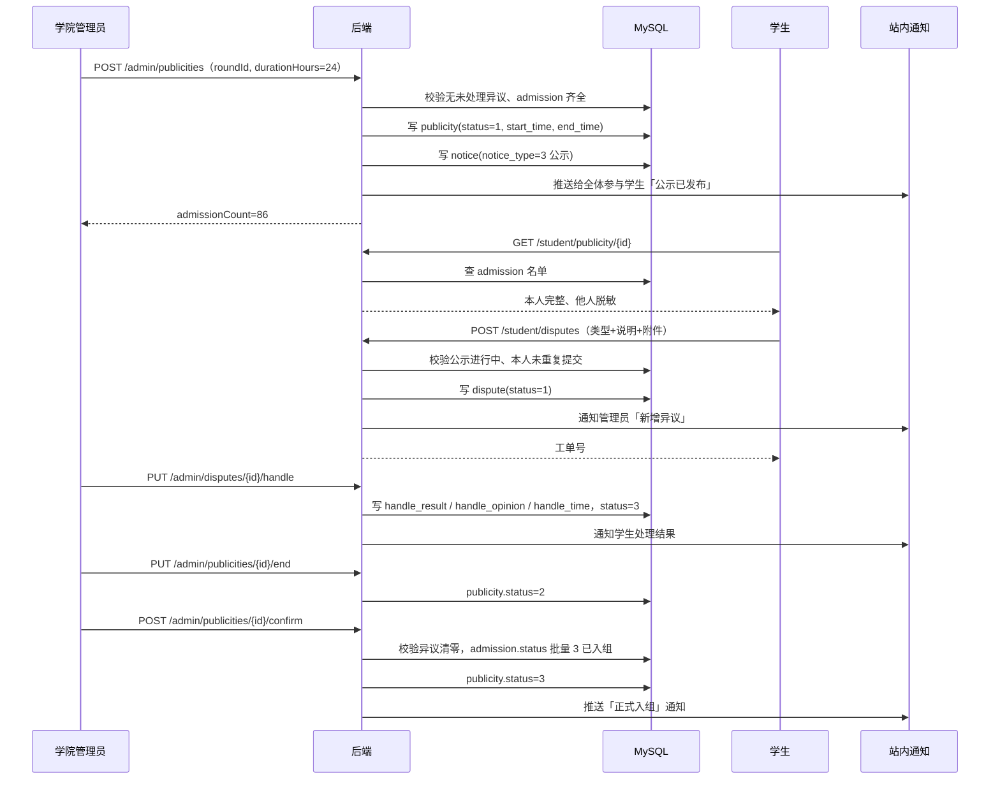

# Flow：公示与异议

## 1. 场景概述

- 触发角色：学院管理员（发起公示、处理异议、确认名单）、学生（查看公示、提交异议）
- 前置条件：本轮拟录取、递补、调剂全部完成；`selection_round.status = 5` 已完成
- 涉及表：`publicity`、`dispute`、`admission`、`notice`、`user_notice`、`operation_log`
- 涉及接口：`POST /admin/publicities`、`GET /student/publicity/{id}`、`POST /student/disputes`、`GET /student/disputes`、`GET /admin/disputes`、`PUT /admin/disputes/{id}/handle`、`PUT /admin/publicities/{id}/end`、`POST /admin/publicities/{id}/confirm`

## 2. 时序图

## 3. 数据流转四段式

### 场景 3.1：发起公示

- **用户操作**：管理员在「公示管理」选择第 1 轮，填写标题「第一轮拟录取名单公示」，公示时长 24 小时，点 `[发布]`。
- **接口调用**：`POST /api/v1/admin/publicities`。
- **数据变更**：
  1. 校验本轮所有 `admission.status ∈ {2, 4, 5}` 已终态，无 `status = 1` 待确认记录。
  2. 校验本轮不存在进行中（`status = 1`）的公示批次。
  3. 插入 `publicity`：`start_time = NOW()`、`end_time = NOW() + 24h`、`status = 1`。
  4. 插入 `notice`：`notice_type = 3` 公示，`status = 2` 已发布，`publish_time = NOW()`。
  5. 向本轮所有参与学生批量写 `user_notice`。
  6. 提交事务。
- **页面反馈**：公示列表新增一条，状态「进行中」，显示倒计时与异议数 0。

### 场景 3.2：学生查看公示名单

- **用户操作**：学生从公告栏进入公示详情。
- **接口调用**：`GET /api/v1/student/publicity/{id}`。
- **数据变更**：只读。服务端按 `student_id = 当前用户` 判定每行 `isSelf`。
- **页面反馈**：表格展示学号、姓名、实训室、导师；本人行显示完整信息并高亮；他人行脱敏为 `2022****01`、`陈*丽`；底部 `[提交异议]` 可用（公示进行中）。

### 场景 3.3：提交异议

- **用户操作**：学生点 `[提交异议]`，选择「录取结果有误」，填写 200 字说明，上传 1 张截图，提交。
- **接口调用**：`POST /api/v1/student/disputes`。
- **数据变更**：
  1. 校验 `publicity.status = 1` 且 `NOW() BETWEEN start_time AND end_time`。
  2. 校验该学生在本次公示下无 `status ∈ {1,2}` 的重复工单。
  3. 校验附件数量 ≤ 3、附件地址合计 ≤ 1000 字符、说明 ≤ 500 字。
  4. 插入 `dispute`：`status = 1` 待处理。
  5. 向全体管理员推送「新增异议工单」通知。
  6. 提交事务。
- **页面反馈**：Toast「异议已提交，工单号 D20261105001」；`[提交异议]` 置灰并变「已提交异议」；「我的异议」列表新增一条。

### 场景 3.4：管理员处理异议

- **用户操作**：管理员在「异议处理」打开工单，选择处理结果「调整录取」，指定新导师，填写处理意见，提交。
- **接口调用**：`PUT /api/v1/admin/disputes/{id}/handle`。
- **数据变更**：
  1. 校验工单 `status ∈ {1,2}`。
  2. 更新 `dispute`：`handle_result = 2`、`handle_opinion`、`handler_id`、`handle_time = NOW()`、`status = 3` 已回复。
  3. `handle_result = 2` 时：原 `admission` 置 4、`active_flag = NULL` 并释放名额；为目标导师条件更新名额并插入新 `admission`（`status = 1`、`active_flag = 1`、`pending_type = 3`、`confirm_deadline = max(公示结束后 2 小时, 通知时刻 + 30 分钟)`）。
  4. 写 `operation_log`：`biz_type = DISPUTE`，前后录取信息快照。
  5. 推送站内通知给学生。
- **页面反馈**：工单状态变「已回复」；学生端看见处理意见；若调整录取，学生收到「请重新确认录取」通知。

### 场景 3.5：结束公示

- **用户操作**：管理员点 `[结束公示]`。
- **接口调用**：`PUT /api/v1/admin/publicities/{id}/end`。
- **数据变更**：
  1. 校验 `status = 1`。
  2. 更新 `publicity.status = 2` 已结束，`end_time = NOW()`。
  3. 未处理异议保持 `status ∈ {1,2}`，不自动关闭。
- **页面反馈**：状态变「已结束」；学生端 `[提交异议]` 置灰，文案变 `[公示已结束]`。

### 场景 3.6：确认最终名单

- **用户操作**：管理员点 `[确认最终名单]`，二次确认。
- **接口调用**：`POST /api/v1/admin/publicities/{id}/confirm`。
- **数据变更**：
  1. 校验 `publicity.status = 2`（已结束）。
  2. 校验该公示下无 `status ∈ {1,2}` 的未处理异议；存在则拒绝。
  3. 将该轮 `admission.status = 2` 批量更新为 `3` 已入组。
  4. 更新 `publicity.status = 3` 已确认。
  5. 批量推送「正式入组」站内通知，含实训室、导师、入组时间。
  6. 写 `operation_log`。
- **页面反馈**：公示列表状态「已确认」；学生端录取结果变「已入组」；管理员可导出最终名单。

## 4. 状态机

### 4.1 公示状态 `publicity.status`

| 当前状态 | 触发动作 | 目标状态 | 校验条件 | 失败反馈 |
|---|---|---|---|---|
| 无 | 发起公示 | 1 进行中 | 本轮无待确认录取、无进行中公示 | 「仍有 N 名学生待确认」 |
| 1 进行中 | 到达 end_time | 1 进行中（不自动结束） | — | 管理员手动结束 |
| 1 进行中 | 管理员结束 | 2 已结束 | — | — |
| 2 已结束 | 确认最终名单 | 3 已确认 | 异议全部处理完 | 「仍有 N 条异议未处理」 |
| 3 已确认 | 管理员解锁批次 | 1 进行中 | 批次已锁定且密码校验通过 | 「批次未锁定」 |
| 3 已确认 | — | 终态 | — | — |

### 4.2 异议状态 `dispute.status`

| 当前状态 | 触发动作 | 目标状态 | 校验条件 | 失败反馈 |
|---|---|---|---|---|
| 1 待处理 | 管理员受理 | 2 处理中 | — | — |
| 1 待处理 | 直接处理并回复 | 3 已回复 | 处理意见必填 | 「处理意见不能为空」 |
| 2 处理中 | 提交处理结果 | 3 已回复 | 同上 | 同上 |
| 1/2 | 管理员关闭 | 4 已关闭 | 写关闭原因 | — |
| 3 已回复 | 学生不再追问 | 终态 | — | — |

## 5. 异常与边界

| 场景 | 触发条件 | 服务端行为 | 错误码 | 前端反馈 |
|---|---|---|---|---|
| 公示期外提交异议 | 超过 end_time | 拒绝 | 400004 | 「公示已结束，无法提交异议」 |
| 重复异议 | 同一公示下二次提交 | 拒绝 | 409001 | 「你已提交过异议，请等待处理」 |
| 异议未处理就确认 | 存在 `status ∈ {1,2}` | 拒绝确认 | 400005 | 「仍有 N 条异议未处理」 |
| 存在待确认录取就公示 | `admission.status = 1` | 拒绝发起 | 400005 | 「仍有 N 名学生待确认」 |
| 重复发起公示 | 已有 `status = 1` 批次 | 拒绝 | 409001 | 「当前已有进行中的公示」 |
| 调整录取后名额不足 | `handle_result = 2` 且目标导师满额 | 拒绝处理提交 | 400002 | 「目标导师剩余名额不足」，需先协调 |
| 公示名单越权 | 学生查看他人完整信息 | 强制脱敏 | 200 | 他人行显示掩码 |
| 异议附件超限 | 上传 4 张图或地址合计超 1000 字符 | 前端拦截 + 服务端校验 | 400001 | 「最多上传 3 张图片」 |
| 异议说明超长 | 说明超过 500 字 | 拒绝提交 | 400001 | 「异议说明最长 500 字」 |

## 6. 测试要点

- 快乐路径：发起公示 → 学生查看（他人脱敏）→ 提交异议 → 管理员回复 → 结束公示 → 确认名单 → 状态变已入组。
- 脱敏：学生 A 查看名单，A 本人完整，其他 85 人全部掩码。
- 异议幂等：同一公示下重复提交返回 409001。
- 阻断：存在 2 条未处理异议时确认名单被拒。
- 调整录取：异议结果为「调整录取」，原导师名额释放，新导师名额占用，两名导师均收到通知。
- 公示期：`end_time` 后 1 秒提交异议被拒。
- 通知：公示发布、异议回复、入组通知三类站内消息均产生。
- 权限：非管理员无法调用 `/admin/disputes/*`；学生只能看到自己的工单。
