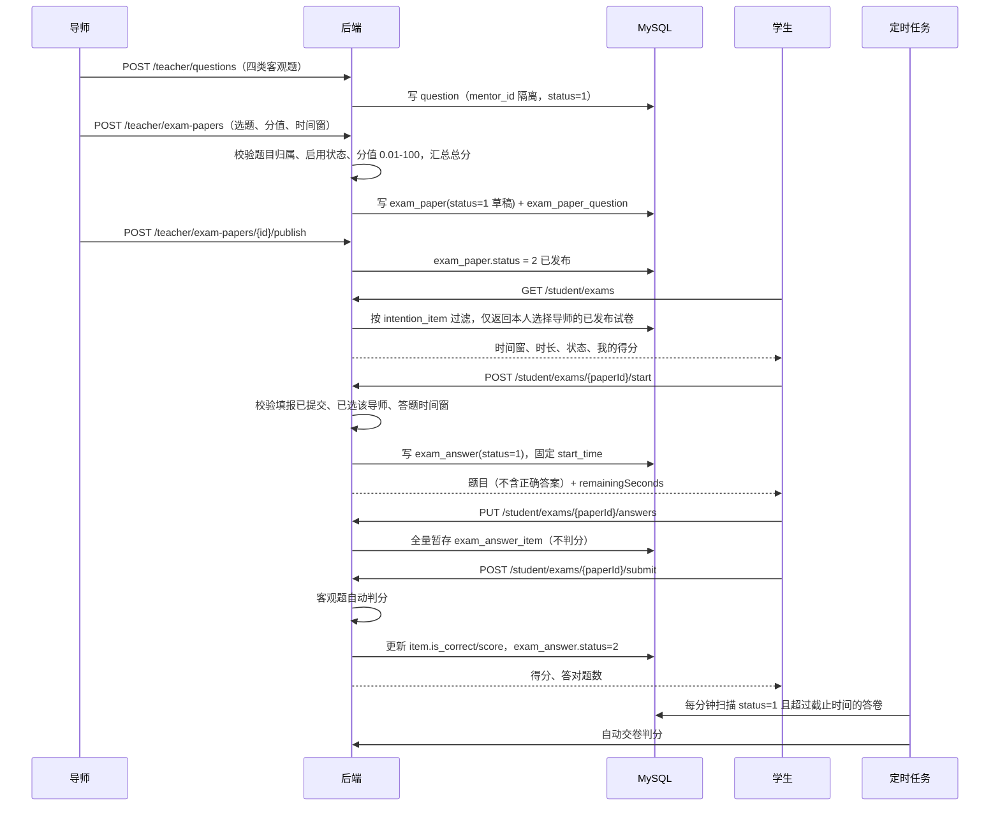

# Flow：在线笔试与自动判分

## 1. 场景概述

- 触发角色：导师（维护题库、组卷、发布、查看结果）、学生（在线作答、交卷）、系统（超时自动交卷与判分）
- 前置条件：本轮填报已截止；学生已提交意向且选择了该导师；导师已发布试卷
- 涉及表：`question`、`exam_paper`、`exam_paper_question`、`exam_answer`、`exam_answer_item`、`intention`、`intention_item`、`selection_round`、`mentor_profile`
- 涉及接口：`GET/POST/PUT/DELETE /teacher/questions`、`GET/POST/PUT/DELETE /teacher/exam-papers`、`POST /teacher/exam-papers/{id}/publish`、`GET /teacher/exam-papers/{id}/results`、`GET /student/exams`、`GET/POST /student/exams/{paperId}`、`PUT /student/exams/{paperId}/answers`、`POST /student/exams/{paperId}/submit`

## 2. 时序图

## 3. 数据流转四段式

### 场景 3.1：导师维护题库

- **用户操作**：导师进入「题库管理」，点 `[新增题目]`，选择题型、填写题干与选项、设置正确答案和分值，保存。
- **接口调用**：`POST /api/v1/teacher/questions`；修改走 `PUT /api/v1/teacher/questions/{id}`。
- **数据变更**：
  1. 校验当前用户存在 `mentor_profile`，否则 403001。
  2. 校验批次 `locked = 0`，否则 400005。
  3. 按题型校验：单选/多选 2–8 个选项且答案键在范围内；多选至少 2 个标准答案；判断仅 `T/F`；填空答案非空。
  4. 选项序列化为 JSON 数组写入 `question.options_json`，正确答案规范化后写入 `correct_answer`。
  5. 写入 `question`，`mentor_id` 与 `lab_id` 取自导师档案，`status = 1`。
- **页面反馈**：题库列表新增一行，题型标签与状态标签正常展示。

### 场景 3.2：导师组卷与发布

- **用户操作**：进入「在线试卷」，点 `[新建试卷]`，填写标题、说明、答题时间窗与时长，从题库加入题目并逐题设置分值，保存草稿后点 `[发布]`。
- **接口调用**：`POST /api/v1/teacher/exam-papers` 保存草稿；`POST /api/v1/teacher/exam-papers/{id}/publish` 发布。
- **数据变更**：
  1. 校验轮次存在、批次未锁定；`endTime > startTime`，时长 1–300 分钟。
  2. 校验题目属于本人、状态为启用、试卷内不重复；总分 = Σ题目分值。
  3. 写 `exam_paper`（`status = 1`）与 `exam_paper_question`（题号从 1 递增）。
  4. 发布时校验至少 1 题、`endTime > 当前时间`，置 `status = 2`；发布后不可修改或删除。
- **页面反馈**：列表状态由「草稿」变为「已发布」，操作列只剩 `[结果]`。

### 场景 3.3：学生开始答题与暂存

- **用户操作**：学生在「在线笔试」点 `[开始答题]`，进入答题页逐题作答，系统自动暂存。
- **接口调用**：`POST /api/v1/student/exams/{paperId}/start`；`PUT /api/v1/student/exams/{paperId}/answers`。
- **数据变更**：
  1. 校验试卷已发布、当前时间在 `start_time ~ end_time` 内。
  2. 校验学生本轮 `intention.status = 2` 且 `intention_item.mentor_id = exam_paper.mentor_id`，否则 403001。
  3. 首次开始写 `exam_answer`，固定 `start_time`，`status = 1`；重复开始返回已有答卷，不重置计时。
  4. 暂存按 `(answer_id, question_id)` 插入或更新 `exam_answer_item.answer_content`，此时 `is_correct = 0`、`score = 0`。
  5. 答题截止 = `min(exam_paper.end_time, exam_answer.start_time + duration_minutes)`；超过截止的暂存请求由服务端自动交卷。
- **页面反馈**：答题页展示服务端校准的剩余倒计时；暂存成功底部提示，不弹窗打断作答。

### 场景 3.4：交卷自动判分

- **用户操作**：学生点 `[交卷]` 并二次确认；或倒计时归零由前端触发；或定时任务扫描到超时答卷。
- **接口调用**：`POST /api/v1/student/exams/{paperId}/submit`。
- **数据变更**：
  1. 校验答卷存在且属于当前学生；已提交时直接返回原判分结果，保证幂等。
  2. 逐题判分：单选/判断精确匹配（忽略大小写与首尾空格）；多选按集合匹配、顺序无关；填空命中 `|` 分隔的任一标准答案；未作答不得分。
  3. 更新 `exam_answer_item.is_correct` 与 `score`，汇总 `objective_score = total_score`。
  4. 更新 `exam_answer.status = 2`、`submit_time`。
  5. 定时任务 `ExamTimeoutJob` 每分钟扫描 `status = 1` 且超过截止时间的答卷并执行同样逻辑；批次锁定后跳过。
- **页面反馈**：展示得分与答对题数，题目区变为只读；导师「结果」弹窗可看到该生已提交与得分。

### 场景 3.5：导师查看结果

- **用户操作**：导师在「在线试卷」点 `[结果]`。
- **接口调用**：`GET /api/v1/teacher/exam-papers/{id}/results`。
- **数据变更**：只读，不写库。
- **页面反馈**：按应考名单展示学号（脱敏）、姓名、状态、开始/交卷时间、得分；已提交优先按得分倒序，未参加排后。

## 4. 异常与边界

| 场景 | 处理 | 错误码 |
|---|---|---|
| 导师操作他人题目/试卷 | 校验 `mentor_id` 归属 | 403001 |
| 学生未选择该导师 | 校验 `intention_item` | 403001 |
| 答题开始前/结束后进入试卷 | 拒绝；已开始的超时答卷自动交卷 | 400004 |
| 重复/并发开始答题 | 唯一键 `uk_paper_student` 兜底，返回已有答卷 | 200 |
| 交卷后再次暂存 | 拒绝 | 400005 |
| 修改/删除已发布试卷 | 拒绝 | 400005 |
| 批次锁定后题库、试卷、答题写操作 | 统一拒绝 | 400005 |
| 答题超时未主动交卷 | 定时任务与访问触发自动交卷判分 | — |
| 学生端响应泄露答案 | 学生 DTO 不包含 `correctAnswer` | — |

## 5. 涉及规则编号

- `INV-22`、`BR-P4-11` 至 `BR-P4-18`、`EX-31` 至 `EX-36`、`AC-57` 至 `AC-64`
- 数据库：`03_Database.md` §3.21–§3.25
- 接口：`04_API.md` §3.51–§3.61
