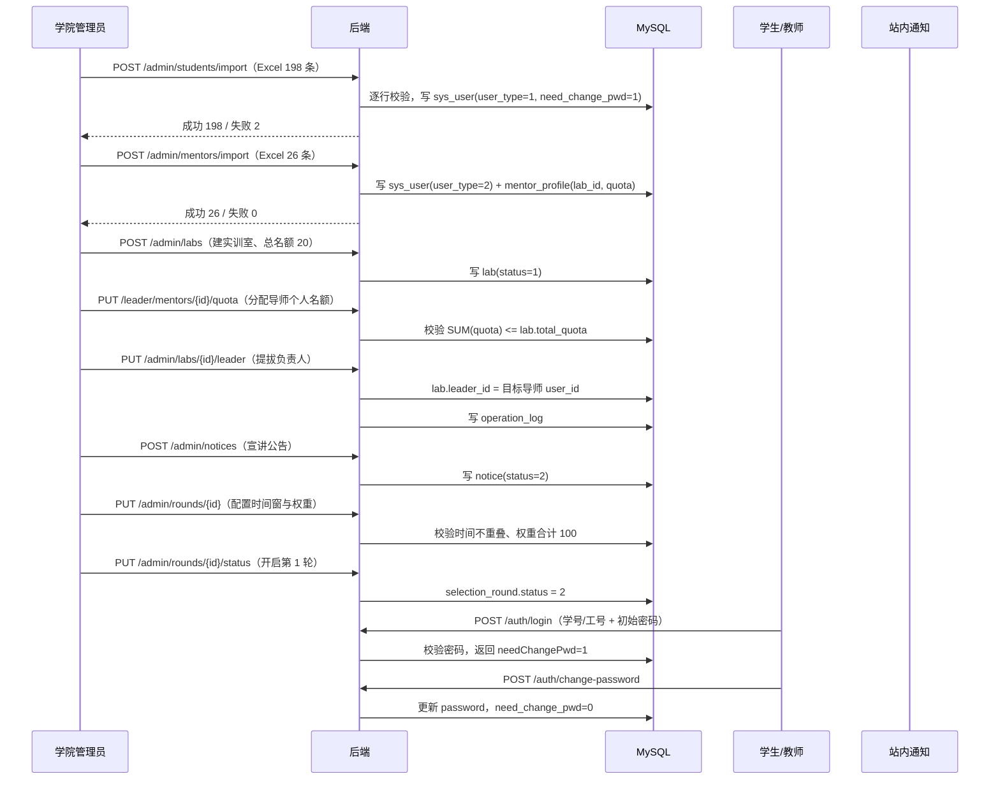

# Flow：基础配置与账号管理

## 1. 场景概述

- 触发角色：学院管理员
- 前置条件：系统首次部署，`selection_round` 尚未开启
- 涉及表：`sys_user`、`lab`、`mentor_profile`、`selection_round`、`notice`、`user_notice`、`operation_log`
- 涉及接口：`POST /admin/students/import`、`POST /admin/mentors/import`、`POST/PUT /admin/labs`、`PUT /admin/labs/{id}/leader`、`POST /admin/notices`、`PUT /admin/rounds/{id}`、`PUT /admin/rounds/{id}/status`、`POST /auth/login`、`POST /auth/change-password`、`POST /admin/{role}/{id}/reset-password`、`PUT /admin/{role}/{id}/status`、`PUT /admin/mentors/{id}/quota`

## 2. 时序图

## 3. 数据流转四段式

### 场景 3.1：批量导入学生

- **用户操作**：管理员在「学生账号管理」点 `[导入学生]`，上传含 200 行的 Excel，确认导入。
- **接口调用**：`POST /api/v1/admin/students/import`（multipart）。
- **数据变更**：
  1. 逐行校验：学号非空且唯一、姓名非空、手机号格式、邮箱格式。
  2. 校验通过的行插入 `sys_user`：`user_type = 1`、`password = BCrypt(初始密码)`、`need_change_pwd = 1`、`status = 1`。
  3. 学号已存在的行不覆盖，记入失败明细。
  4. 失败明细生成 Excel 存至文件服务，返回下载地址。
- **页面反馈**：弹窗展示「成功 198 条 / 失败 2 条」；失败明细可下载；列表页刷新。

### 场景 3.2：批量导入教师并生成导师档案

- **用户操作**：管理员上传教师 Excel（工号、姓名、所属实训室编码、职称、研究方向、手机号、邮箱）。
- **接口调用**：`POST /api/v1/admin/mentors/import`。
- **数据变更**：
  1. 逐行校验工号唯一、`lab_code` 存在。
  2. 插入 `sys_user`：`user_type = 2`、`need_change_pwd = 1`。
  3. 同步插入 `mentor_profile`：`user_id`、`lab_id`、`research_direction`、`quota = 0`、`quota_used = 0`、`version = 0`、`status = 1`。
  4. 两个插入在同一事务内，任一失败整行回滚。
- **页面反馈**：失败明细标注「实训室编码不存在」等具体原因。

### 场景 3.3：配置实训室与导师名额

- **用户操作**：管理员新建实训室「人工智能实训室」，总名额 20；负责人分配 5 名导师名额 4/4/4/4/4。
- **接口调用**：`POST /admin/labs`、`PUT /leader/mentors/{id}/quota`（负责人，冻结前）、`PUT /admin/mentors/{id}/quota`（管理员强制调整）。
- **数据变更**：
  1. 插入 `lab`：`total_quota = 20`、`status = 1`。
  2. 每次调整导师名额时校验 `SUM(mentor_profile.quota) <= lab.total_quota`。
  3. 校验 `quota >= quota_used`（`quota_used` 含拟录取占位与待确认），不允许把名额调到已占用名额以下。
  4. 写 `operation_log`：`biz_type = QUOTA`，记录前后值、操作人、理由。
  5. 第 1 轮 `apply_start` 后进入冻结期：负责人调用 `PUT /leader/mentors/{id}/quota` 返回 400004；强制调整只能由管理员走 `PUT /admin/mentors/{id}/quota`，写 `operation_log` 并生成学生端公告。
- **页面反馈**：名额分配表实时显示合计与剩余；超出时 `[保存]` 置灰并提示「本室名额上限为 20 人」。

### 场景 3.4：提拔实训室负责人

- **用户操作**：管理员在「负责人提拔」选择实训室，下拉选中本室导师「王建国」，确认。
- **接口调用**：`PUT /api/v1/admin/labs/{id}/leader`。
- **数据变更**：
  1. 校验目标用户 `user_type = 2` 且存在 `mentor_profile` 且 `lab_id` 等于该实训室。
  2. 更新 `lab.leader_id = 目标 user_id`。
  3. 若原负责人存在，其权限自动失效（`/leader/**` 接口按 `lab.leader_id` 实时判定，无需改字段）。
  4. 写 `operation_log`：`biz_type = LEADER`，前后负责人。
  5. 推送站内通知给新老负责人。
- **页面反馈**：实训室列表负责人列更新；新负责人下次登录即可见到「本室工作台」入口。

### 场景 3.5：发布公告

- **用户操作**：管理员新建「集中宣讲通知」，类型宣讲，填写时间地点，点 `[发布]`。
- **接口调用**：`POST /api/v1/admin/notices`。
- **数据变更**：
  1. 插入 `notice`：`status = 2` 已发布、`publish_time = NOW()`、`publisher_id`。
  2. 公共端公告列表立即可见。
- **页面反馈**：公告列表状态「已发布」；公共端 `/notices` 出现该公告。

### 场景 3.6：配置并开启轮次

- **用户操作**：管理员配置第 1 轮的填报、面试、名单提交、学生确认四段时窗与四维权重（25/25/25/25），点 `[开启本轮]`。
- **接口调用**：`PUT /admin/rounds/{id}`、`PUT /admin/rounds/{id}/status`。
- **数据变更**：
  1. 校验 `apply_start < apply_end ≤ interview_start < interview_end ≤ nomination_start ≤ nomination_submit_end < confirm_start < nomination_end ≤ adjust_start < adjust_end`，各段不重叠、后一轮晚于前一轮、四维权重合计 100。
  2. 更新 `selection_round` 时间窗与权重。
  3. 状态更新为 2 填报中；校验无其他轮次处于进行中。
  4. 写 `operation_log`。
- **页面反馈**：公共端显示「第 1 轮 · 填报中」横幅；学生端出现填报入口。

### 场景 3.7：首次登录强制改密

- **用户操作**：学生用学号 + 初始密码登录。
- **接口调用**：`POST /api/v1/auth/login` → `POST /api/v1/auth/change-password`。
- **数据变更**：
  1. 登录校验通过，返回 `needChangePwd = 1` 与 Token。
  2. 该用户访问任意业务接口时，后端校验 `need_change_pwd = 1` 并返回 401004。
  3. 改密接口校验原密码、新密码强度（8–20 位含字母与数字）、两次一致、新旧不同。
  4. 更新 `password`、`need_change_pwd = 0`、`gmt_modified`。
- **页面反馈**：登录后强制跳转改密页，其他菜单不可点；改密成功跳工作台。

### 场景 3.8：重置密码与禁用账号

- **用户操作**：管理员对忘记密码的学生点 `[重置密码]`；对离职导师点 `[禁用]`。
- **接口调用**：`POST /admin/students/{id}/reset-password`、`PUT /admin/mentors/{id}/status`。
- **数据变更**：
  1. 重置：`password = BCrypt(初始密码)`、`need_change_pwd = 1`，推送站内通知。
  2. 禁用：`status = 0`；同时将当前 Token 写入 Redis 黑名单，立即失效。
  3. 两者均写 `operation_log`。
- **页面反馈**：列表状态列更新；被禁用用户下次请求返回 401003。

## 4. 状态机

### 4.1 账号状态 `sys_user.status`

| 当前状态 | 触发动作 | 目标状态 | 校验条件 | 失败反馈 |
|---|---|---|---|---|
| 无 | 管理员导入/新增 | 1 启用 | 学号/工号唯一 | 「学号已存在」 |
| 1 启用 | 管理员禁用 | 0 禁用 | — | Token 立即拉黑 |
| 0 禁用 | 管理员启用 | 1 启用 | — | — |
| 1 启用 | 首次登录 | 1 启用 + `need_change_pwd = 1` | 使用初始密码 | 未改密拦截 401004 |
| 1 启用 | 改密完成 | 1 启用 + `need_change_pwd = 0` | 密码强度校验 | 「新密码不能与原密码相同」 |

### 4.2 轮次状态（配置视角）

| 当前状态 | 触发动作 | 目标状态 | 校验条件 | 失败反馈 |
|---|---|---|---|---|
| 1 未开始 | 管理员开启 | 2 填报中 | 时间不重叠、权重 100、无其他轮次进行中 | 「四维权重合计必须为 100」 |
| 2 填报中 | 到达 `apply_end` | 3 面试中 | 定时任务 | — |

## 5. 异常与边界

| 场景 | 触发条件 | 服务端行为 | 错误码 | 前端反馈 |
|---|---|---|---|---|
| 学号重复导入 | Excel 含已存在学号 | 跳过该行，记失败明细 | 200 | 「学号已存在」 |
| 工号对应实训室不存在 | `lab_code` 找不到 | 整行不写入 | 200 | 「实训室编码不存在」 |
| 名额之和超总名额 | 5 名导师各配 5 人，总名额 20 | 拒绝保存 | 400002 | 「本室导师名额之和超出实训室总名额（20 人）」 |
| 名额低于已占用名额 | 已占用 4 人（含待确认占位），把名额改成 3 | 拒绝 | 400002 | 「新名额不得小于已占用名额（4 人，含待确认占位）」 |
| 冻结期负责人改名额 | `NOW() >= 第 1 轮 apply_start` | 拒绝，提示走管理员强制调整 | 400004 | 「名额已冻结，请走管理员强制调整」 |
| 提拔非本室导师 | 选择外室导师 | 拒绝 | 403001 | 「该导师不属于本实训室」 |
| 权重不等于 100 | 25/25/25/30 | 拒绝 | 400002 | 「四维权重合计必须为 100」 |
| 时间窗重叠 | 填报结束晚于面试开始 | 拒绝 | 400002 | 「面试开始时间不得早于填报结束时间」 |
| 多轮同时进行 | 第 1 轮未结束就开第 2 轮 | 拒绝 | 409001 | 「已有轮次正在进行」 |
| 禁用后仍可访问 | 禁用用户的旧 Token | Redis 黑名单拦截 | 401003 | 「账号已被禁用」 |
| 改密前访问业务 | `need_change_pwd = 1` | 拦截 | 401004 | 强制跳改密页 |

## 6. 测试要点

- 快乐路径：导入 198 名学生 → 导入 26 名教师 → 建 3 个实训室 → 配名额 → 提负责人 → 发公告 → 开轮次。
- 导入：含重复学号、非法手机号、未知实训室编码时，失败行准确且不写入。
- 名额：合计 20 可保存，合计 21 被拒；已占用 4 人时把名额改 3 被拒。
- 冻结：第 1 轮 `apply_start` 后负责人改名额返回 400004；管理员强制调整写入 `operation_log` 且生成学生端公告。
- 负责人：提拔后 `/leader/**` 可访问；原负责人失去权限。
- 首登：`need_change_pwd = 1` 时除改密与登出外全部接口返回 401004。
- 禁用：禁用后旧 Token 立即失效，重新登录返回 401003。
- 轮次：权重 100 可保存，99 或 101 被拒；两轮时间重叠被拒。
- 留痕：名额调整、负责人变更、账号禁用均有 `operation_log` 记录。
