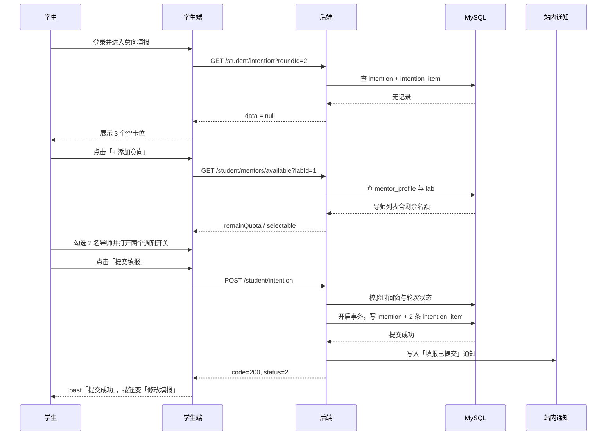

# Flow：意向填报

## 1. 场景概述

- 触发角色：学生
- 前置条件：学生已登录且完成首登改密；**学生档案必填项已完善**；当前轮次处于「填报中」；实训室与导师档案已配置
- 涉及表：`student_profile`、`selection_round`、`intention`、`intention_item`、`mentor_profile`、`lab`
- 涉及接口：`PUT /student/archive`、`GET /public/rounds/current`、`GET /public/labs`、`GET /student/mentors/available`、`GET /student/intention`、`POST /student/intention`

## 2. 时序图

## 3. 数据流转四段式

### 场景 3.0：完善学生档案

- **用户操作**：学生首次进入「我的档案」，填写学业、技能与经历、时间投入、个人陈述，点 `[保存并去填报]`。
- **接口调用**：`PUT /api/v1/student/archive`。
- **数据变更**：
  1. 按 `user_id` 查询 `student_profile`，不存在则插入，存在则更新。
  2. 字段格式校验：编程语言至少 1 项；每周可投入小时在 1–40；个人陈述 300–800 字；GPA 在 0–5。
  3. 计算 `missingFields`（未完成的必填项 key 列表）并返回，**保存本身不因缺项失败**。
  4. 未写入任何意向数据。
- **页面反馈**：Toast「档案已保存」；跳转意向填报页；若仍有缺项，`[提交填报]` 置灰并提示「你还有 X 项档案必填未完成，[去完善]」。

### 场景 3.1：保存草稿

- **用户操作**：在意向填报页选择 1–3 名导师、打开调剂开关后，点击底部 `[保存草稿]`。
- **接口调用**：`POST /api/v1/student/intention`，`submit = 0`。
- **数据变更**：
  1. 校验 `selection_round.status = 2` 且 `NOW() BETWEEN apply_start AND apply_end`。
  2. 校验 `items` 数量：首轮 1–3 条、补录轮 1 条；导师不重复；被选导师 `mentor_profile.status = 1`。
  3. 按 `(round_id, student_id)` 查 `intention`：不存在则插入，`status = 1`；存在则更新两个调剂开关。
  4. 删除该 `intention_id` 下全部 `intention_item`，按入参重新插入。
  5. 不写 `submit_time`。
- **页面反馈**：Toast「草稿已保存」；顶部状态标签保持「草稿」；`[提交填报]` 仍可点击。

### 场景 3.2：提交填报

- **用户操作**：点击 `[提交填报]`，二次确认弹窗点「确认」。
- **接口调用**：`POST /api/v1/student/intention`，`submit = 1`。
- **数据变更**：
  1. 校验 `selection_round.status = 2` 且 `NOW() BETWEEN apply_start AND apply_end`。
  2. 校验 `student_profile` 必填项齐全（编程语言、项目经历、每周可投入小时、可投入时段、个人陈述），缺失则返回 `missingFields`。
  3. 校验 `items` 数量：首轮 1–3 条、补录轮 1 条；导师不重复；被选导师 `mentor_profile.status = 1`。
  4. 按 `(round_id, student_id)` 查 `intention`：不存在则插入，存在则更新；写入两个调剂开关、`status = 2`、`submit_time = NOW()`。
  5. 删除该 `intention_id` 下全部 `intention_item`，按入参重新插入。
  6. 向 `user_notice` 插入一条类型为「填报」的通知：标题「第 N 轮意向已提交」，内容含意向数与截止时间。
  7. 提交事务。
- **页面反馈**：Toast「提交成功，截止前仍可修改」；状态标签变「已提交」；主按钮变 `[修改填报]`；工作台待办「待填报」消失。

### 场景 3.3：截止前修改

- **用户操作**：点击 `[修改填报]`，移除 1 名导师、替换为另一名导师后再次提交。
- **接口调用**：`POST /api/v1/student/intention`，`submit = 1`。
- **数据变更**：
  1. 校验时间窗仍在 `apply_start ~ apply_end` 内。
  2. 更新 `intention` 两个调剂开关，`gmt_modified` 自动更新。
  3. 删除旧 `intention_item`，插入新明细。
  4. 不新增通知，避免刷屏。
- **页面反馈**：Toast「已更新填报」；意向卡片实时刷新。

### 场景 3.4：填报截止

- **用户操作**：截止后刷新页面。
- **接口调用**：`GET /api/v1/student/intention`。
- **数据变更**：无写入。服务端返回 `editable = 0`。
- **页面反馈**：全部输入框与开关置灰；主按钮变 `[填报已截止]` 且不可点击；顶部提示条显示「第 N 轮填报已于 yyyy-MM-dd HH:mm 截止」。

### 场景 3.5：未填报进入下一阶段

- **用户操作**：无操作。
- **接口调用**：轮次流转时由后端定时任务扫描。
- **数据变更**：
  1. 查询本轮 `intention.status = 2` 的学生集合。
  2. 未在该集合中的学生不生成 `interview_schedule`，不进入面试名单。
  3. 后续录取阶段自然无 `admission` 记录，学生端展示「本轮未参与」。
- **页面反馈**：学生工作台待办变为「本轮未填报」；补录轮次开放时出现「去填报」入口。

## 4. 状态机

| 当前状态 | 触发动作 | 目标状态 | 校验条件 | 失败反馈 |
|---|---|---|---|---|
| 无记录 | 保存草稿 | 1 草稿 | 时间窗内、首轮 1–3 条 / 补录 1 条 | 「首轮最多选择 3 个意向」 |
| 1 草稿 | 提交 | 2 已提交 | 时间窗内、首轮 1–3 条 / 补录 1 条 | 「补录轮最多选择 1 个意向」 |
| 2 已提交 | 修改并提交 | 2 已提交 | 时间窗内 | 「填报已截止」 |
| 1 草稿 | 填报截止 | 1 草稿（只读） | 到达 apply_end | — |
| 2 已提交 | 填报截止 | 2 已提交（只读） | 到达 apply_end | — |

## 5. 异常与边界

| 场景 | 触发条件 | 服务端行为 | 错误码 | 前端反馈 |
|---|---|---|---|---|
| 档案未完善 | 必填项缺失即提交 | 拒绝提交，返回缺项列表 | 400002 | 「请先完善档案」，并列出缺项 |
| 陈述字数不足 | 少于 300 或超过 800 字 | 只拒绝保存该字段 | 400001 | 字数计数器标红 |
| 空意向提交 | 未选任何导师点提交 | 拒绝 | 400001 | 「至少选择 1 个意向」 |
| 首轮超出 3 条 | 选择第 4 名导师 | 前端先拦截；服务端二次校验 | 400002 | 「首轮最多选择 3 个意向」 |
| 补录轮超出 1 条 | 选择第 2 名导师 | 前端隐藏卡位；服务端二次校验 | 400002 | 「补录轮最多选择 1 个意向」 |
| 重复导师 | 同一导师选两次 | 拒绝 | 400002 | 「存在重复的导师意向」 |
| 导师已满 | 选择 `remainQuota = 0` 的导师 | 拒绝 | 400002 | 该导师置灰并标注「已满」 |
| 跨实训室超限 | 3 个意向分属 3 个实训室 | 允许，提示需参加 3 场面试 | 200 | 顶部提示「你将参加 3 场面试」 |
| 截止后提交 | 时间窗已过 | 拒绝写入 | 400004 | 「填报已截止」并刷新只读 |
| 轮次未开始 | 提前访问页面 | 拒绝提交 | 400004 | 「第 N 轮填报未开始」 |
| 并发重复提交 | 双击提交 | 唯一键 `uk_round_student` 兜底，第二次为覆盖更新 | 200 | 仅一次 Toast |

## 6. 测试要点

- 快乐路径：选 2 名导师 + 开启内部调剂 → 提交成功 → 数据落 `intention` 与 2 条 `intention_item`。
- 边界：选满 3 名；只选 1 名；3 名分属 3 个实训室。
- 边界：0 条提交被拒；4 条被拒；重复导师被拒。
- 时间：提交前 1 秒成功，提交后 1 秒失败。
- 并发：同一学生双击提交，`intention` 只有一条记录，`intention_item` 不重复。
- 权限：学生 A 不能读取或修改学生 B 的填报。
