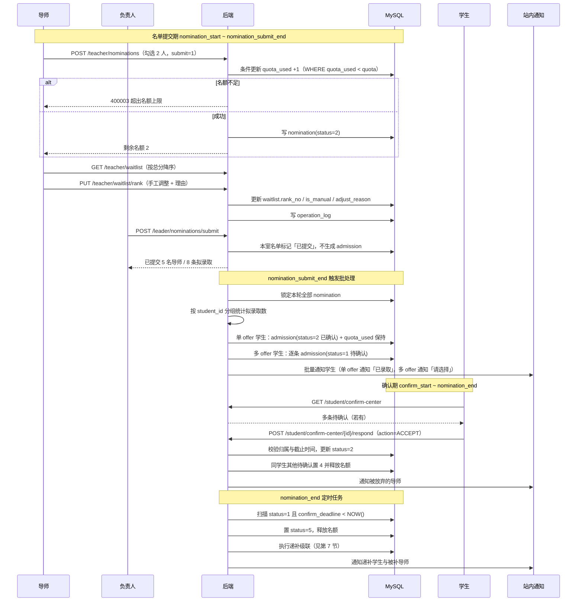
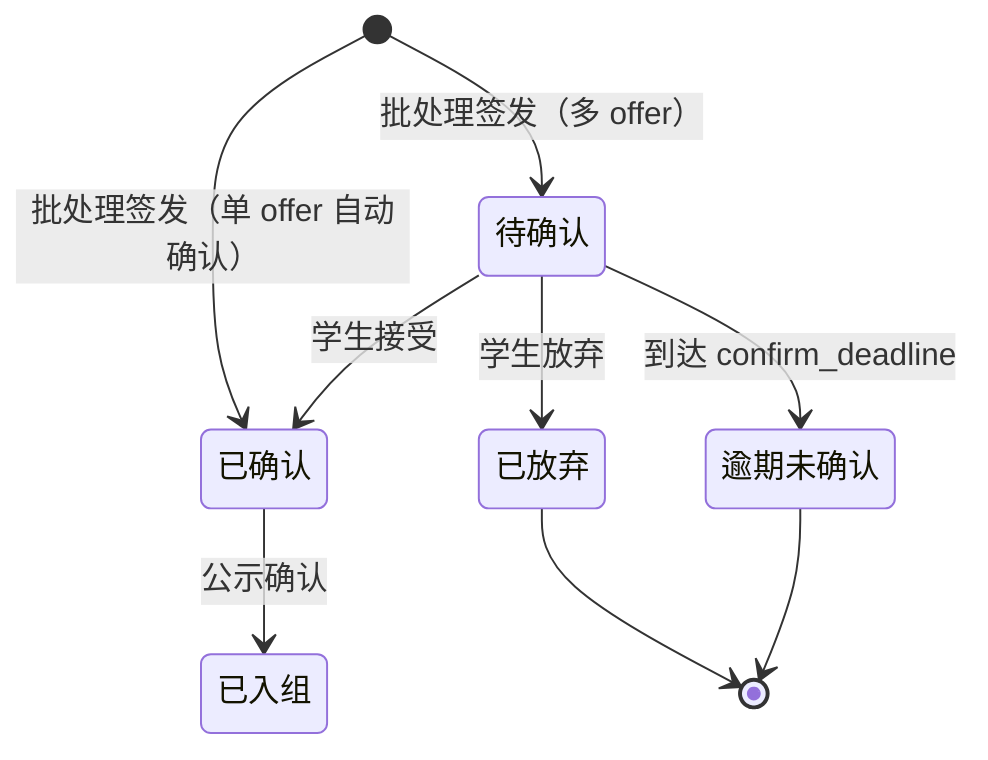

# Flow：拟录取与录取确认

## 1. 场景概述

- 触发角色：导师（勾选拟录取、调整递补顺位）、实训室负责人（汇总提交）、系统批处理（统一签发与自动确认）、学生（确认/拒绝）、系统定时任务（逾期处理与递补）
- 前置条件：本室评分已提交；`selection_round.status = 4` 拟录取确认中
- 涉及表：`nomination`、`waitlist`、`admission`、`mentor_profile`、`interview_score`、`selection_round`、`operation_log`
- 涉及接口：`GET/POST /teacher/nominations`、`GET /teacher/admissions`、`POST /teacher/admissions/{id}/remind`、`GET/PUT /teacher/waitlist/rank`、`GET /leader/nominations`、`POST /leader/nominations/submit`、`GET /student/confirm-center`、`POST /student/confirm-center/{id}/respond`

## 2. 时间窗（三段，不可混用）

| 区间 | 名称 | 允许的操作 | 学生可见性 |
|---|---|---|---|
| `nomination_start ~ nomination_submit_end` | 名单提交期 | 导师勾选、负责人汇总提交；**不生成任何学生可见记录** | 学生看不到任何拟录取 |
| `nomination_submit_end`（单点） | 系统批处理 | 停止收名单 → 按学生维度统一判定 → 单 offer 自动确认 → 其余置待确认 | 批处理完成后才可见 |
| `confirm_start ~ nomination_end` | 学生确认期 | 学生接受/放弃；逾期置 5 | 学生可见并操作 |

**递补保底窗**：递补产生的 `confirm_deadline = max(本轮 nomination_end, 通知时刻 + 30 分钟)`。若该值晚于 `nomination_end`，保底窗优先，硬切断只对未进入保底窗的记录生效。此规则用于避免「11:59 递补，学生只有 1 分钟」。

**为什么必须拆开**：若允许「谁先提交谁先生成」，A 室 10:00 提交时该生只有 1 个拟录取会被误判为唯一并自动确认，B 室 10:30 提交的第 2 个拟录取就成了脏数据。因此**必须等到所有实训室交卷后，按学生维度统计一次，才能判定是否单 offer**。

## 3. 时序图



## 4. 数据流转四段式

### 场景 4.1：导师勾选拟录取

- **用户操作**：导师进入「拟录取勾选」，勾选 2 名学生，点 `[提交拟录取名单]`，二次确认。
- **接口调用**：`POST /api/v1/teacher/nominations`，`submit = 1`。
- **数据变更**：
  1. 校验 `NOW() BETWEEN nomination_start AND nomination_submit_end`，且 `selection_round.status = 4`。
  2. 校验每位 `student_id` 均在本人本轮意向学生集合内。
  3. 逐个执行条件更新：`UPDATE mentor_profile SET quota_used = quota_used + 1, version = version + 1 WHERE id = ? AND quota_used < quota`；影响行数为 0 则整体回滚并返回 400003。
  4. 写 `nomination`：`status = 2`，`total_score` 取该学生 `interview_score.final_total` 快照。
  5. 提交事务。**不生成 `admission`**，学生此时不可见。
- **页面反馈**：Toast「提交成功，剩余名额 2 人」；名额提示条刷新；表格转只读。

### 场景 4.2：名额超限拦截

- **用户操作**：名额 3 人已勾 3 人，再勾第 4 人。
- **接口调用**：前端先行拦截；绕过前端直接调接口时服务端二次拦截。
- **数据变更**：无写入。条件更新影响 0 行，事务回滚。
- **页面反馈**：Toast「超出个人名额上限（3 人）」；勾选框回弹；名额提示条不变。

### 场景 4.3：调整递补顺位

- **用户操作**：导师把第 3 名拖到第 1 名，填写理由「线下约谈后综合判断」，保存。
- **接口调用**：`PUT /api/v1/teacher/waitlist/rank`。
- **数据变更**：
  1. 校验 `waitlistId` 归属本人且 `apply_status = 1`。
  2. 批量更新 `rank_no`，相关记录 `is_manual = 1`、`adjust_reason` 写入。
  3. 校验同一导师下 `rank_no` 无重复、无并列。
  4. 写 `operation_log`：`biz_type = WAITLIST`，前后顺位快照。
- **页面反馈**：列表实时重排；被调整行显示黄色「已手工调整」标签。

### 场景 4.4：负责人提交本室名单

- **用户操作**：负责人在「本室录取汇总」检查 5 名导师的勾选，确认后点 `[提交至学院]`。
- **接口调用**：`POST /api/v1/leader/nominations/submit`。
- **数据变更**：
  1. 校验当前用户为本室负责人，且仍在名单提交期内。
  2. 校验本室所有在职导师均已提交（未提交的导师名额进入补录轮）。
  3. 本室 `nomination` 标记「已汇总」，**此步不写 `admission`**。
  4. 冲突检测：同一学生被本室多名导师拟录取 → 写入冲突列表，仅提示，不阻断。
  5. 提交事务。
- **页面反馈**：Toast「已提交，8 条拟录取待学院批次签发」；冲突区展示需协调的学生。

### 场景 4.5：系统统一签发与自动确认（批处理）

- **用户操作**：无。`nomination_submit_end` 到点由定时任务触发，幂等可重跑。
- **接口调用**：内部批处理，不开放外部 API；管理员可用 `POST /api/v1/admin/rounds/{id}/issue` 手动重跑。
- **数据变更**：
  1. 加 Redis 分布式锁 `lock:round:{roundId}:issue`，防止重复执行。
  2. 锁定本轮全部 `nomination.status = 2` 记录。
  3. **按 `student_id` 分组**，统计每名学生的拟录取条数。此步必须在所有实训室提交完成后执行，是自动确认的唯一合法时点。
  4. 单条拟录取的学生：直接写 `admission`，`status = 2` 已确认、`active_flag = 1`、`pending_type = NULL`、`source_type = 1`、`confirm_time = NOW()`。
  5. 多条拟录取的学生：逐条写 `admission`，`status = 1` 待确认、**`active_flag = NULL`**、`pending_type = 1`、`confirm_deadline = nomination_end`。
  6. 本室**有面试评分但未被拟录取**的学生，按导师分组写入 `waitlist`：`apply_status = 1`、`rank_no` 按 `interview_score.final_total` 降序从 1 开始（同分按 `student_id` 升序）；已存在同 `(round_id, mentor_id, student_id)` 记录则跳过，保证重复签发幂等。
  7. 无拟录取的学生：不写 `admission`，`active_flag` 保持 NULL，进入补录候选。
  8. 写 `operation_log`：`biz_type = ISSUE`，记录本轮签发数、自动确认数、待确认数。
  9. **不在此刻推送结果通知**；仅在 `confirm_start` 后由定时任务向学生推送「结果已可查看」，避免早于门禁泄漏录取结果。
- **页面反馈**：管理员端显示「签发完成：自动确认 42 人，待确认 6 人」；学生端在 `confirm_start` 后可见结果。

### 场景 4.6：学生接受录取

- **用户操作**：学生进入「录取待确认中心」，点 `[接受]`，二次确认。
- **接口调用**：`POST /api/v1/student/confirm-center/{id}/respond`，`action = ACCEPT`。
- **数据变更**：
  1. 校验 `NOW() BETWEEN confirm_start AND nomination_end`。
  2. 校验 `admission.student_id = 当前用户`，否则 403001。
  3. 校验 `status = 1`，且该生同轮无其他 `status ∈ {2,3}` 记录，否则 400005。
  4. 更新 `admission.status = 2`、`active_flag = 1`，写 `confirm_time`。
  5. 该生同轮其他 `admission.status = 1` 记录批量置 4、`active_flag = NULL`，对应 `mentor_profile.quota_used - 1`。
  6. 对每个被释放的名额执行递补级联（见第 7 节）。
  7. 推送通知给被放弃导师与递补学生。
- **页面反馈**：Toast「已接受录取，请等待公示」；状态卡片变「已确认」。

### 场景 4.7：多拟录取选择唯一去向

- **用户操作**：学生有 2 条待确认，点击其中一张导师卡的 `[接受]`。
- **接口调用**：`POST /api/v1/student/confirm-center/{id}/respond`，`action = ACCEPT`。
- **数据变更**：同场景 4.6。
- **页面反馈**：所选卡显示「已确认」；另一张置灰标注「已选择其他导师」；顶部提示消失。

### 场景 4.8：学生拒绝录取

- **用户操作**：学生点 `[拒绝]`，二次确认「拒绝后不可撤回，确认拒绝？」。
- **接口调用**：`POST /api/v1/student/confirm-center/{id}/respond`，`action = REJECT`。
- **数据变更**：
  1. 校验归属、状态与时间窗。
  2. 更新 `admission.status = 4`、`active_flag = NULL` 已放弃。
  3. `mentor_profile.quota_used - 1`（条件 `quota_used > 0`）。
  4. 执行递补级联（见第 7 节）。
  5. 写 `operation_log`。
- **页面反馈**：学生端状态变「已放弃」；导师端名额 +1；递补学生收到通知。

### 场景 4.9：逾期未确认

- **用户操作**：无。`nomination_end` 后定时任务每分钟扫描。
- **接口调用**：内部定时任务。
- **数据变更**：
  1. 查 `admission.status = 1 AND confirm_deadline < NOW()`。
  2. 批量置 `status = 5` 逾期未确认、`active_flag = NULL`。
  3. 逐个 `mentor_profile.quota_used - 1`。
  4. 执行递补级联。
  5. 向学生推送「已逾期，视为放弃」。
- **页面反馈**：学生端卡片只读显示「已放弃（逾期未确认）」；导师端显示替补学生。

### 场景 4.10：补录轮次（第 2、3 轮）

- **用户操作**：管理员结束上一轮并开启补录轮；学生重新填报；后续流程同前。
- **接口调用**：`PUT /admin/rounds/{id}/status` → `GET /student/supplement/mentors` → `POST /student/intention` → 面试 → 拟录取 → 确认。
- **数据变更**：
  1. 开启补录轮时不重置 `quota_used`，剩余名额 = `quota - quota_used`。
  2. 上一轮 `admission.status ∈ {4, 5}` 的学生可参与本轮。
  3. 新建 `intention`（`round_id` 为新轮次），唯一键按轮次隔离。
  4. 补录导师列表仅返回 `quota - quota_used > 0` 的导师。
  5. 补录轮必须配置独立的 `nomination_start` / `nomination_submit_end` / `confirm_start` / `nomination_end`，不得沿用上一轮时窗。
- **页面反馈**：学生端出现「第 N 轮补录 · 剩余名额 X 个」横幅；仅显示有剩余名额的导师。

## 5. 状态机

### 5.1 拟录取状态 `nomination.status`

| 当前状态 | 触发动作 | 目标状态 | 校验条件 | 失败反馈 |
|---|---|---|---|---|
| 1 草稿 | 提交 | 2 已提交 | 名额条件更新成功 | 「超出个人名额上限」 |
| 2 已提交 | 批处理签发 | 2 已提交（保留） | 到达 `nomination_submit_end` | — |
| 2 已提交 | 轮次结束 | 3 已作废 | 未生成 `admission` 的记录 | — |

### 5.2 录取状态 `admission.status`

| 当前状态 | 触发动作 | 目标状态 | 校验条件 | 失败反馈 |
|---|---|---|---|---|
| 1 待确认 | 学生接受 | 2 已确认 | 未超截止、归属本人 | 「已超过确认截止时间」 |
| 1 待确认 | 学生放弃 | 4 已放弃 | 同上 | 同上 |
| 1 待确认 | 到达截止 | 5 逾期未确认 | 定时任务 | 站内通知 |
| 2 已确认 | 公示确认 | 3 已入组 | 公示结束且异议清零 | — |
| 4 已放弃 | 下一轮录取 | 新记录 1 待确认 | 学生进入下一轮 | — |
| 5 逾期未确认 | 下一轮录取 | 新记录 1 待确认 | 同上 | — |

### 5.3 递补状态 `waitlist.apply_status`

| 当前状态 | 触发动作 | 目标状态 | 校验条件 | 失败反馈 |
|---|---|---|---|---|
| 1 待递补 | 名额释放触发级联 | 2 已递补 | 未被跳过（见第 7 节） | — |
| 1 待递补 | 轮次结束 | 3 已失效 | — | — |
| 2 已递补 | 学生放弃 | 3 已失效 | 名额再次释放时取下一顺位 | — |

## 6. 状态流转图



## 7. 递补级联算法

任一 `admission` 进入 `4 已放弃` / `5 逾期未确认` 时，对该导师执行级联：

```
cascade(mentorId):
  1. 加锁 lock:mentor:{mentorId}:cascade，防并发重复递补
  2. while (mentor_profile.quota_used < mentor_profile.quota):
       candidate = waitlist 中 mentor_id = mentorId
                   AND apply_status = 1
                   AND NOT EXISTS(本轮该学生的 admission 且 active_flag = 1)
                   ORDER BY rank_no ASC LIMIT 1
       if candidate is null: break            # 递补队列耗尽，名额保留至下一轮
       if candidate 已有该导师的 admission 记录: 
           标记 apply_status = 3 已失效; continue   # 防重复
       条件更新 quota_used + 1 (WHERE quota_used < quota)
       if 更新失败: break                      # 名额已被其他操作占用
       写 admission(status = 1 待确认, active_flag = NULL, pending_type = 2, source_type = 2 递补)
       更新 candidate.apply_status = 2 已递补
       写 operation_log(biz_type = CASCADE)
       推送通知给 candidate
  3. 释放锁
```

**四条硬约束**

| 约束 | 说明 |
|---|---|
| 跳过已确认 | 递补对象若本轮已有 `status = 2` 或 `3` 的记录，跳过取下一顺位 |
| 跳过已持有 | 递补对象若已有该导师的任何 `admission` 记录，标记失效并跳过 |
| 循环补位 | 一次释放多个名额时，循环直到名额填满或队列耗尽 |
| 幂等可重跑 | `admission` 唯一键 `(round_id, mentor_id, student_id)` + `waitlist.apply_status` 状态机双重兜底 |

**递补确认时限**：`confirm_deadline = max(nomination_end, 通知时刻 + 30 分钟)`。保底窗优先于硬切断：若递补发生在截止前 30 分钟内，学生仍有完整的 30 分钟；若发生在截止后，则从通知时刻起算 30 分钟。

## 8. 异常与边界

| 场景 | 触发条件 | 服务端行为 | 错误码 | 前端反馈 |
|---|---|---|---|---|
| 名额并发超录 | 10 个请求抢 2 个名额 | 条件更新只成功 2 条，其余回滚 | 400003 | 「超出个人名额上限」 |
| 重复勾选 | 同一学生再次提交拟录取 | 唯一键覆盖更新 | 200 | 「已更新拟录取」 |
| 同室多导师拟录取 | 2 名导师都勾选 | 批处理时各生成一条待确认 | 200 | 「请选择唯一去向」 |
| 多室分批提交误判 | A 室先交、B 室后交 | 批处理统一判定，不在提交时确认 | — | 学生端始终看不到 |
| 学生同时持有多条待确认 | 跨室 2 条 | 接受其一，其余自动放弃并释放名额 | 200 | 顶部提示「请选择唯一去向」 |
| 放弃后无可递补 | 队列为空或全失效 | 名额空出，保留至下一轮 | 200 | 导师端提示「仍有空缺」 |
| 递补对象已录取 | 顺位第 1 已确认他处 | 跳过取下一顺位 | — | 无感知 |
| 递补触发并发 | 两个放弃动作同时触发 | Redis 锁串行，唯一键兜底 | — | 无重复通知 |
| 非本人确认 | 学生 A 传学生 B 的 admissionId | 拒绝 | 403001 | 「无权操作他人的录取记录」 |
| 轮次提交期已过 | 超过 `nomination_submit_end` | 拒绝 | 400005 | 「名单已截止」 |
| 学生提前看结果 | `NOW() < confirm_start` | 学生接口返回空 | 200 | 「结果尚未公布」 |
| 分数缺失 | 学生未录分却被勾选 | 拒绝 | 400005 | 「该学生尚未录入面试评分」 |

## 9. 测试要点

- 快乐路径：勾选 → 提交 → 批处理 → 自动确认/待确认 → 学生确认 → 已确认。
- **统一判定**：A 室 10:00 提交 1 条，B 室 10:30 提交 1 条，同一学生共 2 条，批处理后该生应为 2 条待确认，而非 1 条自动确认。
- 名额：`quota = 2`，提交 3 人时第 3 人失败，前 2 人成功且 `quota_used = 2`。
- 并发：`quota = 2`，20 个并发请求，仅 2 条成功，无 `quota_used > quota`。
- 多拟录取：接受其一后另一条状态 4，对应导师 `quota_used` 减 1，并触发递补。
- 递补级联：顺位第 1 已确认他处，应自动跳过并补第 2 位。
- 递补幂等：同一释放事件重复触发 3 次，只产生 1 条新 `admission`。
- 逾期：`confirm_deadline` 过后 1 分钟，`status = 5`，名额释放，递补完成。
- 补录：第 1 轮剩余 2 个名额，第 2 轮导师列表只出现这 2 个名额对应的导师。
- 权限：导师只能勾选本人意向学生；负责人只能提交本室名单。
