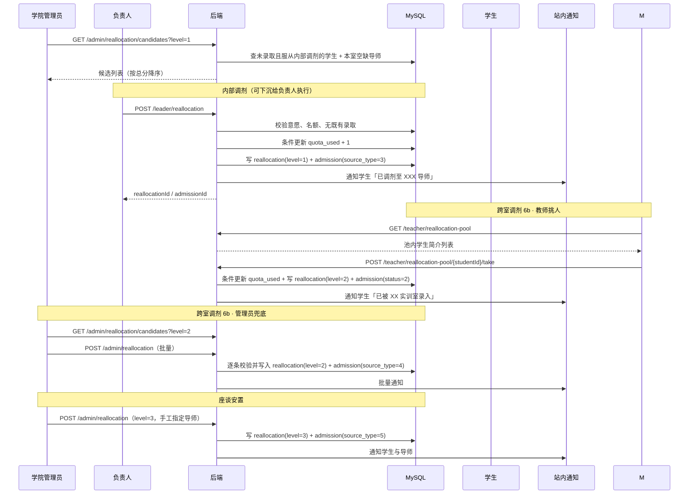

# Flow：统筹调剂

## 1. 场景概述

- 触发角色：实训室负责人（本室内部调剂）、**导师（跨室池抢录）**、学院管理员（跨室兜底、座谈安置）
- 前置条件：本轮拟录取确认已结束；存在未录取学生与未满名额导师
- 涉及表：`admission`、`reallocation`、`mentor_profile`、`intention`、`waitlist`、`operation_log`、`user_notice`
- 涉及接口：`GET /leader/reallocation/candidates`、`POST /leader/reallocation`、`GET /teacher/reallocation-pool`、`POST /teacher/reallocation-pool/{studentId}/take`、`GET /admin/reallocation/candidates`、`POST /admin/reallocation`

## 2. 三级优先规则

| 级别 | 名称 | 适用学生 | 执行人 | 目标导师范围 |
|---|---|---|---|---|
| 1 | 实训室内部调剂 | 未录取 + `accept_inner_adjust = 1` | 负责人 / 管理员 | 原意向实训室内仍有剩余名额的导师 |
| 2 | 全院跨实训室调剂 | 未录取 + `accept_cross_adjust = 1` | 教师先挑先得，管理员兜底 | 全院仍有剩余名额的导师 |
| 3 | 座谈安置 | 未录取 + 两项调剂均不服从 | 管理员 | 手工指定，需线下座谈后录入 |

> 系统不开放学生自选剩余名额，调剂结果由执行人分配后直接生效，学生仅接收通知。

## 3. 时序图

## 4. 数据流转四段式

### 场景 4.1：内部调剂

- **用户操作**：负责人在「本室调剂」页选择学生「张强」（服从内部调剂、本轮未录取），选择本室仍有 2 个空缺的导师「王建国」，点 `[确认调剂]`。
- **接口调用**：`POST /api/v1/leader/reallocation`。
- **数据变更**：
  1. 校验操作人为该生原意向实训室的负责人。
  2. 校验 `intention.accept_inner_adjust = 1`。
  3. 校验学生本轮无 `admission` 有效记录（`status ∈ {1,2,3}`）。
  4. 条件更新目标导师名额：`quota_used = quota_used + 1 WHERE id = ? AND quota_used < quota`。
  5. 插入 `reallocation`：`level = 1`、`from_lab_id = 原实训室`、`to_lab_id`、`to_mentor_id`、`operator_id`、`reason`。
  6. 插入 `admission`：`source_type = 3`、`status = 2` 已确认（分配即生效，不要求学生二次确认）。
  7. 写 `operation_log`：`biz_type = REALLOCATION`。
  8. 提交事务。
- **页面反馈**：候选池该学生移出；导师名额减 1；Toast「调剂成功」；学生收到「已调剂至 XX 导师」通知。

### 场景 4.2：跨室调剂（教师挑人）

- **用户操作**：导师进入「全院调剂池」，浏览学生简介，点某学生 `[录入]`，二次确认。
- **接口调用**：`POST /api/v1/teacher/reallocation-pool/{studentId}/take`。
- **数据变更**：
  1. 校验当前处于 6b 子时窗内，且当前用户为在职导师。
  2. 校验学生本轮无有效录取、已勾选「服从跨室调剂」、仍未被任何人录入。
  3. 条件更新导师名额：`quota_used = quota_used + 1 WHERE id = ? AND quota_used < quota`。
  4. 插入 `reallocation`：`level = 2`、`to_lab_id`、`to_mentor_id`、`operator_id = 当前导师`、`reason` 取入参（必填）。
  5. 插入 `admission`：`source_type = 4`、`status = 2` 已确认、`active_flag = 1`、`pending_type = NULL`（直接生效，学生不再二次确认）。
  6. 写 `operation_log`：`biz_type = REALLOCATION`，含录入理由。
  7. 推送通知给学生。
- **页面反馈**：Toast「已录入，3 秒后移出列表」；卡片移除；名额提示条减 1。
- **并发**：两个教师同时点同一学生，唯一键 + 条件更新只允许一个成功，失败方提示「该生已被 XX 实训室录入」。

### 场景 4.3：跨室调剂（管理员兜底）

- **用户操作**：教师挑完后，管理员在「统筹调剂 · 跨室兜底」Tab 勾选剩余学生，批量指定导师，点 `[批量分配]`。
- **接口调用**：`POST /api/v1/admin/reallocation`，`level = 2`。
- **数据变更**：
  1. 逐条校验 `intention.accept_cross_adjust = 1`、学生无有效录取、目标导师剩余名额 > 0。
  2. 逐条条件更新 `quota_used`，失败条目记入 `failList`，不影响其他条。
  3. 成功条目写 `reallocation`（`level = 2`）与 `admission`（`source_type = 4`、`status = 2` 已确认）。
  4. 批量推送站内通知。
- **页面反馈**：结果弹窗展示「成功 4 条 / 失败 1 条」及失败原因；成功学生从候选池移出。

### 场景 4.4：座谈安置

- **用户操作**：管理员对不服从调剂的学生「李娜」线下座谈后，在「座谈安置」Tab 手工指定导师「赵明」，填写说明「学生同意转入智能制造实训室」。
- **接口调用**：`POST /api/v1/admin/reallocation`，`level = 3`。
- **数据变更**：
  1. 不校验调剂意愿开关（该级别本身面向不服从调剂的学生）。
  2. 其余校验同 4.2。
  3. 写 `reallocation`（`level = 3`，`from_lab_id` 可为空）与 `admission`（`source_type = 5`、`status = 2` 已确认）。
  4. `reason` 必填，写入 `operation_log` 作为座谈留痕。
- **页面反馈**：Toast「已安置」；学生端显示「已调剂至 XX 导师」。

### 场景 4.5：调剂结果通知与调整

- **用户操作**：学生进入「录取待确认中心」查看「已调剂至 XX 导师」；调剂结果直接生效，学生不可自行放弃。
- **接口调用**：学生端仅查询；确需调整时由管理员调用 `POST /api/v1/admin/admissions/{id}/adjust`（`action = CANCEL` 或 `REASSIGN`，`reason` 必填）。
- **数据变更**：
  1. 调剂分配时 `admission.status = 2` 已确认、`source_type ∈ {3,4,5}`，**直接生效**，不要求学生点「接受」。
  2. 管理员 `CANCEL` 时 `status = 4`、释放名额但不触发递补；`REASSIGN` 时原导师名额释放、新导师条件占用，不改变名额总数。
  3. 上述调整一律写 `operation_log`，含前后值与原因；该生本轮不再进入调剂池。
- **页面反馈**：默认显示「已确认，请等待公示」；管理员调整后显示对应状态与原因。

## 5. 状态机

### 5.1 调剂级别流转

| 序号 | 级别 | 前置条件 | 未命中时 |
|---|---|---|---|
| 1 | 内部调剂 | 学生服从内部调剂且原室有名额 | 进入第 2 级候选池 |
| 2 | 跨室调剂 | 学生服从跨室调剂且全院有名额 | 进入第 3 级候选池 |
| 3 | 座谈安置 | 管理员线下座谈完成 | 保留未录取，进入下一轮补录 |

### 5.2 调剂记录状态

| 当前状态 | 触发动作 | 目标状态 | 校验条件 | 失败反馈 |
|---|---|---|---|---|
| 无记录 | 执行调剂 | 生成 `reallocation` + `admission(status=2 已确认)` | 意愿、名额、无既有录取 | 对应错误码 |
| 无记录 | 教师抢录 | 生成 `reallocation(level=2, operator=导师)` + `admission(status=2, source_type=4)` | 池内、调剂子窗内、名额充足 | 409001 / 400002 |
| 已确认 | 学生放弃 | `admission` 变 4，名额释放并触发递补 | 公示开始前 | 「已进入公示，不可放弃」 |
| 已确认 | 公示确认 | `admission` 变 3 已入组 | 公示结束 | — |

## 6. 异常与边界

| 场景 | 触发条件 | 服务端行为 | 错误码 | 前端反馈 |
|---|---|---|---|---|
| 不服从调剂 | 学生对 `level=1` 未勾选内部调剂 | 拒绝 | 400002 | 「学生未勾选服从实训室内部调剂」 |
| 名额已满 | 目标导师 `quota_used = quota` | 条件更新失败 | 400002 | 「目标导师剩余名额不足」 |
| 重复调剂 | 学生本轮已有有效录取 | 拒绝 | 400005 | 「学生本轮已有录取记录」 |
| 跨级越权 | 负责人执行 `level=2` | 拒绝 | 403001 | 「跨室调剂仅学院管理员可操作」 |
| 非本室负责人 | 负责人 A 给 B 室学生调剂 | 拒绝 | 403001 | 「该学生不属于本实训室」 |
| 座谈无理由 | `level=3` 且 `reason` 为空 | 拒绝 | 400001 | 「座谈安置必须填写说明」 |
| 批量部分失败 | 5 条中 1 条名额不足 | 逐条处理，成功的保留 | 200 | 结果弹窗展示成功/失败明细 |
| 学生在公示前放弃调剂结果 | 主动放弃 | 状态 4，名额释放并触发递补，不再回调剂池 | — | 双方通知 |
| 教师被禁用 | 抢录后导师离职 | 其有效录取保持，剩余名额退出抢录池，学生可申请改派 | — | 学生端提示 |

## 7. 测试要点

- 快乐路径：内部调剂 1 人成功，`reallocation.level = 1`，`admission.source_type = 3`，导师 `quota_used` 加 1。
- 三级顺序：同一学生先在内层候选出现，未被分配后才出现在跨室候选。
- 意愿校验：不服从内部调剂的学生不出现在 `level=1` 候选，且直接调用接口被拒。
- 批量：5 条中 1 条失败，4 条成功且事务不回滚已成功项。
- 权限：负责人只能调本室，管理员可调全院。
- 名额并发：两名管理员同时调剂至同一导师最后 1 个名额，仅 1 条成功。
- 留痕：每条调剂都能在 `operation_log` 中查到操作人、时间、原因。
