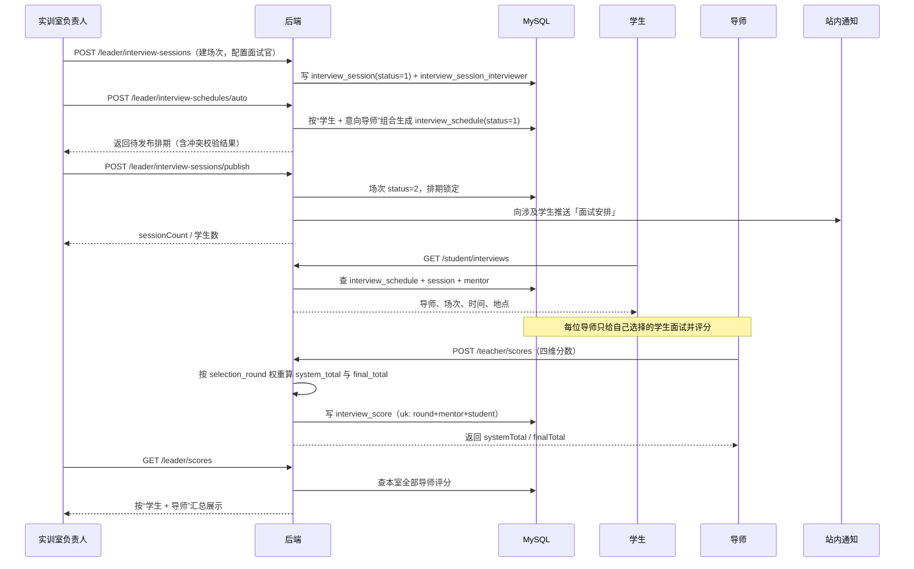

# Flow：面试排期与评分

## 1. 场景概述

- 触发角色：实训室负责人（建场次、排期）、导师（自主出题、独立评分）、学生（参加面试）
- 前置条件：本轮填报已截止；本室存在已提交意向的学生
- 涉及表：`interview_session`、`interview_session_interviewer`、`interview_schedule`、`interview_score`、`intention_item`、`selection_round`、`mentor_profile`
- 涉及接口：`GET/POST/PUT/DELETE /leader/interview-sessions`、`POST /leader/interview-schedules/auto`、`PUT /leader/interview-schedules`、`POST /leader/interview-sessions/publish`、`GET /leader/scores`、`GET/POST /teacher/scores`、`POST /teacher/scores/import`、`GET /student/interviews`

## 2. 时序图

## 3. 数据流转四段式

### 场景 3.1：新建面试场次

- **用户操作**：负责人进入「面试排期」，点 `[新增场次]`，填写场次名称、日期、14:00–15:30、地点、容量 30、面试官 2 人，保存。
- **接口调用**：`POST /api/v1/leader/interview-sessions`。
- **数据变更**：
  1. 校验当前用户为 `lab.leader_id` 对应负责人，且 `round_id` 处于「面试中」。
  2. 校验 `start_time < end_time`，日期落在 `interview_start ~ interview_end` 内。
  3. 向 `interview_session` 插入记录，`status = 1` 草稿。
  4. 面试官须为本室在职导师，校验通过后按 `(session_id, interviewer_id)` 批量写 `interview_session_interviewer`，唯一键去重。
- **页面反馈**：场次列表新增一行，状态标签「草稿」，`[发布排期]` 按钮高亮。

### 场景 3.2：按导师自动分配

- **用户操作**：点 `[自动分配]`。
- **接口调用**：`POST /api/v1/leader/interview-schedules/auto`，入参 `roundId`。
- **数据变更**：
  1. 查询本室本轮已提交意向的 `intention_item`，按“学生 + 导师”组合展开。
  2. 每个组合只分配一条 `interview_schedule`；同一学生选择 N 位导师则最多 N 条。
  3. 目标场次必须配置了该导师（`interview_session_interviewer`），且剩余容量 > 0。
  4. 校验学生在该场次时段无其他排期；同一学生多条排期不得时间重叠。
  5. 批量写 `interview_schedule`，带 `mentor_id`，`status = 1` 待面试；唯一键 `(round_id, mentor_id, student_id)`。
- **页面反馈**：待排区按组合清空，场次内显示已排人数；无可用场次或时间冲突时提示具体导师。

### 场景 3.3：发布排期

- **用户操作**：点 `[发布排期]`，确认弹窗点「确认发布」。
- **接口调用**：`POST /api/v1/leader/interview-sessions/publish`。
- **数据变更**：
  1. 校验本室本轮所有“学生 + 导师”组合均已排期，缺失则返回缺失数量。
  2. 校验无学生时间冲突、无导师时间冲突（按 `interview_session_interviewer.interviewer_id` 关联场次时段）、无超容量。
  3. 更新 `interview_session.status = 2` 已发布。
  4. 向每名学生的 `user_notice` 插入「面试安排」通知，内容含场次、时间、地点、注意事项。
  5. 提交事务。
- **页面反馈**：场次状态变「已发布」；所有编辑按钮置灰；Toast 展示发布结果。

### 场景 3.4：导师录入四维评分

- **用户操作**：导师进入「报名学生」，点选择本人的学生 `[评分]`，填写学习态度 90、逻辑思维 85、编程基础 88、时间投入 80，填评语后点击 `[提交评分]`。
- **接口调用**：`POST /api/v1/teacher/scores`，`submit = 1`。
- **数据变更**：
  1. 校验当前用户为导师，且该学生选择了本人并存在 `interview_schedule`，否则拒绝。
  2. 读取 `selection_round` 四维权重（默认各 25%）。
  3. 计算 `system_total = 90×0.25 + 85×0.25 + 88×0.25 + 80×0.25 = 85.75`（四舍五入两位）。
  4. `manual_total` 为空时 `final_total = system_total`。
  5. 按 `(round_id, mentor_id, student_id)` 插入或更新 `interview_score`，`status = 2`，`scorer_id = 导师用户ID`。
  6. 提交事务。
- **页面反馈**：Toast「评分已提交」；导师列表显示总分；负责人汇总页同步可见（只读）。

### 场景 3.5：导师手动覆写总分

- **用户操作**：录分弹窗中打开 `[手动调整总分]`，输入 88，填写理由「面试现场表现优于笔试」，提交。
- **接口调用**：`POST /api/v1/teacher/scores`，含 `manualTotal = 88`、`adjustReason`。
- **数据变更**：
  1. 校验 `adjustReason` 非空，否则拒绝。
  2. 写 `manual_total = 88.00`、`adjust_reason`。
  3. `final_total = 88.00`（覆盖系统值）。
  4. 写 `operation_log`：`biz_type = SCORE`、`before_value = 85.75`、`after_value = 88.00`、`reason`。
- **页面反馈**：总分区显示 88.00 并带「已手动调整」标签，悬停展示理由。

### 场景 3.6：导师批量导入评分

- **用户操作**：导师在「报名学生」页上传 Excel（学号、学习态度、逻辑思维、编程基础、时间投入、评语），确认导入。
- **接口调用**：`POST /api/v1/teacher/scores/import`（multipart）。
- **数据变更**：
  1. 逐行校验学号存在、属于本人已排期学生、四维分数在 0–100。
  2. 校验通过的行按 `(round_id, mentor_id, student_id)` upsert `interview_score`，统一计算 `system_total` 与 `final_total`。
  3. 失败行不写入，收集行号与原因。
- **页面反馈**：弹窗展示成功数与失败明细。

### 场景 3.7：学生查看面试安排

- **用户操作**：学生进入「面试安排」页。
- **接口调用**：`GET /api/v1/student/interviews`。
- **数据变更**：只读，无写入。
- **页面反馈**：卡片按时间升序排列；同一学生选择多位导师时显示多条安排，每条标注导师；未发布时展示「暂无面试安排」。

## 4. 状态机

### 4.1 场次状态 `interview_session.status`

| 当前状态 | 触发动作 | 目标状态 | 校验条件 | 失败反馈 |
|---|---|---|---|---|
| 1 草稿 | 修改/删除 | 1 草稿 | 未发布 | — |
| 1 草稿 | 发布排期 | 2 已发布 | 无冲突、无超容、学生+导师组合全覆盖 | 「存在 N 个学生-导师组合未排期」 |
| 2 已发布 | 取消并重排 | 1 草稿 | 负责人二次确认 | 已推送通知不可撤回，需重新通知 |
| 2 已发布 | 面试结束 | 3 已结束 | 到达场次结束时间 | — |

### 4.2 排期状态 `interview_schedule.status`

| 当前状态 | 触发动作 | 目标状态 | 校验条件 | 失败反馈 |
|---|---|---|---|---|
| 1 待面试 | 负责人登记完成 | 2 已完成 | 该条排期存在 | — |
| 1 待面试 | 负责人登记缺席 | 3 缺席 | 该条排期存在 | 学生端标红「缺席」 |

### 4.3 评分状态 `interview_score.status`

| 当前状态 | 触发动作 | 目标状态 | 校验条件 | 失败反馈 |
|---|---|---|---|---|
| 1 草稿 | 导师提交 | 2 已提交 | 四维分数齐全且在 0–100 | 「分数必须在 0-100 之间」 |
| 2 已提交 | 导师修正 | 2 已提交 | 写 `operation_log`（手动覆写时） | — |

## 5. 异常与边界

| 场景 | 触发条件 | 服务端行为 | 错误码 | 前端反馈 |
|---|---|---|---|---|
| 学生时间冲突 | 同一学生同一时段被排两场 | 拒绝发布 | 409001 | 列出冲突学生与时段 |
| 导师冲突 | 同一导师同时段两场 | 拒绝发布 | 409001 | 列出冲突导师 |
| 场次超容 | 已排人数 > capacity | 拒绝新增 | 400002 | 「场次超出容量」 |
| 学生跨多位导师 | 学生选择 N 位导师 | 各生成 1 条排期 | 200 | 学生端显示 N 条，分别标注导师 |
| 非本人学生评分 | 导师给未选择本人的学生评分 | 拒绝 | 403001 | 「该学生未选择该导师或尚未排期」 |
| 重复评分 | 同一导师同一学生二次评分 | 覆盖更新，保留最后一次 | 200 | Toast「评分已更新」 |
| 分数越界 | 输入 120 或 -5 | 拒绝 | 400001 | 输入框红框提示 |
| 手动覆写无理由 | `manualTotal` 有值、`adjustReason` 为空 | 拒绝 | 400001 | 「手动调整总分时必须填写理由」 |
| 未发布就被学生看到 | 场次仍为草稿 | 学生接口不返回 | 200 | 「暂无面试安排」 |
| 补录直录 / 抢录学生 | 免面试直接产生录取 | 不进排期、不录分，`total_score` 为 NULL | — | 名单标注「免面试」 |

## 6. 测试要点

- 快乐路径：建 2 场 → 按“学生 + 导师”自动分配 → 发布 → 学生收到通知 → 导师各自录分 → 负责人汇总可见。
- 分数：90/85/88/80 且等权，`system_total = 85.75`。
- 权重：管理员改为 40/30/20/10，同一组分数重算结果变化且 `final_total` 同步。
- 覆写：`manualTotal = 88` 且有理由，`final_total = 88.00`，日志有前后值。
- 冲突：A 学生 14:00 场次已排，再排 14:30 同室另一场应被拒。
- 权限：导师 A 不能给未选择自己的学生评分；负责人只能汇总查看，不能替导师改分。
- 并发：同一“学生 + 导师”被两场同时自动分配，唯一键兜底只保留一条。
