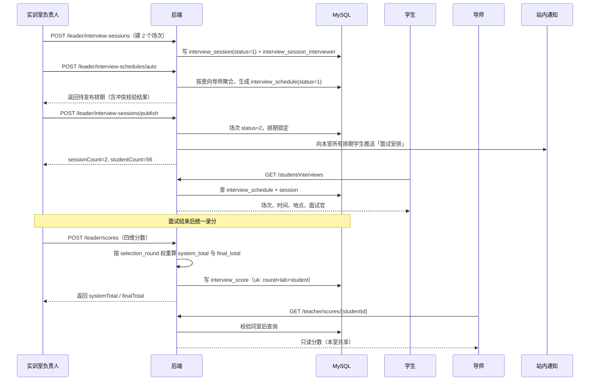

# Flow：面试排期与评分

## 1. 场景概述

- 触发角色：实训室负责人（排期、录分）、学生（参加面试）、导师（查看分数）
- 前置条件：本轮填报已截止；本室存在已提交意向的学生
- 涉及表：`interview_session`、`interview_session_interviewer`、`interview_schedule`、`interview_score`、`intention_item`、`selection_round`、`mentor_profile`
- 涉及接口：`GET/POST/PUT/DELETE /leader/interview-sessions`、`POST /leader/interview-schedules/auto`、`PUT /leader/interview-schedules`、`POST /leader/interview-sessions/publish`、`GET/POST /leader/scores`、`POST /leader/scores/import`、`GET /student/interviews`、`GET /teacher/scores/{studentId}`

## 2. 时序图

## 3. 数据流转四段式

### 场景 3.1：新建面试场次

- **用户操作**：负责人进入「面试排期」，点 `[新增场次]`，填写场次名称、日期、14:00–15:30、地点、容量 30、面试官 2 人，保存。
- **接口调用**：`POST /api/v1/leader/interview-sessions`。
- **数据变更**：
  1. 校验当前用户为 `lab.leader_id` 对应负责人，且 `round_id` 处于「面试中」。
  2. 校验 `start_time < end_time`，日期落在 `interview_start ~ interview_end` 内。
  3. 向 `interview_session` 插入记录，`status = 1` 草稿。
  4. 面试官须为本室在职导师，否则拒绝；校验通过后按 `(session_id, interviewer_id)` 批量写 `interview_session_interviewer`，唯一键去重。
- **页面反馈**：场次列表新增一行，状态标签「草稿」，`[发布排期]` 按钮高亮。

### 场景 3.2：自动分配学生

- **用户操作**：点 `[自动分配]`。
- **接口调用**：`POST /api/v1/leader/interview-schedules/auto`，入参 `roundId`。
- **数据变更**：
  1. 查询本室本轮 `intention_item` 中出现的所有 `distinct student_id`（跨实训室意向按本室维度去重）。
  2. 按学生意向导师聚合，把意向集中度高的学生优先分配到对应面试官所在场次。
  3. 校验学生在该场次时段无其他排期、场次未超容量。
  4. 批量写 `interview_schedule`，`status = 1` 待面试。
  5. 同一 `(round_id, lab_id, student_id)` 唯一，重复分配走更新。
- **页面反馈**：待排区清空，场次内显示已排人数；冲突学生行标红并展示冲突原因。

### 场景 3.3：发布排期

- **用户操作**：点 `[发布排期]`，确认弹窗点「确认发布」。
- **接口调用**：`POST /api/v1/leader/interview-sessions/publish`。
- **数据变更**：
  1. 校验本室本轮所有已提交意向的学生均已排期，缺失则返回缺失名单。
  2. 校验无学生时间冲突、无面试官时间冲突（按 `interview_session_interviewer.interviewer_id` 关联场次时段）、无超容量。
  3. 更新 `interview_session.status = 2` 已发布。
  4. 向每名学生的 `user_notice` 插入「面试安排」通知，内容含场次、时间、地点、注意事项。
  5. 提交事务。
- **页面反馈**：场次状态变「已发布」；所有编辑按钮置灰；Toast「已发布，共 56 名学生收到通知」。

### 场景 3.4：录入四维评分

- **用户操作**：负责人进入「本室评分」，点某学生 `[录分]`，填写学习态度 90、逻辑思维 85、编程基础 88、时间投入 80，填评语后点击 `[提交评分]`。
- **接口调用**：`POST /api/v1/leader/scores`，`submit = 1`。
- **数据变更**：
  1. 校验该学生在本室存在 `interview_schedule` 记录，否则断言「该学生未在本室面试」。
  2. 读取 `selection_round` 四维权重（默认各 25%）。
  3. 计算 `system_total = 90×0.25 + 85×0.25 + 88×0.25 + 80×0.25 = 85.75`（四舍五入两位）。
  4. `manual_total` 为空时 `final_total = system_total`。
  5. 按 `(round_id, lab_id, student_id)` 插入或更新 `interview_score`，`status = 2`，写 `scorer_id`。
  6. 提交事务。
- **页面反馈**：Toast「评分已提交」；列表四维状态变「已评分」，总分列显示 85.75；导师端同步可见（只读）。

### 场景 3.5：手动覆写总分

- **用户操作**：录分弹窗中打开 `[手动调整总分]`，输入 88，填写理由「面试现场表现优于笔试」，提交。
- **接口调用**：`POST /api/v1/leader/scores`，含 `manualTotal = 88`、`adjustReason`。
- **数据变更**：
  1. 校验 `adjustReason` 非空，否则拒绝。
  2. 写 `manual_total = 88.00`、`adjust_reason`。
  3. `final_total = 88.00`（覆盖系统值）。
  4. 写 `operation_log`：`biz_type = SCORE`、`before_value = 85.75`、`after_value = 88.00`、`reason`。
- **页面反馈**：总分区显示 88.00 并带「已手动调整」标签，悬停展示理由。

### 场景 3.6：批量导入评分

- **用户操作**：点 `[导入评分表]`，上传 Excel（学号、学习态度、逻辑思维、编程基础、时间投入、评语），确认导入。
- **接口调用**：`POST /api/v1/leader/scores/import`（multipart）。
- **数据变更**：
  1. 逐行校验学号存在、属于本室排期学生、四维分数在 0–100。
  2. 校验通过的行批量 upsert `interview_score`，统一计算 `system_total` 与 `final_total`。
  3. 失败行不写入，收集行号与原因。
- **页面反馈**：弹窗展示「成功 54 条 / 失败 2 条」及失败明细，可下载失败清单。

### 场景 3.7：学生查看面试安排

- **用户操作**：学生进入「面试安排」页。
- **接口调用**：`GET /api/v1/student/interviews`。
- **数据变更**：只读，无写入。
- **页面反馈**：卡片按时间升序排列；跨实训室时显示「第 1 场」「第 2 场」；未发布时展示「暂无面试安排」。

## 4. 状态机

### 4.1 场次状态 `interview_session.status`

| 当前状态 | 触发动作 | 目标状态 | 校验条件 | 失败反馈 |
|---|---|---|---|---|
| 1 草稿 | 修改/删除 | 1 草稿 | 未发布 | — |
| 1 草稿 | 发布排期 | 2 已发布 | 无冲突、无超容、学生全覆盖 | 「存在 N 名学生未排期」 |
| 2 已发布 | 取消并重排 | 1 草稿 | 负责人二次确认 | 已推送通知不可撤回，需重新通知 |
| 2 已发布 | 面试结束 | 3 已结束 | 到达场次结束时间 | — |

### 4.2 排期状态 `interview_schedule.status`

| 当前状态 | 触发动作 | 目标状态 | 校验条件 | 失败反馈 |
|---|---|---|---|---|
| 1 待面试 | 负责人录分 | 2 已完成 | 场次已发布 | — |
| 1 待面试 | 面试结束未录分 | 3 缺席 | 定时任务扫描场次结束后仍无评分 | 学生端标红「缺席」 |

### 4.3 评分状态 `interview_score.status`

| 当前状态 | 触发动作 | 目标状态 | 校验条件 | 失败反馈 |
|---|---|---|---|---|
| 1 草稿 | 提交 | 2 已提交 | 四维分数齐全且在 0–100 | 「分数必须在 0-100 之间」 |
| 2 已提交 | 负责人修正 | 2 已提交 | 写 `operation_log` | — |

## 5. 异常与边界

| 场景 | 触发条件 | 服务端行为 | 错误码 | 前端反馈 |
|---|---|---|---|---|
| 学生时间冲突 | 同一学生同一时段被排两场 | 拒绝发布 | 409001 | 列出冲突学生与时段 |
| 面试官冲突 | 同一面试官同时段两场 | 拒绝发布 | 409001 | 列出冲突面试官 |
| 场次超容 | 已排人数 > capacity | 拒绝新增 | 400002 | 「场次超出容量」 |
| 跨室面试 | 学生 3 个意向分属 3 个实训室 | 每室各 1 条排期 | 200 | 学生端显示 3 场 |
| 非本室录分 | 负责人对非本室学生录分 | 拒绝 | 403001 | 「该学生未在本室面试」 |
| 重复录分 | 同一学生二次录分 | 覆盖更新，保留最后一次 | 200 | Toast「评分已更新」 |
| 分数越界 | 输入 120 或 -5 | 拒绝 | 400001 | 输入框红框提示 |
| 手动覆写无理由 | `manualTotal` 有值、`adjustReason` 为空 | 拒绝 | 400001 | 「手动调整总分时必须填写理由」 |
| 未发布就被学生看到 | 场次仍为草稿 | 学生接口不返回 | 200 | 「暂无面试安排」 |
| 补录直录 / 抢录学生 | 免面试直接产生录取 | 不进排期、不录分，`total_score` 为 NULL | — | 名单标注「免面试」 |

## 6. 测试要点

- 快乐路径：建 2 场 → 自动分配 56 人 → 发布 → 学生收到通知 → 录分 → 导师可查。
- 分数：90/85/88/80 且等权，`system_total = 85.75`。
- 权重：管理员改为 40/30/20/10，同一组分数重算结果变化且 `final_total` 同步。
- 覆写：`manualTotal = 88` 且有理由，`final_total = 88.00`，日志有前后值。
- 冲突：A 学生 14:00 场次已排，再排 14:30 同室另一场应被拒。
- 权限：负责人 A 不能给实训室 B 的学生录分；导师只能查看、不能修改分数。
- 并发：同一学生被两场同时自动分配，唯一键兜底只保留一条。
