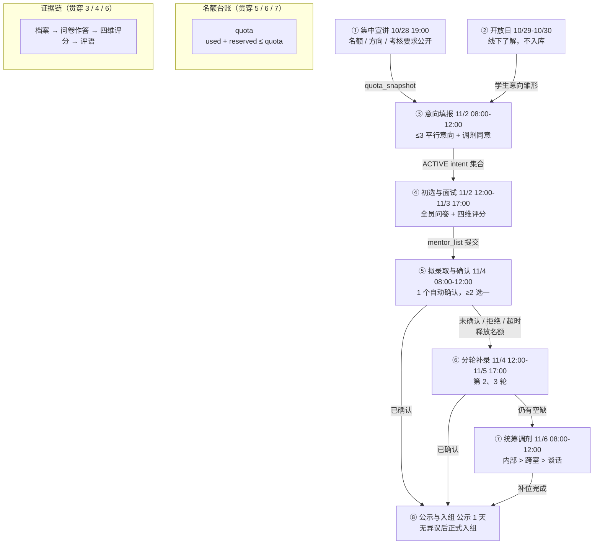
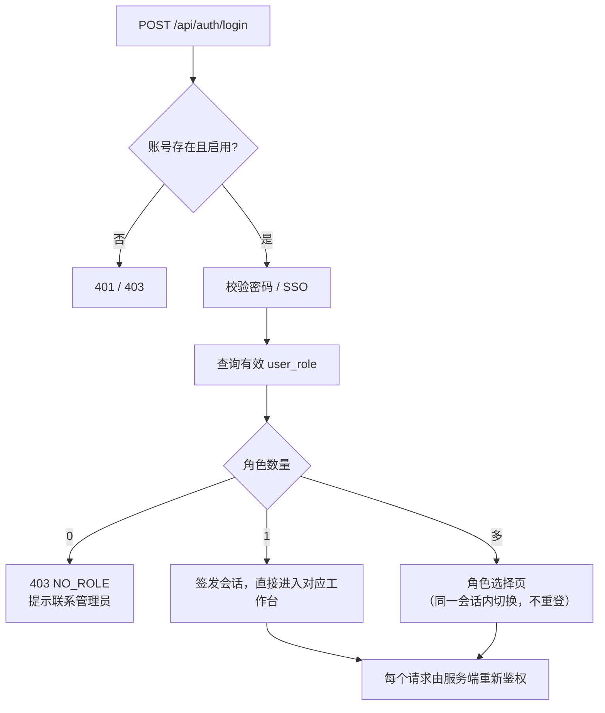
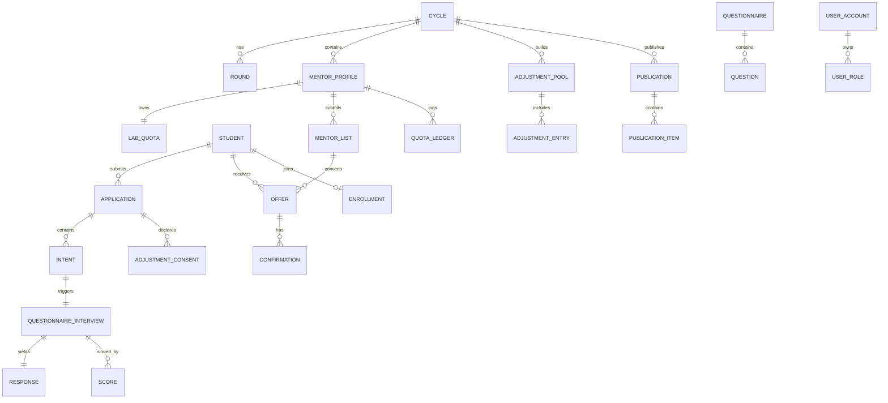
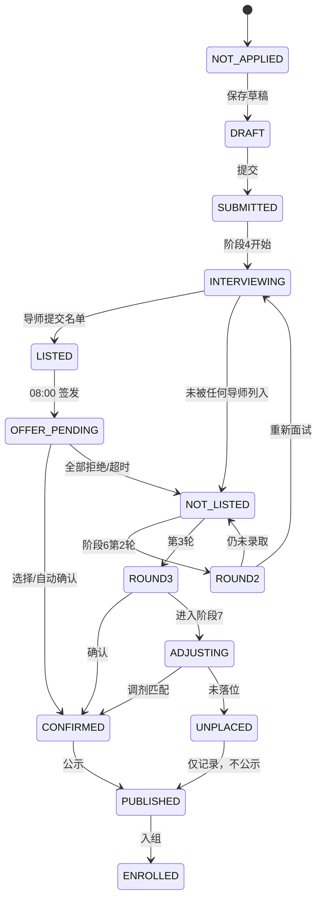

# 学生实训室进组选拔系统 · 设计与需求文档

**版本**：v3.0
**日期**：2026-11-09
**本版说明**：以流程图八个阶段为骨架重写。每个阶段独立成章，统一回答"谁、在什么时间窗、拿什么数据、做什么动作、产出什么状态、什么情况下不允许"。跨阶段公共机制（登录、名额台账、Offer、调剂同意、问卷面试、AI、保密、审计、时间门禁）集中到第 11 章，不再与主流程并列。

---

## 0. 读法

### 0.1 文档三条线

| 线 | 章节 | 回答的问题 |
|---|---|---|
| 纵向主线 | 第 1–10 章 | 流程怎么跑。八阶段，一阶段一章。 |
| 横向机制 | 第 11 章 | 每个阶段都要用的公共规则。 |
| 落地层 | 第 12–22 章 | 数据怎么存、状态怎么迁、接口怎么开、页面怎么摆、怎么验收。 |

### 0.2 编号规则

| 前缀 | 含义 | 出现位置 |
|---|---|---|
| `BR-Pn-xx` | 第 n 阶段的业务规则 | 各阶段章第 7 节 |
| `EX-Pn-xx` | 第 n 阶段的边界与异常 | 各阶段章第 8 节 |
| `INV-xx` | 全局不变量（任何时刻都必须成立） | 12.3 |
| `AC-xx` | 验收标准 | 20 |
| `Q-xx` | 待确认问题 | 22 |

### 0.3 一个判断标准

任何一条需求，如果回答不了这四个问题——
**属于哪个阶段 / 由谁触发 / 写哪张表 / 受哪个时间窗约束**——
它就没有落到架构里，仍然是"愿望"而不是"设计"。

---

## 1. 系统全景

### 1.1 一句话定义

一个由学院统一配置时间窗、以导师为选择主体、以学生**无序平行意向**为输入、以**名额台账**为硬约束、以"选择 → 确认 → 补录 → 调剂"为收敛路径的双向选择系统。

它不是一个报名表，也不是一个打分器。它是一个**分阶段收敛的撮合系统**：每一阶段把候选集合缩小一次，直到"每个学生一个去处、每个名额一个人"。

### 1.2 八阶段时间轴（系统总日历）

| # | 阶段 | 时间窗 | 时长 | 主战场 | 核心产出 | 状态载体 |
|---|---|---|---|---|---|---|
| 1 | 集中宣讲 | 10/28 19:00 | 单点 | 线下 + 线上材料 | 名额基线、导师目录 | `lab_quota_snapshot` |
| 2 | 实训室开放日 | 10/29–10/30 | 2 天 | 线下 | 学生形成意向（不入库） | 浏览日志 |
| 3 | 意向填报 | 11/2 08:00–12:00 | 4 h | 系统 | 平行意向集合 + 调剂同意 | `application` / `intent` / `adjustment_consent` |
| 4 | 导师初选与面试考核 | 11/2 12:00–11/3 17:00 | 29 h | 系统（问卷）+ 线下组织 | 拟录取 / 递补 / 内部调剂候选 | `questionnaire_interview` / `score` / `mentor_list` |
| 5 | 拟录取与学生确认 | 11/4 08:00–12:00 | 4 h | 系统 | 确认名单 + 触发的递补 | `offer` / `quota_ledger` |
| 6 | 分轮补录（第 2、3 轮） | 11/4 12:00–11/5 17:00 | 29 h | 系统 | 补录名单、剩余名额 | `round` / `intent` / `offer` |
| 7 | 统筹调剂录取 | 11/6 08:00–12:00 | 4 h | 系统 | 调剂分配结果 | `adjustment_pool` / `adjustment_entry` |
| 8 | 结果公示与正式入组 | 11/7 起，公示 1 天 | 1 天 | 系统 | 最终名单、入组记录 | `publication` / `enrollment` |

**系统关闭区间**（骨架的一部分，必须显式定义）：

| 区间 | 状态 | 说明 |
|---|---|---|
| 10/30 24:00 – 11/2 08:00 | 只读 | 开放日结束，意向未开 |
| 11/2 12:00 – 11/3 17:00 | 阶段 4 进行中 | 学生不能改意向，只能作答问卷 |
| 11/3 17:00 – 11/4 08:00 | 只读 | 等待确认期 |
| 11/4 12:00 – 11/5 17:00 | 阶段 6 进行中 | 第 2、3 轮补录 |
| 11/5 17:00 – 11/6 08:00 | 只读 | 等待调剂 |
| 11/6 12:00 – 公示开始 | 只读 | 名单汇总 |

**规则**：系统所有时间判断以**服务端时间**为准；客户端时间、本地缓存时间一律不参与判定。窗口关闭后，对应写接口返回 `409 WINDOW_CLOSED`，不做"宽容几分钟"。

### 1.3 主数据流：一张图



**这张图的读法**：
- 实线箭头是**数据**，不是"下一步"。阶段 5 的拒绝/超时会**回流**到阶段 6，这是系统里唯一的逆向流。
- 名额台账不在任何单一阶段里，它被 5/6/7 三个阶段**同时读写**，所以必须是独立资产（见 11.2）。
- 证据链在阶段 3 生成，阶段 4 消费，阶段 6 复用（补录轮次不再重复填档案，但可能重新答卷）。

### 1.4 四个角色 × 八个阶段：站位表

这是骨架的骨架。每一格只写该角色在该阶段的**唯一主要动作**，避免职责重叠。

| 角色 | ①宣讲 | ②开放日 | ③填报 | ④面试 | ⑤确认 | ⑥补录 | ⑦调剂 | ⑧公示 |
|---|---|---|---|---|---|---|---|---|
| **学生** | 听 | 走访、问 | 提交 ≤3 意向 + 勾调剂 | 答 N 份问卷 | 确认/放弃 | 未录取者重报 | 等结果/被谈话 | 查本人结果 |
| **导师** | 讲方向、报名额 | 接待、答疑 | **不可见报名名单** | 出题、评分、排名单 | 发 offer | 补录再选 | 参与调剂接收 | 入组带教 |
| **实训室负责人** | 组织本室 | 组织开放 | 监控本室填报率 | **统筹本室面试** | 审本室名单 | 统筹本室补录 | 本室内部调剂 | 入组安排 |
| **学院** | 全院发布 | 统筹 | 配置窗口、全院监控 | 监督进度 | 汇总确认 | **公布剩余名额** | 建池、定优先级 | 汇总公示 |

**三条读表结论**：
1. 阶段 ③ 导师是"盲"的——看不到谁报了自己、报了几个人。这是刻意的（见 5.7）。
2. 阶段 ④ 负责人是"组织者"不是"评判者"——他统筹时间与场地，评分权在导师。
3. 阶段 ⑥ 学院是"信息发布者"——剩余名额必须由系统算出来，不能手工填。

### 1.5 系统边界

**系统做**：时间窗与门禁、身份与角色路由、意向与承诺、问卷与作答、四维评分与评语、名单编制、名额台账、Offer 与确认、补录轮次、调剂匹配、公示与入组、审计与通知。

**系统不做**：
- 线下宣讲的组织与场地（阶段 1 的组织工作）
- 开放日的现场接待（阶段 2 的线下部分）
- 面试场所与设备安排（阶段 4 的线下部分）
- 谈话安置的实质沟通内容（阶段 7 只在系统里记录结论）
- 最终的行政发文（阶段 8 的公文）

**外部依赖**：大模型 API（仅用于摘要/整理，受 11.6、11.7 约束）。除此外不依赖任何第三方业务系统；学生档案、成绩单如需对接教务，按 12.5 的同步方式处理。

### 1.6 三条主线

理解全系统的钥匙：每个阶段的动作，都能归到下面三条线中的一条或几条。

| 主线 | 起点 | 终点 | 关键不变量 |
|---|---|---|---|
| **A 选择线** | 学生意向 | 学生确认的一个去处 | 一个学生最终只能有一个 CONFIRMED |
| **B 名额线** | 学院公布的名额 | 名额被填满或作废 | `used + reserved ≤ quota`，任何时刻成立 |
| **C 证据线** | 学生档案 | 导师的录用理由 | 问卷回答是证据，不是分数；分数只来自四维评分 |

八阶段就是这三条线在不同时间点的**交汇与收敛**：

| 阶段 | A 选择线 | B 名额线 | C 证据线 |
|---|---|---|---|
| ③ 填报 | 建立意向集合 | 名额只读展示 | 提交档案与陈述 |
| ④ 面试 | 导师形成名单 | 名单受 quota 约束 | 问卷 + 四维评分 |
| ⑤ 确认 | 学生收敛到 1 个 | reserve → fill | 录用理由归档 |
| ⑥ 补录 | 未录取者重新选择 | 释放的名额重新开放 | 复用/补充证据 |
| ⑦ 调剂 | 按同意范围分配 | 剩余名额进池 | 按分数排序 |
| ⑧ 公示 | 结果锁定 | 名额清零或入组 | 理由可审计 |

---

## 2. 角色、权限与可见性

### 2.1 角色定义与数据范围

| 角色 | 代码 | 数据范围 | 一句话职责 |
|---|---|---|---|
| 学生 | `STUDENT` | self | 提交意向、作答、确认 |
| 导师 | `MENTOR` | 本人 + 本人收到的意向 | 出题、评分、编名单、发 offer |
| 实训室负责人 | `LAB_HEAD` | `scope = lab` | 组织本室流程、审名单、本室调剂 |
| 学院管理员 | `COLLEGE_ADMIN` | `scope = college` | 配置窗口、全院监督、建调剂池、公示 |
| 系统管理员 | `SYS_ADMIN` | 无业务数据 | 配置、日志、故障处理（业务数据脱敏） |

**范围判定**：`user_role(scope_type, scope_id)` 决定数据边界；同一账号可有多条角色记录（见 11.1）。

### 2.2 按阶段的权限矩阵

图例：**W** 可写　**R** 只读　**A** 审计访问（需填理由，留日志）　**—** 不可见

| 动作 | 学生 | 导师 | 负责人 | 学院 |
|---|---|---|---|---|
| ① 维护导师目录/名额 | — | W（本人） | W（本室） | W（全院） |
| ① 发布宣讲材料 | — | R | R | W |
| ② 查看开放日安排 | R | R | W（本室） | W |
| ③ 提交/修改意向（窗口内） | W | — | — | — |
| ③ 查看本室报名名单（窗口关闭后） | — | R（仅本人收到的） | R（本室） | R（全院） |
| ④ 发布/编辑问卷（冻结前） | — | W（本人） | R（本室） | R（全院） |
| ④ 作答问卷 | W（本人） | — | — | — |
| ④ 四维评分/评语 | — | W（本人） | R（本室） | R（全院） |
| ④ 提交拟录取名单 | — | W | 审核 | R |
| ⑤ 接收/确认/放弃 offer | W（本人） | — | R（本室） | R（全院） |
| ⑤ 发 offer | — | W | — | — |
| ⑥ 重新填报 | W（未录取者） | — | — | — |
| ⑥ 公布剩余名额 | — | R | R | W |
| ⑦ 提交调剂意愿 | 已在 ③ 采集 | — | — | — |
| ⑦ 执行调剂 | — | R（接收） | W（本室 L1） | W（L2/L3） |
| ⑧ 查看公示 | R（本人结果） | R | R | W |

### 2.3 字段级可见性（谁看到哪一个格子）

| 内容 | 学生本人 | 导师（本室） | 负责人 | 学院 | 其他导师 |
|---|---|---|---|---|---|
| 档案基础信息 | W/R | R（仅本人意向者） | R（本室） | R（全院） | — |
| 共享个人陈述 | W/R | R（仅本人意向者） | R（本室） | R（全院） | — |
| 意向数量/顺序 | R | **—**（不可见） | R（本室，仅统计） | R（全院，仅统计） | — |
| 问卷题目（定制） | R（仅分配给自己） | W（本人） | R（本室） | R（全院） | — |
| 问卷作答 | R（本人） | R（本人意向者） | A | A | — |
| 四维评分 | — | W（本人） | R（本室） | R（全院） | — |
| 评语 | — | W（本人） | R（本室） | R（全院） | — |
| AI 摘要 | — | R（本人） | R（本室） | R（全院） | — |
| 其他学生结果 | — | — | R（本室） | R（全院） | — |
| 未录用原因 | — | W | R | R | — |

**三条硬规则**：
- **导师互不可见**：看不到同室其他导师的定制题、作答、评分、名单；共享题除外。
- **管理只读**：负责人与学院可看，不可编辑。想改只能发**建议消息**，导师可采纳/回复/忽略，系统不代改、不自动退回。
- **作答内容走审计访问**：负责人/学院查看"学生作答原文"需填写理由，生成访问日志（默认策略，见 Q-03）。

### 2.4 发布状态门禁

任何面向学生的内容（名额、名单、结果、公示）都带一个发布状态，只有 `PUBLISHED` 才对相应角色可见。

```
DRAFT → INTERNAL_REVIEW → PUBLISHED → LOCKED
                              ↑            │
                              └── WITHDRAWN ┘（仅管理员，留痕）
```

- `DRAFT`：创建者可改，学生不可见。
- `INTERNAL_REVIEW`：导师/负责人/学院可见，学生不可见。
- `PUBLISHED`：目标角色可见（学生端需配合 11.9 的时间门禁）。
- `LOCKED`：只读，任何角色不可改；只有系统管理员可在故障场景下解锁并留痕。

---

## 3. 阶段一 · 集中宣讲（10/28 19:00）

### 3.1 本阶段要解决什么

在任何一个学生做选择之前，先把**选择的对象**定义清楚：有哪些实训室、哪些导师、每个导师招几个、考什么、怎么培养。这一阶段产出的是**基线**——后面所有名额计算都以它为准。

图上的信息：学院组织统一宣讲，各导师介绍项目方向、招录名额、培养安排与考核要求。时间 10/28 19:00。

### 3.2 时间窗与门禁

| 项 | 定义 |
|---|---|
| 主体时间 | 10/28 19:00（单点，宣讲会） |
| 系统开放 | 10/26 起可维护导师目录与名额；10/28 19:00 起对学生可见 |
| 名额冻结时点 | 10/30 24:00 名额**首次冻结**为 `quota_snapshot` |
| 冻结后变更 | 只能由学院在系统内调整，必须填写理由，生成 `quota_adjust_log` |

**为什么冻结在 10/30 而不是 11/2**：学生在开放日（10/29–10/30）看到的名额，必须与 11/2 填报时看到的一致，否则学生是在"假信息"上做决定。

### 3.3 参与者与动作

| 角色 | 动作 | 系统落点 |
|---|---|---|
| 学院 | 创建选拔周期 `cycle`、配置各阶段时间窗、发布宣讲公告 | `cycle` / `announcement` |
| 学院 | 汇总各室名额，审定后发布 | `lab_quota.initial` |
| 负责人 | 维护本室导师名单、方向、名额建议 | `mentor_profile` |
| 导师 | 填写项目方向、招录名额、培养安排、考核要求（宣讲口径） | `mentor_profile` / `lab_direction` |
| 学生 | 查看公告、目录、名额 | 只读页面 |

### 3.4 输入

- 学院层面的选拔周期与时间窗配置（模板值见 1.2，可被学院覆盖）。
- 各实训室上报的导师清单与建议名额。
- 各导师的宣讲材料（方向、名额、培养、考核）。

### 3.5 输出

| 产出 | 表 | 说明 |
|---|---|---|
| 选拔周期 | `cycle(id, name, open_at, close_at, status)` | 一个学年一个主周期 |
| 导师档案 | `mentor_profile(mentor_id, lab_id, direction, quota_suggest, requirements)` | 对学生只读展示 |
| 名额基线 | `lab_quota(lab_id, mentor_id, quota, version)` | 阶段 5/6/7 的唯一额度来源 |
| 名额快照 | `lab_quota_snapshot(cycle_id, mentor_id, quota, frozen_at)` | 冻结后不再变，用于审计与对账 |
| 宣讲公告 | `announcement(id, cycle_id, title, content, publish_at, status)` | 支持附件 |

### 3.6 页面

- 学院端：`周期配置` → `名额汇总审阅` → `公告发布`
- 导师端：`我的宣讲信息`（填写方向/名额/培养/考核）
- 负责人端：`本室导师与名额一览`
- 学生端：`宣讲公告`、`实训室与导师目录`（含名额、方向、考核要求）

### 3.7 业务规则

- **BR-P1-01** 名额必须 > 0 才允许发布；为 0 的导师不进入后续流程，也不出现在学生目录中。
- **BR-P1-02** 名额冻结后（10/30 24:00），任何变更必须由学院操作并记录 `before/after/reason/operator`。
- **BR-P1-03** 导师目录对学生的可见字段固定为：姓名、所属实训室、方向、名额、考核要求、培养安排；不展示导师联系方式（统一走站内信）。
- **BR-P1-04** 宣讲材料在 10/28 19:00 前为 `INTERNAL_REVIEW`，19:00 自动 `PUBLISHED`。
- **BR-P1-05** 同一周期内导师归属实训室只能有一个；跨室兼任需拆成两条 `mentor_profile`，名额分别计算。

### 3.8 边界与异常

- **EX-P1-01** 某导师临时不招：学院将其名额置 0 并留痕；已发布的目录立即更新，学生端显示"本期不招"。
- **EX-P1-02** 名额调整发生在冻结之后、填报之前（10/30–11/2）：允许，但必须在学生端显著提示变更。
- **EX-P1-03** 导师材料缺失：该导师不进入目录，名额不参与汇总。
- **EX-P1-04** 宣讲会临时改期：只影响线下，不影响系统窗口；系统窗口以 `cycle` 配置为准。

### 3.9 数据与接口

| 接口 | 方法 | 说明 |
|---|---|---|
| `/api/cycle/{id}` | GET | 周期与时间窗 |
| `/api/mentors?cycle_id=` | GET | 导师目录（学生视角字段裁剪） |
| `/api/admin/quotas` | PUT | 学院调整名额（需 reason） |
| `/api/admin/announcements` | POST/PUT | 公告发布 |

### 3.10 验收

- 学生能在 10/28 19:00 后看到全部在招导师及其名额，且与 11/2 填报页显示一致。
- 名额冻结后修改，`quota_adjust_log` 有完整前后值与操作人。
- 名额为 0 的导师不出现在学生目录。

---

## 4. 阶段二 · 实训室开放日（10/29–10/30）

### 4.1 本阶段要解决什么

给学生一个**信息补齐**的机会：实地看环境、见导师、问高年级学生，把"目录上的文字"变成"可判断的印象"。这一阶段**不产生任何业务数据**，只产生浏览行为；它的设计目的是防止学生在信息匮乏下盲填意向。

图上的信息：学生实地走访实训室，与导师、高年级学生交流，了解项目氛围和培养方式。时间 10/29–10/30。

### 4.2 时间窗与门禁

| 项 | 定义 |
|---|---|
| 主体时间 | 10/29 00:00 – 10/30 24:00 |
| 系统能力 | 开放日日程、实训室介绍、往届项目、站内答疑 |
| 关闭后 | 页面转为只读归档；不影响后续填报 |

### 4.3 参与者与动作

| 角色 | 动作 | 系统落点 |
|---|---|---|
| 学生 | 查看日程、预约走访（可选）、站内提问 | `visit_slot` / `qa_thread` |
| 导师 | 发布接待时段、答疑 | `visit_slot` / `qa_thread` |
| 负责人 | 编排本室开放日安排 | `lab_open_day` |
| 学院 | 全院统筹、发布总日程 | `open_day_plan` |

### 4.4 输入

- 阶段 1 产出的导师目录与名额。
- 各室开放日的时段安排。

### 4.5 输出

- 开放日日程（`open_day_plan` / `visit_slot`）。
- 问答记录（`qa_thread`）：**公开问答**，所有学生可见；私聊不鼓励但允许，且不进入任何评分。
- 浏览日志（`view_log`）：仅用于统计热度，**不向导师展示谁看过我**。

### 4.6 页面

- 学生端：`开放日总日程`、`实训室详情`、`预约走访`、`公开问答`
- 导师端：`我的接待时段`、`回答问题`
- 负责人端：`本室开放日编排`
- 学院端：`全院开放日总览`

### 4.7 业务规则

- **BR-P2-01** 开放日**不产生意向**，学生在系统里不能在此阶段提交任何意向；意向只能等到 11/2 08:00。
- **BR-P2-02** 导师在开放日**不得承诺录取**、不得索要系统外的材料、不得以"开放日表现"作为评分依据。系统内不设"开放日印象分"字段。
- **BR-P2-03** 学生浏览记录**不向导师披露**（否则会形成"谁对我感兴趣"的反向信号，破坏 5.7 的盲选）。
- **BR-P2-04** 公开问答对所有学生可见，回答不得包含对其他学生的评价。
- **BR-P2-05** 预约名额上限由各室配置，约满即止，不做候补。

### 4.8 边界与异常

- **EX-P2-01** 学生未参加开放日：不影响后续任何资格；系统不做"是否到场"的采集。
- **EX-P2-02** 导师在问答中给出与目录不一致的名额：以冻结后的 `quota_snapshot` 为准，负责人负责纠正。
- **EX-P2-03** 开放日期间学生私下联系导师：系统不阻止也不记录，但后续一切以系统内提交为准（BR-P2-02）。
- **EX-P2-04** 预约冲突：同一时段多个导师，学生只能选一个；可改约，截止 10/30 24:00。

### 4.9 数据与接口

| 接口 | 方法 | 说明 |
|---|---|---|
| `/api/open-day/plan?cycle_id=` | GET | 总日程 |
| `/api/open-day/slots/{mentor_id}` | GET/POST | 时段与预约 |
| `/api/qa/threads?lab_id=` | GET/POST | 公开问答 |
| `/api/labs/{id}` | GET | 实训室详情（含往届项目） |

### 4.10 验收

- 开放日期间学生在系统内无法提交意向（接口返回 403）。
- 导师端看不到任何学生的浏览记录。
- 公开问答对所有学生可见，且不含他人评价。

---

## 5. 阶段三 · 意向填报（11/2 08:00–12:00）

### 5.1 本阶段要解决什么

把"我想去哪"变成一份**结构化、不可事后篡改、对导师不暴露顺序**的输入。

图上的信息：学生最多填报 3 个平行导师意向，**不分志愿先后**；同时选择是否服从实训室内部调剂和全院跨实训室调剂。时间 11/2 08:00–12:00。

这是全系统的**入口闸门**：后面所有阶段的操作对象，都是这里产生的 `intent` 集合。

### 5.2 时间窗与门禁

| 项 | 定义 |
|---|---|
| 开放 | 11/2 08:00:00（服务端） |
| 关闭 | 11/2 12:00:00（服务端，硬关） |
| 提前进入 | 11/2 00:00 起可保存草稿，但不可提交 |
| 关闭后 | 只读；写接口返回 `409 WINDOW_CLOSED` |
| 补录轮 | 阶段 6 重新开窗，复用同一套表，`round` 区分 |

**没有"补填"**：窗口关闭即终局。唯一例外是**系统级故障**——由学院发起，统一延长并在全端公告（见 11.9）。

### 5.3 参与者与动作

| 角色 | 动作 | 说明 |
|---|---|---|
| 学生 | 完善档案 → 写共享陈述 → 选 ≤3 导师 → 勾选调剂范围 → 提交 | 提交后本人不可改 |
| 导师 | **不可见报名情况** | 窗口关闭后统一可见 |
| 负责人 | 查看本室填报率（聚合数字，不看具体名单） | 用于催办 |
| 学院 | 配置窗口、监控全院填报率、处理故障 | 不看具体名单直到关闭 |

### 5.4 输入

**A. 学生全局档案**（一次填写，跨意向复用；有效期一学年）

| 字段组 | 字段 | 必填 | 说明 |
|---|---|---|---|
| 身份 | 学号、姓名、学院、专业、年级、班级 | 是 | 学号/姓名从教务同步，学生不可改 |
| 联系 | 手机、邮箱 | 是 | 仅导师与管理员可见 |
| 学业 | 已修核心课及成绩、GPA/排名（可选）、英语等级 | 是（成绩） | 成绩由教务同步，学生可申诉 |
| 技能 | 编程语言、工具链、项目经历 | 是 | 结构化标签 + 自由文本 |
| 经历 | 竞赛、科研、实习、开源 | 否 | 需附证明链接或附件 |
| 时间 | 每周可投入小时、可投入时段、是否有其他组织任职 | 是 | 直接对应"时间投入"维度 |
| 意向 | 期望方向、期望培养方式 | 否 | 仅作参考，不参与排序 |

**B. 共享个人陈述**（每份申请共用一份，防止"对不同导师写不同版本"）

- 篇幅：300–800 字。
- 固定四段引导：为什么选这个方向 / 做过什么 / 能投入多少 / 希望得到什么。
- **所有导师看到的是同一份文本**；学生不能为不同导师写不同陈述。

**C. 意向级信息**（每条意向独有）

| 字段 | 说明 |
|---|---|
| `mentor_id` | 目标导师 |
| `lab_id` | 冗余存储，便于按室统计 |
| `note_to_mentor` | 可选，≤200 字；**对同一导师只写一次，不可针对不同导师差异化** |
| `created_at` | 仅系统与审计可见，不向导师展示 |

**D. 承诺与授权**

- 承诺信息真实（勾选）。
- 授权学院/负责人在必要时审计（勾选）。
- 同意调剂范围（**三级独立勾选，默认全不勾**，见 5.6）。

### 5.5 输出

| 产出 | 表 | 说明 |
|---|---|---|
| 申请单 | `application(id, cycle_id, round, student_id, college_id, status, submitted_at, content_hash)` | 一轮一份 |
| 意向 | `intent(id, application_id, mentor_id, lab_id, note, status)` | **无 priority 列** |
| 陈述 | `student_statement(application_id, content, version)` | 一份 |
| 调剂同意 | `adjustment_consent(application_id, scope_code, accepted, constraints, snapshot_at)` | 三级各一行 |
| 回执 | `submission_receipt(application_id, receipt_no, submitted_at, ip, content_hash)` | 可下载 |

**状态迁移**：

```
（无） → DRAFT ──提交──→ SUBMITTED ──窗口关闭──→ LOCKED
   │                        │
   └──── 撤销（窗口内）──────┘
```

`LOCKED` 之后，任何人（包括管理员）都不能改内容；只能整单作废（`VOID`）并留痕，用于极端故障。

### 5.6 调剂同意的三级模型

| 级别 | 代码 | 含义 | 勾选后进入的池 |
|---|---|---|---|
| 实训室内部 | `L1` | 接受在本实训室内换导师 | 内部调剂池 |
| 全院跨室 | `L2` | 接受在全院范围内换实训室 | 跨室调剂池 |
| 全校跨院 | `L3` | 接受跨学院调剂（如学院支持） | 跨院池（默认关闭） |

**规则**：
- 三级**互相独立**，默认全部不勾。勾 `L2` 不以勾 `L1` 为前提（业务上通常同时勾选，UI 提示但不强制）。
- 存储为三行 `adjustment_consent`，不建四张"组合表"；池子由掩码派生（见 11.4）。
- 提交时快照 `snapshot_at`，后续轮次可重新确认（阶段 6），**以最新一次为准**。

### 5.7 平行意向的关键设计：让导师"盲"

这是本系统最容易被做错的地方。如果导师能看到"这个学生把谁填第一、填了几个"，选择就会被"备胎感"左右。所以：

| 设计点 | 做法 | 目的 |
|---|---|---|
| 无序存储 | `intent` 无 `priority`，唯一索引 `(application_id, mentor_id)` | 系统层面不存在"第一志愿" |
| 界面不排序 | 学生端按加入顺序展示，仅本人可见；交付给导师时**不带顺序** | 不留推断线索 |
| 隐藏数量 | 导师看不到该生报了几个导师 | 不能推断"我是不是备选" |
| 隐藏时间 | 导师看不到提交时间 | 不能推断"是最后补的" |
| 统一陈述 | 同一份个人陈述给所有导师 | 不能针对不同导师写不同话术 |
| 关闭后统一下发 | 12:00 前导师端完全不可见 | 防止最后几分钟被"打招呼" |

**必须承认的边界**：导师之间私下交流是系统管不住的；学生主动告诉导师"我还报了谁"也是管不住的。系统能做的是**不提供、不展示、不统计**，把推断成本抬高，而不是假装能消灭它。

### 5.8 页面

- 学生端：`填报须知` → `档案完善`（分步） → `选择导师`（搜索/筛选/对比） → `共享陈述` → `调剂范围` → `预览` → `提交` → `回执`
- 导师端：窗口内显示"填报进行中，结束后可查看"
- 负责人端：`本室填报进度`（仅百分比与人数，不含名单）
- 学院端：`全院填报监控`

### 5.9 业务规则

- **BR-P3-01** 意向数量 1–3；0 个不允许提交（可存草稿）。
- **BR-P3-02** 同一导师只能有一条 ACTIVE 意向。
- **BR-P3-03** 无顺序字段；任何导出、任何接口响应，都不得包含能推断顺序的信息（含 `created_at`）。
- **BR-P3-04** 调剂范围为三级独立勾选，默认全不勾；不勾任何一级 = 不接受任何调剂。
- **BR-P3-05** 提交即锁定：本人不可改；管理员不可代改，只能作废整单（`VOID`）并留痕。
- **BR-P3-06** 完整度校验：档案必填项齐全、陈述 ≥300 字、承诺已勾选；缺一项不允许提交。
- **BR-P3-07** 提交幂等：同一 `application` 重复提交返回同一回执，不产生重复记录。
- **BR-P3-08** 截止判定以服务端收包时间；12:00:00.001 之后一律拒绝。
- **BR-P3-09** 导师在窗口期内看不到报名人数、名单、任何聚合指标（防止针对性劝退）。
- **BR-P3-10** 草稿每 30 秒自动保存到服务端；本地同时保留一份；冲突时以服务端版本为准并提示。

### 5.10 边界与异常

- **EX-P3-01** 窗口内 0 意向：允许草稿但不计入选拔；关闭后显示"未提交"。
- **EX-P3-02** 学生重复报名同一导师：前端阻止，后端唯一索引兜底。
- **EX-P3-03** 学生跨学院报名：允许；但其 `L2/L3` 范围受目标学院是否开放限制。
- **EX-P3-04** 学生在最后一分钟断网：以服务端已收到的最后一次提交为准；未收到则视为未提交，不做补救。
- **EX-P3-05** 账号被停用：拒绝提交，提示联系学院。
- **EX-P3-06** 教务同步失败导致成绩缺失：允许提交，标记 `data_incomplete`，导师可见该标记；不得因此拒绝面试（见 BR-P4-01）。
- **EX-P3-07** 学生误选后想改：窗口内可撤回重提，撤回也留痕。

### 5.11 数据与接口

| 接口 | 方法 | 说明 |
|---|---|---|
| `/api/applications` | POST | 创建/获取本轮申请单 |
| `/api/applications/{id}/draft` | PUT | 自动保存草稿 |
| `/api/applications/{id}/submit` | POST | 提交（幂等，返回回执） |
| `/api/applications/{id}/withdraw` | POST | 窗口内撤回 |
| `/api/intents` | POST/DELETE | 增删意向（≤3） |
| `/api/consents` | PUT | 三级调剂同意 |
| `/api/mentors?cycle_id=&lab_id=` | GET | 可选导师列表（含余额） |

### 5.12 验收

- 提交 4 个意向被拒绝。
- 接口响应、导出文件中不存在任何顺序字段（代码审查 + 响应断言）。
- 12:00:01 提交被拒绝。
- 提交后修改被拒绝，且数据库记录哈希不变。
- 三级调剂默认全部未勾选。

---

## 6. 阶段四 · 导师初选与面试考核（11/2 12:00–11/3 17:00）

### 6.1 本阶段要解决什么

把"意向集合"变成"每个导师的拟录取名单、递补名单、内部调剂候选名单"。

图上的信息：以实训室为单位统一组织面试，**无论报名人数是否满额，所有报名学生均参加**；考察**学习态度、逻辑思维、编程基础、时间投入**；确定拟录取名单、递补名单和内部调剂候选名单。时间 11/2 12:00–11/3 17:00。

三个不能漏的点：
1. **全员面试**——不因名额满而跳过任何人。这是"公平"的制度表达。
2. **统一窗口**——学院/实训室定一个时间段，学生在这段时间内自己选时作答；不是逐个预约。
3. **三类名单**——拟录取（≤额度）、递补（有序）、内部调剂候选（本室跨导师）。

### 6.2 时间窗与门禁

| 项 | 定义 |
|---|---|
| 问卷冻结 | 11/2 12:00 前，导师必须定稿自己的问卷（题目、题型、限时） |
| 开考 | 11/2 12:00（与意向填报关闭同一时刻，无缝衔接） |
| 交卷截止 | 11/3 17:00（硬关） |
| 导师名单截止 | 11/3 17:00（与交卷截止同一时刻） |
| 学生作答时段 | 窗口内任选，每份问卷单独计时（从打开开始） |
| 未交卷 | 该意向在该导师处标记 `INCOMPLETE`，不阻断其他意向 |

**关键**：学生可能同时有 3 份问卷（来自 3 个导师），三份是**独立计时、独立提交**的；一份超时不代表全部作废。

### 6.3 参与者与动作

| 角色 | 动作 | 系统落点 |
|---|---|---|
| 导师 | 冻结前编辑问卷；开考后评分、写评语、排名单 | `questionnaire` / `score` / `mentor_list` |
| 学生 | 查看分配给自己的 N 份问卷，逐份作答提交 | `response` |
| 负责人 | 统筹本室面试时间、监督进度、处理异常 | `lab_interview_plan` |
| 学院 | 配置统一窗口、全院监督 | `cycle` |

**"实训室统一组织面试"在系统里怎么落地**：所有导师的问卷窗口**同为** 11/2 12:00–11/3 17:00，学生在同一窗口内自行安排；实训室负责人在线下可安排场地/答疑，但系统不设"逐个预约"的机制（这是 11.9 的一部分）。

### 6.4 输入

| 输入 | 来源 | 说明 |
|---|---|---|
| 意向集合 | 阶段 3 `intent`（ACTIVE） | 每条形一条面试记录 |
| 学生档案 + 陈述 | 阶段 3 | 导师在答完问卷后可见 |
| 导师问卷 | 导师在冻结前配置 | 结构见 11.5 |
| 四维评分表 | 系统模板（可配权重） | 学习态度/逻辑思维/编程基础/时间投入 |

### 6.5 输出

| 产出 | 表 | 说明 |
|---|---|---|
| 面试实例 | `questionnaire_interview(lab_id, mentor_id, round, student_id, questionnaire_id, response_id, status)` | 一个（导师, 学生, 轮次）一行 |
| 作答 | `response(id, interview_id, answers_json, started_at, submitted_at, duration, ip)` | 提交后不可改 |
| 四维评分 | `score(interview_id, dim_code, value, weight)` | 1–5 分，四维必填 |
| 评语 | `mentor_comment(interview_id, content, recommendation)` | ≥100 字 |
| 拟录取名单 | `mentor_list(mentor_id, round, type, student_id, rank, reason)` | `type ∈ {ADMIT, WAITLIST, INTERNAL_CANDIDATE}` |

**状态迁移**：

```
NOT_STARTED → IN_PROGRESS → SUBMITTED ──评分──→ SCORED ──入名单──→ LISTED
     │                                              │
     └──────────── 超时未交 ──→ INCOMPLETE ─────────┘（可评分但不完整）

问卷：DRAFT → FROZEN（11/2 12:00） → CLOSED（11/3 17:00）
```

### 6.6 页面

- 导师端：`我的问卷（冻结前可编辑）` → `待评分列表` → `评分与评语` → `编制名单（拖动排序）` → `提交名单`
- 学生端：`我的面试任务（N 份）` → `作答（单题、自动保存、计时）` → `提交` → `完成情况`
- 负责人端：`本室面试进度看板`（完成率/未交名单/异常）
- 学院端：`全院面试进度`

### 6.7 业务规则

- **BR-P4-01** **全员面试**：所有 ACTIVE 意向必须生成面试实例；不得因名额已满而跳过；跳过行为在提交名单时校验并拒绝。
- **BR-P4-02** 问卷冻结：11/2 12:00 后不可改题、不可改限时；仅系统级故障可重开（留痕）。
- **BR-P4-03** 同导师同轮同题同限时：同一位导师在同一轮次下，所有学生拿到同一份问卷、同一时限。
- **BR-P4-04** 问卷互相隔离：导师 A 看不到导师 B 的题、答、分；负责人/学院只读。
- **BR-P4-05** 评分四维必填，1–5 整数；评语 ≥100 字；未填不允许入名单。
- **BR-P4-06** 拟录取数 ≤ `quota - used - reserved`（实时校验，超额拒绝）。
- **BR-P4-07** 递补名单必须**全序排列**，不允许并列；同分按：问卷完成度 → 提交时间早 → 学号小。
- **BR-P4-08** 内部调剂候选：只列本室其他导师的落选者，且该生 **勾选了 L1**；未勾 L1 的学生不得进入任何内部候选名单。
- **BR-P4-09** 问卷回答不折算成分数；AI 摘要不得作为评分依据，只能作为阅读辅助（见 11.6）。
- **BR-P4-10** 导师不得看到学生的其他意向、意向数量、提交时间（延续 BR-P3-03/09）。
- **BR-P4-11** 17:00 未提交名单 = 放弃本轮该导师的选择权，其 quota 全部进入补录；系统自动生成 `MENTOR_NO_SUBMIT` 事件。
- **BR-P4-12** 学生某份问卷未交：该意向 `INCOMPLETE`，导师可评（基于已有信息）也可不评，但不得因此拒绝该生的**其他**意向。
- **BR-P4-13** 名单提交后可在 17:00 前撤回重交，保留版本；17:00 后锁定。

### 6.8 边界与异常

- **EX-P4-01** 学生 3 份问卷只交了 1 份：其余 2 个意向 `INCOMPLETE`，正常参与后续；不"一票否决"。
- **EX-P4-02** 导师临时无法履职（病假/出差）：负责人可申请代评（需学院授权、留痕），或该导师名额直接转入补录。
- **EX-P4-03** 学生提交时网络中断：已保存的答案不丢；未点提交则视为未交（与阶段 3 同规则）。
- **EX-P4-04** 导师提交名单超额：系统拒绝并给出可用额度。
- **EX-P4-05** 同一学生被多个导师列入拟录取：**允许**，这正是阶段 5 需要收敛的输入。
- **EX-P4-06** 学生投诉题目不公：负责人/学院可查看题目，只能发建议消息，不改题（BR-P4-02）。
- **EX-P4-07** 导师问卷抄袭/过于简单：无系统强制，负责人可通过建议消息提醒；最终评分仍在导师。
- **EX-P4-08** 17:00 瞬间提交：以服务端收包时间判定，晚 1 秒拒绝。
- **EX-P4-09** 学生放弃某导师（主动撤回单条意向）：窗口内允许，撤回后该导师名额回到可用；已答问卷作废留档。

### 6.9 数据与接口

| 接口 | 方法 | 说明 |
|---|---|---|
| `/api/questionnaires` | POST/PUT | 导师编辑问卷（冻结前） |
| `/api/questionnaires/{id}/freeze` | POST | 定稿 |
| `/api/interviews?role=mentor` | GET | 待评分列表 |
| `/api/interviews/{id}/response` | POST | 学生提交作答 |
| `/api/interviews/{id}/score` | PUT | 四维评分 + 评语 |
| `/api/mentor-lists/{mentor_id}` | POST | 提交名单（ADMIT/WAITLIST/INTERNAL） |
| `/api/mentor-lists/{mentor_id}/withdraw` | POST | 撤回重交 |

### 6.10 验收

- 报名 30 人、名额 5 人的导师，必须生成 30 条面试实例，一条不少。
- 导师试图跳过某学生直接提交名单 → 拒绝并提示。
- 拟录取 6 人（名额 5）→ 拒绝。
- 递补名单存在并列 → 拒绝。
- 未勾 L1 的学生出现在内部调剂候选 → 拒绝。
- 17:00:01 提交名单被拒绝，且该导师名额进入补录。

---

## 7. 阶段五 · 拟录取与学生确认（11/4 08:00–12:00）

### 7.1 本阶段要解决什么

把"每个导师各自看中的名单"收敛成"每个学生唯一的一个去处"。

图上的信息：仅收到 **1 个**拟录取意向的**自动确认**；收到 **2 个及以上**意向的，在规定时间内**自主选择唯一去向**；**逾期未确认视为放弃**，空出的名额**按递补顺位补充**。时间 11/4 08:00–12:00。

这一阶段的核心矛盾是：**同一批学生被多个导师同时看中**。系统不能替学生选，也不能让学生无限期占位，所以用"自动确认 + 限时选择 + 超时释放 + 递补"四件事把它收敛掉。

### 7.2 时间窗与门禁

| 项 | 定义 |
|---|---|
| 名单汇集 | 11/3 17:00 已截止（阶段 4 锁定） |
| Offer 批量签发 | 11/4 08:00:00（系统批处理，非人工） |
| 学生确认窗口 | 11/4 08:00 – 12:00 |
| 自动确认 | 08:00 签发时对"仅 1 个 offer"的学生立即执行 |
| 超时处理 | 12:00:00 批量置 `EXPIRED`，随后触发递补级联 |
| 阶段关闭 | 12:00 后所有 offer 终态，未确认者不再有机会 |

### 7.3 参与者与动作

| 角色 | 动作 | 说明 |
|---|---|---|
| 系统 | 08:00 批量签发 offer；对单 offer 学生自动确认；12:00 批量过期 | 批处理任务，幂等 |
| 学生 | 查看收到的 offer；≥2 时选择一个；也可主动放弃单 offer（需二次确认） | 12:00 前可改选 |
| 导师 | 查看自己发出的 offer 状态；不可撤回已确认 | 只读为主 |
| 负责人 | 查看本室确认进度、缺口 | 只读 |
| 学院 | 监控全院确认率、处理异常 | 只读 + 异常干预 |

**"自动确认"的含义**：学生只被一个导师看中时，不需要点任何按钮，系统 08:00 直接置为 `CONFIRMED` 并通知双方。这是流程图明确规定的，不是可选优化。

### 7.4 输入

| 输入 | 来源 | 说明 |
|---|---|---|
| 拟录取名单 | 阶段 4 `mentor_list(type=ADMIT)` | 每条形一个 offer |
| 递补名单 | 阶段 4 `mentor_list(type=WAITLIST)` | 有序，用于级联 |
| 名额台账 | `quota_ledger` | 校验 `reserved + used ≤ quota` |
| 学生状态 | `application` / `intent` | 用于判断是否已确认其他处 |

### 7.5 输出

| 产出 | 表 | 说明 |
|---|---|---|
| Offer | `offer(id, cycle_id, round, mentor_id, lab_id, student_id, status, source, issued_at, expires_at, confirmed_at)` | `source ∈ {MENTOR_LIST, WAITLIST, ADJUST}` |
| 名额台账 | `quota_ledger(id, cycle_id, mentor_id, entry_type, qty, ref_id, created_at)` | 追加式，不更新不删除 |
| 确认记录 | `confirmation(offer_id, student_id, action, at, ip)` | 每次选择/放弃都留痕 |
| 级联事件 | `cascade_event(id, trigger_offer_id, promoted_offer_id, at, seq)` | 可回放 |

**Offer 状态机**（详见 13.2）：

```
                 ┌── 仅 1 个 ──→ AUTO_CONFIRMED
ISSUED ──────────┤
                 └── ≥2 个 ───→ PENDING ──学生选择──→ CONFIRMED
                                   │                    │
                                   ├── 学生放弃 ──→ DECLINED
                                   ├── 12:00 超时 ─→ EXPIRED
                                   └── 选了别的 ──→ INVALIDATED_BY_CHOICE
CONFIRMED ──导师撤回（极例外，需审批）──→ REVOKED ──→ 释放名额
```

### 7.6 页面

- 学生端：`我的拟录取`（卡片式，显示导师/实训室/确认截止）→ 选择 → 二次确认 → 结果页
- 导师端：`我发出的 offer`（已确认/待确认/已放弃/已过期）
- 负责人端：`本室确认看板`（名额、已确认、缺口）
- 学院端：`全院确认总览` + `异常清单`（重复确认、长时间未操作）

### 7.7 业务规则

- **BR-P5-01** 08:00 批量签发：`mentor_list(ADMIT)` 逐条转 `offer`；签发前重新校验额度，超额记录进入异常清单，不签发。
- **BR-P5-02** **单 offer 自动确认**：一个学生本轮只有 1 个 offer 时，签发即 `AUTO_CONFIRMED`；不发"待确认"。
- **BR-P5-03** **多 offer 必选一**：≥2 个 offer 时全部 `PENDING`；学生选定一个，其余立即 `INVALIDATED_BY_CHOICE`，并释放其占用。
- **BR-P5-04** 12:00 前学生可**改选**：已 `CONFIRMED`（通过选择产生）可改选其他仍在有效期内的 offer；改选同样触发旧 offer 失效与级联。自动确认的 offer **不可改选**（BR-P5-09）。
- **BR-P5-05** 主动放弃：单 offer 学生可放弃，需二次确认并填写原因（可选）；放弃后名额立即释放。
- **BR-P5-06** **逾期即放弃**：12:00:00 未操作的 `PENDING` 全部 `EXPIRED`；不提供补确认。
- **BR-P5-07** **递补级联**：任一 offer 进入 `DECLINED / EXPIRED / INVALIDATED_BY_CHOICE / REVOKED`，立即按该导师的 `WAITLIST` 顺序补位，签发新 offer；若该生已 `CONFIRMED` 或已持有同导师 offer，则跳过取下一位。
- **BR-P5-08** **严格不超发**：任何时刻 `该导师已签发且未终态的 offer 数 + CONFIRMED 数 ≤ quota`；不允许"先发再退"。
- **BR-P5-09** 自动确认不可撤回：学生只被一个导师看中即视为承诺；如确需退出，走人工特批（`REVOKED` + 原因 + 学院审批），并转入阶段 6 的候选。
- **BR-P5-10** 一个学生最多一个 `CONFIRMED`：数据库唯一约束（部分索引）兜底，任何并发选择只允许一个成功。
- **BR-P5-11** 所有确认/放弃/失效动作写入 `confirmation` 与审计日志，含时间、IP、UA。
- **BR-P5-12** 12:00 之后进入阶段 6 前，系统必须完成一次对账：`sum(quota) = sum(CONFIRMED) + sum(可用)`。

### 7.8 为什么"给 100 人发 offer 且都同意"不会发生

这是必须在架构层面回答的问题，而不是靠"导师自觉"：

| 环节 | 约束 |
|---|---|
| 阶段 4 提交名单 | 拟录取数 ≤ `quota - used - reserved`，超额直接拒绝（BR-P4-06） |
| 阶段 5 签发 | 签发前二次校验，超额不签发（BR-P5-01） |
| 台账 | 只有 `RESERVE` 成功才产生 offer，`RESERVE` 内部做原子扣减（11.2） |
| 确认 | 每个 `RESERVE` 对应一个具体学生，不存在"一个名额发多张" |
| 结果 | 若导师名额 5，则本轮最多 5 张 offer；100 人全部同意在数据上不可能出现 |

**唯一会"打乱"的情况**是：5 个名额、5 张 offer，其中 3 人放弃。这时不是超发，而是**欠发**，由递补级联补位（BR-P5-07），补不满的进入阶段 6。系统的设计目标是让"打乱"表现为**可预期的递补**，而不是"超额录取后劝退"。

### 7.9 边界与异常

- **EX-P5-01** 同一学生被 3 个导师拟录取：3 张 `PENDING`；选 1 个，另 2 个失效并各自递补。
- **EX-P5-02** 学生 12:00 前 1 秒点击确认，请求在 12:00:00.3 到达：以服务端收包时间判定，拒绝。
- **EX-P5-03** 递补对象已确认他处：跳过，继续下一位；不产生"占位"。
- **EX-P5-04** 递补名单耗尽仍有空缺：该名额转入阶段 6，不强行补人。
- **EX-P5-05** 导师想撤回已确认学生：仅限举证造假等极例外，需学院审批；撤回后学生进入阶段 6。
- **EX-P5-06** 学生确认后反悔（12:00 前）：允许改选（BR-P5-04）；12:00 后不允许，只能走特批退出。
- **EX-P5-07** 批处理 08:00 失败：任务可重入，幂等键 `(cycle_id, round, mentor_id, student_id)`；重跑不产生重复 offer。
- **EX-P5-08** 某导师全部 offer 被拒：该导师名额全部回到可用，进入阶段 6。
- **EX-P5-09** 学生账号在确认期被停用：offer 仍按 12:00 超时处理，不特殊延期。

### 7.10 数据与接口

| 接口 | 方法 | 说明 |
|---|---|---|
| `/api/offers?role=student` | GET | 我的 offer 列表 |
| `/api/offers/{id}/confirm` | POST | 选择该 offer（原子） |
| `/api/offers/{id}/decline` | POST | 放弃 |
| `/api/offers/{id}/switch` | POST | 12:00 前改选 |
| `/api/admin/offers/expire` | POST | 批量过期（定时任务调用） |
| `/api/labs/{id}/confirmation-board` | GET | 本室确认看板 |

### 7.11 验收

- 单 offer 学生在 08:00 后无需操作即为 `CONFIRMED`。
- 双 offer 学生选择其一后，另一条在 1 秒内变为 `INVALIDATED_BY_CHOICE`，且对应导师收到递补。
- 12:00 后所有 `PENDING` 为 `EXPIRED`。
- 并发选择（同一学生两个浏览器）只有一个成功，另一个返回冲突。
- 任取一个导师，`CONFIRMED + 未终态 offer ≤ quota` 恒成立。

---

## 8. 阶段六 · 分轮补录（11/4 12:00–11/5 17:00）

### 8.1 本阶段要解决什么

把阶段 5 遗留的空缺补上。空缺有两个来源：**拒绝/超时释放的名额**、**递补名单耗尽仍空的名额**。

图上的信息：学院公布剩余名额，未录取学生重新填报志愿，实训室统一组织面试、双向确认与顺位递补，依次完成**第二轮和第三轮**补录。时间 11/4 12:00–11/5 17:00。

注意：流程图写的是"依次完成第二轮和第三轮"，即**一个 29 小时的大窗口内跑两个完整的小轮次**。所以本阶段必须定义**子窗口**，否则"轮"只是一个说法，落不了地。

### 8.2 时间窗与门禁（子窗口模板）

| 子阶段 | 第 2 轮 | 第 3 轮 | 说明 |
|---|---|---|---|
| 公布剩余名额 | 11/4 12:00 | 11/5 08:00 | 由台账算出，非手工填 |
| 填报 | 11/4 12:00–14:00 | 11/5 08:00–10:00 | ≤3 平行意向，规则同阶段 3 |
| 面试与评分 | 11/4 14:00–20:00 | 11/5 10:00–15:00 | 规则同阶段 4，可复用问卷 |
| 名单提交 | 11/4 20:00 | 11/5 15:00 | 硬截止 |
| 确认 | 11/4 20:00–22:00 | 11/5 15:00–17:00 | 规则同阶段 5 |
| 级联与对账 | 11/4 22:00 | 11/5 17:00 | 结束后进入下一轮或阶段 7 |

**模板可配置**：学院可在上述总窗口内调整各子段起止，但必须满足 `填报 < 面试 < 确认` 的先后与最短时长（建议填报 ≥1h、面试 ≥3h、确认 ≥1h）。

### 8.3 参与者与动作

| 角色 | 动作 | 说明 |
|---|---|---|
| 学院 | 公布剩余名额（系统计算 + 发布） | 只发布"哪个导师还有几个"，不发布候选学生 |
| 负责人 | 统筹本室补录面试 | 同阶段 4 |
| 导师 | 确认是否继续招；可复用或更新问卷；评分；提交名单 | 名额为 0 的导师不出现 |
| 学生 | 仅**未录取者**可填报；≤3 意向；可更新调剂同意 | 已确认者不可参与 |

### 8.4 输入

- 阶段 5 结束时的台账：每个导师的可用名额。
- 未录取学生集合：`无 CONFIRMED offer 且状态不为 VOID` 的所有学生。
- 学生档案与陈述（复用，不需重填）。
- 导师问卷（可复用第 1 轮版本，或在本轮填报开始前更新并冻结）。

### 8.5 输出

| 产出 | 表 | 说明 |
|---|---|---|
| 轮次 | `round(cycle_id, round_no, open_at, close_at, status)` | `round_no ∈ {2,3}` |
| 剩余名额公布 | `vacancy_publication(round_no, mentor_id, available, published_at)` | 每轮单独公布 |
| 新一轮申请 | `application(round=2/3, ...)` | 复用档案与陈述 |
| 新一轮意向 | `intent(round=2/3, ...)` | 仍无顺序 |
| Offer | `offer(round=2/3, ...)` | 规则同阶段 5 |
| 轮次结果 | `round_result(round_no, confirmed, vacancies_after)` | 供下一轮/阶段 7 使用 |

### 8.6 页面

- 学院端：`剩余名额公布` → `轮次配置` → `轮次对账`
- 学生端：`补录通知（我是否可参加）` → `剩余名额` → `重新填报` → `面试任务` → `确认`
- 导师端：`是否继续招` → `本轮名单` → `评分与提交`
- 负责人端：`本室补录看板`

### 8.7 业务规则

- **BR-P6-01** 参与资格：仅"截至本轮开始无 `CONFIRMED` offer"的学生；已确认者接口返回 `403 ALREADY_CONFIRMED`。
- **BR-P6-02** 可选导师范围：仅 `available > 0` 的导师；名额为 0 的导师不出现在填报页。
- **BR-P6-03** 每轮重新提交意向，≤3 条，无序；**不继承**上一轮意向（避免"僵尸意向"被自动匹配）。
- **BR-P6-04** 调剂同意**可更新**，以本轮快照为准；不更新则沿用上一轮快照（UI 明示）。
- **BR-P6-05** 面试规则同阶段 4：全员、同题同限时、四维必填、名单不超过可用名额。
- **BR-P6-06** 确认规则同阶段 5：单 offer 自动确认、多 offer 限时选择、超时释放、递补级联。
- **BR-P6-07** 每轮结束时做一次对账，生成 `round_result`；第 3 轮结束仍有空缺，全部进入阶段 7。
- **BR-P6-08** 轮次不可跳过：第 2 轮未结束不得开第 3 轮。
- **BR-P6-09** 上一轮失效的 offer 不复活；学生需在新一轮重新获得。
- **BR-P6-10** 导师连续两轮不提交名单：标记 `MENTOR_INACTIVE`，其名额全部进入阶段 7。

### 8.8 边界与异常

- **EX-P6-01** 第 2 轮后仍有导师空缺：进入第 3 轮，重新公布。
- **EX-P6-02** 某导师在第 2 轮已招满：第 3 轮不出现。
- **EX-P6-03** 学生在第 2 轮已确认：不得参加第 3 轮。
- **EX-P6-04** 同一学生跨轮重复报名同一导师：允许（新一轮是新数据），但每轮内唯一。
- **EX-P6-05** 第 2 轮无人报名某导师：该导师名额进入第 3 轮；第 3 轮仍无人，进入阶段 7。
- **EX-P6-06** 学生错过本轮填报：等下一轮；最后一轮错过则只能走阶段 7 的谈话安置（且需其同意过调剂）。
- **EX-P6-07** 第 2 轮面试中有导师未提交名单：其名额进入第 3 轮，不递延到阶段 5 的旧名单。
- **EX-P6-08** 系统故障导致某轮中断：学院统一延长该子窗口并公告；已提交数据不回滚。

### 8.9 数据与接口

| 接口 | 方法 | 说明 |
|---|---|---|
| `/api/rounds?cycle_id=` | GET | 轮次与子窗口 |
| `/api/vacancies?round_no=` | GET | 剩余名额（学生视角） |
| `/api/applications?round_no=2` | POST | 新一轮申请 |
| `/api/rounds/{no}/close` | POST | 关闭轮次并对账（管理员/定时） |
| `/api/rounds/{no}/result` | GET | 本轮结果 |

### 8.10 验收

- 已确认学生在第 2、3 轮填报接口均返回 403。
- 名额为 0 的导师不出现在补录可选列表。
- 两轮子窗口严格顺序执行，未结束第 2 轮无法开启第 3 轮。
- 每轮结束 `round_result` 与台账对账一致。

---

## 9. 阶段七 · 统筹调剂录取（11/6 08:00–12:00）

### 9.1 本阶段要解决什么

三轮之后仍有空缺，也仍有学生没去处。这一阶段做**最后一次撮合**，但撮合范围不是无限的，而是**由学生在阶段 3 / 阶段 6 勾选的调剂范围决定**。

图上的信息：三轮补录后剩余名额纳入**全院调剂池**，按优先级统筹安排：
1. 第一优先级：**实训室内部调剂**
2. 第二优先级：**全院跨实训室调剂**
3. 第三优先级：**未服从调剂学生谈话安置**

时间 11/6 08:00–12:00。

**注意第三优先级的措辞**：不是"给不服从调剂的学生也分配"，而是"**谈话安置**"——他们没有授权系统自动分配，所以只能人工沟通，且必须经本人同意才能落位。

### 9.2 时间窗与门禁

| 项 | 定义 |
|---|---|
| 建池 | 11/6 08:00，系统按台账与同意快照生成池 |
| 自动匹配 | 08:00–10:30，按 L1 → L2 → L3 顺序执行 |
| 结果通知 | 10:30 前推送 |
| 学生异议/放弃 | 10:30–11:30（放弃须二次确认） |
| 谈话安置 | 08:00–12:00（学院/负责人线下进行，系统记录结论） |
| 关闭 | 12:00，未落位学生标记 `UNPLACED` |

### 9.3 参与者与动作

| 角色 | 动作 | 系统落点 |
|---|---|---|
| 系统 | 建池、排序、匹配、签发调剂 offer | `adjustment_pool` / `adjustment_entry` |
| 学院 | 启动匹配、处理异议、主持谈话 | `adjustment_run` / `talk_record` |
| 负责人 | 本室 L1 调剂的确认与沟通 | `adjustment_pool(lab)` |
| 导师 | 接收调剂学生；可提出异议（须理由） | `mentor_objection` |
| 学生 | 查看调剂结果；可放弃；被谈话 | `adjustment_entry.status` |

### 9.4 输入

| 输入 | 来源 | 说明 |
|---|---|---|
| 剩余名额 | `round_result` / `quota_ledger` | 每导师 `available` |
| 未落位学生 | 无 `CONFIRMED` 的学生 | 含从未填报者（按规则处理，见 EX-P7-01） |
| 调剂同意快照 | `adjustment_consent`（最近一次） | 决定进入哪个池 |
| 四维总分 | `score` | 池内排序依据，取学生最近一次面试的分数快照 |

### 9.5 输出

| 产出 | 表 | 说明 |
|---|---|---|
| 调剂池 | `adjustment_pool(id, cycle_id, college_id, round, scope_code, status, capacity)` | 每个范围一个池 |
| 池内条目 | `adjustment_entry(id, pool_id, student_id, priority, score_snapshot, status, assigned_lab_id, assigned_mentor_id)` | 一人一条/池 |
| 调剂 offer | `offer(source=ADJUST)` | 状态 `DIRECT_ASSIGNED` |
| 谈话记录 | `talk_record(id, student_id, operator, result, note, at)` | `result ∈ {MATCHED, NO_MATCH, WITHDRAW}` |

**池的派生**（不建四张组合表）：

| 学生勾选 | 掩码 | 进入的池（按优先级） |
|---|---|---|
| 只 L1 | 1 | L1 |
| 只 L2 | 2 | L2 |
| L1 + L2 | 3 | L1 → L2 |
| 只 L3 | 4 | L3 |
| L1 + L3 | 5 | L1 → L3 |
| L2 + L3 | 6 | L2 → L3 |
| L1 + L2 + L3 | 7 | L1 → L2 → L3 |
| 都不勾 | 0 | 不进池，只进谈话名单 |

### 9.6 页面

- 学院端：`调剂总控`（池容量/参与人数/匹配进度/异议）→ `谈话安置记录`
- 学生端：`调剂结果`（导师/实训室/确认说明）→ 放弃（二次确认）
- 负责人端：`本室 L1 调剂`
- 导师端：`接收的调剂学生` + `提出异议`

### 9.7 业务规则

- **BR-P7-01** **优先级严格串行**：L1 全部匹配完成后才启动 L2；L2 完成后才启动 L3。不得并行、不得跨级插队。
- **BR-P7-02** **池容量 = 该范围内剩余名额总和**；匹配数不得超过容量。
- **BR-P7-03** 池内排序：四维总分降序 → 面试完成度 → 学号升序；分数取**最近一次有效面试**的快照，不允许事后重算。
- **BR-P7-04** 一条学生记录在一个池内只能被匹配一次；匹配成功后从后续池移除。
- **BR-P7-05** L1 只能匹配**同实训室、不同导师**；L2 只能匹配**不同实训室**；L3 只能匹配**不同学院**。
- **BR-P7-06** 未勾任何范围的学生**不参与自动匹配**，只能谈话安置；谈话结果必须由学生本人在系统中确认。
- **BR-P7-07** 调剂结果默认 `DIRECT_ASSIGNED`（因学生已事先授权）；学生在 10:30–11:30 可放弃，放弃后该名额给池内下一位。
- **BR-P7-08** 导师异议：仅在"硬性不合格"（如时间冲突、基础不满足）时可提，须填理由；由学院裁定；异议不自动阻断匹配。
- **BR-P7-09** 12:00 后未落位学生标记 `UNPLACED`，不进入公示名单。
- **BR-P7-10** 所有匹配写入台账 `ADJUST` 条目，可逐条回放到"谁在什么分数、什么顺序、什么名额下被分到哪"。

### 9.8 边界与异常

- **EX-P7-01** 学生从未填报过任何意向：默认不参与调剂；如需安置，只能走谈话并由学院特批记录。
- **EX-P7-02** 池内人数 > 名额：按排序截断，剩余学生进入下一级池（若已勾选）或谈话名单。
- **EX-P7-03** 同分：按 BR-P7-03 的次序拆分，保证全序。
- **EX-P7-04** 学生放弃调剂结果：名额回池，通知下一位；11:30 后放弃不再补位（名额空置，记入未完成）。
- **EX-P7-05** 导师拒绝接收：学院裁定；若理由成立，换下一位；若不成立，维持匹配并记录。
- **EX-P7-06** L1 池无名额但 L2 有名额：勾了 L1+L2 的学生自动进入 L2。
- **EX-P7-07** 谈话后学生仍不接受：标记 `UNPLACED`，流程结束；不强制分配。
- **EX-P7-08** 12:00 前系统故障：整体顺延并在全端公告，已匹配结果不回滚。

### 9.9 数据与接口

| 接口 | 方法 | 说明 |
|---|---|---|
| `/api/adjustment/pools?cycle_id=` | GET | 池与容量 |
| `/api/adjustment/run` | POST | 启动匹配（按 scope 串行） |
| `/api/adjustment/entries` | GET | 池内条目与结果 |
| `/api/adjustment/{id}/decline` | POST | 学生放弃 |
| `/api/talk-records` | POST | 谈话安置记录 |

### 9.10 验收

- 只勾 L1 的学生绝不会出现在 L2 结果中。
- L2 匹配在 L1 未完成时无法启动。
- 池内人数超过容量时按分数截断，且截断位置可复现。
- 未勾任何范围的学生不会收到任何自动分配结果。
- 每次匹配都能在台账中回溯到分数与名额。

---

## 10. 阶段八 · 结果公示与正式入组（公示 1 天）

### 10.1 本阶段要解决什么

把系统内的结果变成**可被检验的公开结论**，并在无异议后完成身份转换：学生从"申请者"变成"实训室成员"。

图上的信息：学院汇总最终录取名单并公示，**公示 1 天**；公示无异议后，学生正式加入实训室开展 AI+PBL 项目实训。

### 10.2 时间窗与门禁

| 项 | 定义 |
|---|---|
| 汇总 | 11/6 12:00 后，学院核对最终名单 |
| 公示开始 | 11/7 00:00（可配置；公示时长固定 24h） |
| 公示结束 | 11/8 00:00 |
| 异议受理 | 公示全程；截止与公示结束同步 |
| 锁定 | 公示结束且异议处理完毕 → 名单 `LOCKED` |
| 入组 | 锁定后 24h 内生成入组记录，学生角色增加"实训室成员" |

### 10.3 参与者与动作

| 角色 | 动作 | 系统落点 |
|---|---|---|
| 学院 | 汇总、发布公示、处理异议、锁定 | `publication` / `objection` |
| 学生 | 查看本人结果；对结果提异议 | `publication`（本人视图）/ `objection` |
| 导师 | 查看本人录取名单 | 只读 |
| 负责人 | 查看本室名单、安排入组 | `enrollment` |

### 10.4 输入

- 阶段 5/6/7 的终态结果：`CONFIRMED` + `DIRECT_ASSIGNED`。
- 台账对账结果（必须平衡）。
- 公示字段配置（哪些字段公开、如何脱敏）。

### 10.5 输出

| 产出 | 表 | 说明 |
|---|---|---|
| 公示 | `publication(id, cycle_id, scope, published_at, closed_at, status)` | 全院/分院范围 |
| 公示条目 | `publication_item(publication_id, student_id, mentor_id, lab_id, display_name, status)` | 脱敏后展示 |
| 异议 | `objection(id, publication_id, student_id, category, content, status, resolution, handled_by, at)` | 分类：资格/流程/计算/其他 |
| 入组 | `enrollment(id, cycle_id, student_id, lab_id, mentor_id, joined_at, status)` | 正式成员关系 |

### 10.6 公示内容与脱敏

| 字段 | 是否公开 | 处理 |
|---|---|---|
| 学号 | 是 | 中间 4 位掩码（如 `2023****12`） |
| 姓名 | 是 | 保留姓，名掩码（如 `张*`） |
| 录取导师 | 是 | 公开 |
| 录取实训室 | 是 | 公开 |
| 所属学院 | 是 | 公开 |
| 四维分数 | **否** | 不公开 |
| 评语 | **否** | 不公开 |
| 问卷作答 | **否** | 不公开 |
| 未录取名单 | **否** | 不公示 |
| 排名 | **否** | 不公示 |

### 10.7 页面

- 学院端：`名单汇总` → `公示发布` → `异议处理` → `名单锁定`
- 学生端：`我的结果`（含导师、实训室、入组说明）；`公示名单`（脱敏）；`提异议`
- 导师端：`我的录取名单`
- 负责人端：`本室名单` + `入组安排`

### 10.8 业务规则

- **BR-P8-01** 公示名单 = 所有 `CONFIRMED` + `DIRECT_ASSIGNED` 的学生；不含 `UNPLACED`。
- **BR-P8-02** 只公示必要字段，且必须脱敏；分数、评语、作答、未录取者一律不出现。
- **BR-P8-03** 公示期为 24 小时，截止后不再受理新异议；已受理的继续处理。
- **BR-P8-04** 异议必须实名（登录态），可匿名对其他学生展示，但对处理人实名。
- **BR-P8-05** 异议成立（资格造假、计算错误、流程违规）→ 学院可撤销该条结果、恢复名额、必要时启动递补；不成立 → 书面回复理由。
- **BR-P8-06** 公示期内学生主动放弃：需书面确认，名额按台账处理（有递补则递补，无则空置），并更新公示。
- **BR-P8-07** 公示结束后名单 `LOCKED`，任何改动只能由学院在系统内以"更正"方式操作并留痕，不允许静默修改。
- **BR-P8-08** 入组记录生成后，学生获得 `LAB_MEMBER` 关系；导师端出现带教名单；负责人端出现成员名册。
- **BR-P8-09** 公示期间系统对名单只读；除异议通道外不开放任何写操作。

### 10.9 边界与异常

- **EX-P8-01** 异议在第 23 小时提出：受理，公示期可延长至处理完毕（延长需公告）。
- **EX-P8-02** 异议成立导致名额空缺且递补名单已空：该名额空置，不顺延到下一学年。
- **EX-P8-03** 学生在公示期放弃：见 BR-P8-06；若递补者已入组其他室，不重复递补。
- **EX-P8-04** 名单锁定后才发现错误：走"更正"流程，保留原记录与新记录，不删除。
- **EX-P8-05** 公示页面被外部抓取：只暴露脱敏字段；接口层做字段白名单，非前端隐藏。

### 10.10 数据与接口

| 接口 | 方法 | 说明 |
|---|---|---|
| `/api/publications` | POST | 发布公示 |
| `/api/publications/current` | GET | 公示名单（脱敏） |
| `/api/objections` | POST | 提交异议 |
| `/api/objections/{id}/resolve` | POST | 处理异议（学院） |
| `/api/publications/{id}/lock` | POST | 锁定名单 |
| `/api/enrollments` | POST | 生成入组记录 |

### 10.11 验收

- 公示接口响应中不存在分数、评语、作答、未录取者字段（白名单测试）。
- 公示截止后提交异议被拒绝。
- 名单锁定后任何更新接口返回 409，除非走"更正"。
- 入组生成后，学生端显示所属实训室与导师，导师端出现该学生。

---

## 11. 横向机制（贯穿八阶段）

前八章是"每一阶段做什么"。本章是"每个阶段都要遵守的公共规则"。它们的共同点是：**不属于某一个阶段，但任何一个阶段违反了都会出系统性错误**。

| 机制 | 贯穿阶段 | 不做好会怎样 |
|---|---|---|
| 11.1 统一登录 | 全流程 | 四个登录口、权限漂移、越权 |
| 11.2 名额台账 | 1/4/5/6/7 | 超发、欠发、对不上账 |
| 11.3 Offer 生命周期 | 5/6/7 | 一人多处、名额悬空 |
| 11.4 调剂同意模型 | 3/6/7 | 未经授权分配、组合爆炸 |
| 11.5 问卷面试 | 4/6 | 题目泄漏、口径不一、无法复核 |
| 11.6 AI 边界 | 4/5/7 | AI 越权评判、学生不服 |
| 11.7 保密与外部 API | 全流程 | 数据外泄、合规风险 |
| 11.8 审计与公平 | 全流程 | 无法解释、无法申诉 |
| 11.9 时间门禁 | 全流程 | 补交、暗箱操作 |
| 11.10 通知 | 全流程 | 错过窗口、争议无据 |

### 11.1 统一登录与角色路由

**原则**：**一个登录入口，一套账号，角色由数据库预置**。不存在"学生登录页 / 教师登录页"，也不存在"登录后让用户自己选身份"。

#### 11.1.1 数据模型

```sql
user_account(
  id, login_name, student_no, employee_no, name,
  phone, email, status, password_hash, sso_subject,
  last_login_at, created_at
)

user_role(
  id, user_id, role_code, scope_type, scope_id,
  active, valid_from, valid_to
)
-- role_code: STUDENT | MENTOR | LAB_HEAD | COLLEGE_ADMIN | SYS_ADMIN
-- scope_type: SELF | LAB | COLLEGE | ALL
```

#### 11.1.2 登录与路由



**关键设计**：
- 会话中只存 `user_id` 与登录凭证，**不把角色当作可信凭证**；每次请求由服务端按 `user_role` + `scope` 重新计算权限。
- 多角色（如既是导师又是负责人）在顶部切换，切换只改变当前作用域，不重新认证。
- 学生与教职工使用同一 `login_name` 规则（学号 / 工号），避免"两个系统"。

#### 11.1.3 账号开通与维护

| 来源 | 方式 | 说明 |
|---|---|---|
| 学生 | 教务数据导入 + 首次激活 | 学号即登录名；姓名/学院/专业同步 |
| 导师 | 人事/学院导入 | 工号即登录名；`role=MENTOR` + `scope=LAB` |
| 负责人 | 学院指派 | `role=LAB_HEAD` + `scope=LAB` |
| 学院管理员 | 学院指派 | `role=COLLEGE_ADMIN` + `scope=COLLEGE` |
| 系统管理员 | 运维指派 | 无业务数据权限 |

#### 11.1.4 规则

- **BR-AUTH-01** 只有 `/api/auth/login` 一个登录接口；禁止按角色拆分。
- **BR-AUTH-02** 角色 0 个：拒绝登录并提示；角色多个：必须选择后才能进入业务页。
- **BR-AUTH-03** 权限判定在服务端，前端隐藏按钮不作为安全措施。
- **BR-AUTH-04** 管理员角色强制二次验证；所有管理员登录写审计。
- **BR-AUTH-05** 账号停用立即生效：已签发会话在下一次请求被拒绝。
- **BR-AUTH-06** 禁止 AI 参与身份判定、角色分配、权限提升。

### 11.2 名额台账（Quota Ledger）

**一句话**：名额不是一个可以随便改的数字，而是一本**只追加、不修改**的账。

#### 11.2.1 账目类型

| 类型 | 含义 | 增减 |
|---|---|---|
| `INIT` | 初次分配 | +quota |
| `ADJUST` | 学院调整（含置 0） | ±quota |
| `RESERVE` | 签发 offer 时预留 | +reserved |
| `RELEASE` | offer 失效/放弃/过期，释放预留 | -reserved |
| `FILL` | 学生确认，预留转占用 | -reserved, +used |
| `VOID` | 撤销已确认（极例外） | -used |

**可用名额**：`available = quota - used - reserved`。

#### 11.2.2 三条不变量

- **INV-01** `used ≥ 0`，`reserved ≥ 0`，`used + reserved ≤ quota`。
- **INV-02** 台账只追加，不 UPDATE、不 DELETE；纠错用反向条目。
- **INV-03** 任一时点，`quota` 与 `lab_quota_snapshot` 的差异必须能由 `ADJUST` 条目解释。

#### 11.2.3 并发控制

```sql
-- 伪代码：预留必须原子
BEGIN;
SELECT quota, used, reserved FROM quota_balance
 WHERE mentor_id = ? FOR UPDATE;
-- 检查 used + reserved + 1 <= quota
INSERT INTO quota_ledger(entry_type, qty, ref_id) VALUES ('RESERVE', 1, ?);
UPDATE quota_balance SET reserved = reserved + 1 WHERE mentor_id = ?;
COMMIT;
```

- 唯一约束：`(mentor_id, ref_id, entry_type)`，防止重复扣减。
- 定时对账：每 10 分钟重算 `quota_balance` 与台账聚合值，不一致告警并冻结该导师的发 offer 能力。

### 11.3 Offer 生命周期（跨阶段）

完整状态见 13.2。这里只约束"谁能触发哪个迁移"：

| 迁移 | 触发者 | 阶段 | 前置条件 |
|---|---|---|---|
| `ISSUED` | 系统（批量签发） | 5/6 | 名单已提交 + 有可用额度 |
| `AUTO_CONFIRMED` | 系统 | 5/6 | 该生本轮仅 1 个 offer |
| `PENDING → CONFIRMED` | 学生 | 5/6 | 确认窗口内 |
| `PENDING → DECLINED` | 学生 | 5/6 | 二次确认 |
| `PENDING → EXPIRED` | 系统 | 5/6 | 窗口结束 |
| `→ INVALIDATED_BY_CHOICE` | 系统 | 5/6 | 学生选了其他 offer |
| `CONFIRMED → REVOKED` | 学院（审批） | 5/6 | 举证造假等例外 |
| `WAITLIST → ISSUED` | 系统 | 5/6 | 有释放且递补未耗尽 |
| `DIRECT_ASSIGNED` | 系统 | 7 | 调剂匹配成功 |

**规则**：
- 任何 offer 状态变化都写 `offer_event`（append-only）。
- 任何 `RESERVE` 必须有对应 offer；任何 release 必须有对应 `offer_event`。
- 已 `CONFIRMED` 的 offer 不可回退到 `PENDING`（改选通过"新确认 + 旧失效"实现，不是回退）。

### 11.4 调剂同意模型

#### 11.4.1 为什么不是四张表

学生勾选"接受院内调剂 / 接受跨院调剂"会产生四种组合。直觉做法是建四张表或一个 `combo` 字段，但这样每增加一级范围就要改表结构。正确做法是：

- **一条学生 × 一个范围 = 一行** `adjustment_consent`。
- 池子由**掩码**派生，不存储组合。
- 新增第四级范围时，只加一个 `scope_code`，不改表。

#### 11.4.2 快照与轮次

| 时点 | 行为 |
|---|---|
| 阶段 3 提交 | 写入三级同意 + `snapshot_at` |
| 阶段 6 每轮 | 学生可更新；不更新则沿用上一轮快照 |
| 阶段 7 建池 | 读取**最近一次**快照，冻结为 `consent_snapshot` |

#### 11.4.3 规则

- **BR-ADJ-01** 默认全部不勾；不提供"全选"默认值。
- **BR-ADJ-02** 同意可撤回，但只在下一次快照生效前；已进入匹配池的不得中途撤回。
- **BR-ADJ-03** 同意授予的是"**被安排**"的授权，不是"**必须去**"的义务；学生仍可在结果阶段放弃（BR-P7-07）。
- **BR-ADJ-04** 每一级同意的授予与撤回都写审计（谁、何时、哪一级、从什么改成什么）。
- **BR-ADJ-05** 未勾选任何级别的学生**不得**被自动分配，只能谈话（BR-P7-06）。

### 11.5 问卷面试机制

#### 11.5.1 定位

问卷是**面试的唯一形式**（本版不启用视频/线下面试）。它承载两件事：
1. **证据**：学生对具体问题的回答，供导师判断匹配度。
2. **公平**：同一导师对所有报名者使用同一份题、同一时限。

#### 11.5.2 结构

```sql
questionnaire(id, cycle_id, lab_id, mentor_id, round, version,
              status, time_limit, frozen_at, created_by)

question(id, questionnaire_id, seq, type, title, body,
         required, options_json, score_hint, max_length)
-- type: SINGLE | MULTI | TEXT | LONG_TEXT | SCALE | CODE
```

| 题型 | 用途 | 说明 |
|---|---|---|
| 单选 / 多选 | 方向偏好、时间安排、技术栈 | 选项固定，可统计 |
| 简答 / 长答 | 动机、项目细节、场景判断 | 主观，作为证据 |
| 量表 | 自评投入度、抗压 | 仅参考，不计入四维分 |
| 代码块 | 编程基础 | 纯文本，不执行代码 |

#### 11.5.3 生命周期

```
DRAFT → FROZEN（窗口开启） → CLOSED（窗口结束）
             │
             └─ 系统故障重开（留痕，仅学院可操作）
```

- 冻结后题目不可增删改；可修复错别字属例外，需留痕并全量通知。
- 同一导师同一轮只有一份有效问卷；新版本必须在新一轮开始前冻结。

#### 11.5.4 作答

- 每份问卷单独计时，从学生点击"开始"起算；中途关闭继续计时。
- 自动保存（每 15 秒）；提交后不可改。
- 超时自动提交已填内容，标记 `TIMEOUT_SUBMITTED`；未开始则 `NOT_STARTED`。
- 学生可同时持有 N 份（N = 意向数），互不影响。

#### 11.5.5 与评分的关系

| 内容 | 是否进入四维分 | 用途 |
|---|---|---|
| 问卷作答 | **否** | 证据、面试记录 |
| 四维评分 | 是 | 排序、调剂 |
| 评语 | 否 | 解释录用/不录用 |
| AI 摘要 | **否** | 阅读辅助，不可作为评分依据 |

#### 11.5.6 规则

- **BR-Q-01** 同导师、同轮、同题、同限时（BR-P4-03）。
- **BR-Q-02** 冻结后不可改题；仅系统故障可重开。
- **BR-Q-03** 作答原文仅导师本人、负责人（审计）、学院（审计）可见；同室其他导师不可见。
- **BR-Q-04** 学生不可见他人作答、不可见评分与评语。
- **BR-Q-05** 问卷与评分分离存储，评分表不引用作答文本作为计算输入。

### 11.6 AI 辅助边界

**定位**：AI 是**阅读助手与整理助手**，不是评委，也不是流程推进器。

#### 11.6.1 允许

| 场景 | 输出 | 约束 |
|---|---|---|
| 长答摘要 | 3–5 条要点 | 必须标注来源段落 |
| 信息抽取 | 技能、项目、时间投入 | 仅结构化，不评价 |
| 材料归类 | 按主题分组 | 不排序、不打分 |
| 评语草稿 | 导师起草辅助 | 导师必须逐句确认后才能保存 |
| 出题建议 | 基于方向生成候选问题 | 导师自行选用，系统不自动发布 |
| 查重提示 | 文本相似度 | 只提示，不判定作弊 |

#### 11.6.2 禁止

- 打分、排名、推荐录取/不录取、自动筛选。
- 推断人格、情绪、诚实度、心理状态。
- 人脸、语音、笔迹、视频分析。
- 以"AI 检测"结果作为任何决定的依据。
- 直接写业务表、改状态、发通知、推进流程。
- 代替导师写最终评语（只能起草，必须人工确认）。

#### 11.6.3 工程约束

- AI 服务使用**只读副本**或脱敏后的文本，不接触原始业务库。
- 所有 AI 输出带 `model`, `prompt_version`, `generated_at`, `source_refs`，可追溯。
- 导师界面明确标注"AI 生成，仅供参考"；未确认的草稿不进入任何统计。
- AI 不可用时，全流程照常运行（无硬依赖）。
- 防提示注入：学生文本进入模型前做隔离标记，系统提示与用户内容分离；输出不执行任何指令。

### 11.7 保密与外部 API

#### 11.7.1 数据分级

| 级别 | 内容 | 要求 |
|---|---|---|
| L1 公开 | 导师目录、名额、公示名单（脱敏） | 可公开 |
| L2 内部 | 学生档案、意向、评分、评语 | 登录 + 角色 + 审计 |
| L3 敏感 | 身份证号、联系方式、作答原文、AI 摘要 | 最小化、加密、严格审计 |

#### 11.7.2 外部 API 的硬性条件

使用外部大模型 API 时，必须同时满足：

1. 签署数据处理协议（DPA），明确**不用于训练**。
2. 明确**不留存**或限时留存（≤30 天）并可删除。
3. 数据不出境（或经合规评估）。
4. 传输 TLS 1.2+，静态加密，密钥托管在 KMS。
5. 进入模型前做 PII 脱敏（姓名、学号、手机、邮箱、身份证）。
6. 只发送**文本**，不发送附件原文件、不发送图片。
7. 供应商提供访问日志与安全事件通知（≤24h）。
8. 合同终止时删除全部数据并出具证明。

**不满足任一条 → 不接入**。宁可没有 AI，不可裸奔数据。

#### 11.7.3 系统内控

- 最小权限：导师只能看自己意向者的材料；负责人/学院看作答走审计访问（Q-03）。
- 导出管控：批量导出需审批，导出文件带水印与操作人。
- 日志脱敏：日志中不出现完整作答、手机号、身份证号。
- 留存：业务数据保留至本学年结束 + 1 年；审计日志保留 3 年；到期删除。
- 密钥轮换：每 90 天；离职人员权限 24h 内回收。

### 11.8 审计、公平与申诉

#### 11.8.1 审计日志

```sql
audit_log(id, actor_id, actor_role, action, object_type, object_id,
          before_json, after_json, reason, ip, ua, at, prev_hash, hash)
```

- append-only，哈希链防篡改。
- 必审动作：名额调整、名单提交/撤回、offer 签发/确认/撤销、调剂匹配、公示发布/锁定、敏感数据查看、权限变更。
- 敏感查看（作答原文）单独记录 `access_log`，含理由。

#### 11.8.2 公平性指标（每轮自动生成）

| 指标 | 期望 | 异常处理 |
|---|---|---|
| 面试覆盖率 | 100% 的 ACTIVE 意向 | 未覆盖即阻断名单提交 |
| 超发次数 | 0 | 立即告警并冻结发 offer |
| 递补执行率 | 100% 有递补即执行 | 缺失即告警 |
| 调剂越权 | 0（未勾选却分配） | 立即回滚 + 审计 |
| 异议率 | 监控 | 异常升高触发复核 |

#### 11.8.3 申诉路径

```
学生 → 导师（仅沟通，不改变结果）
     → 负责人（本室流程问题）
     → 学院（资格、计算、流程违规）
     → 公示期异议（正式记录）
```

系统只记录与流转，不做"AI 判定"；所有结论由人作出并留理由。

### 11.9 时间门禁与防补交

| 规则 | 实现 |
|---|---|
| 服务端时间为准 | NTP 同步；窗口判定只读服务端 `now()` |
| 窗口集中配置 | `cycle` / `round` 表；不散落在代码里 |
| 统一拦截 | 写接口中间件校验 `stage` + `window`，返回 `409` |
| 关闭即只读 | 关闭后前端置灰 + 后端拒绝，双重 |
| 不设个人补交 | 任何角色都不能为单个学生开窗 |
| 故障延长 | 仅学院可发起，**全量**延长，公告 + 审计；不针对个人 |
| 定时任务幂等 | 过期、级联、对账均以唯一键保证可重跑 |
| 时钟漂移告警 | 服务器间偏差 > 2s 告警 |

**"系统故障"的认定**：由学院在系统中登记（时间、范围、影响、证据），系统生成 `window_extension` 记录；延长对**该窗口内所有参与者**生效。这是唯一合法的"补时间"方式。

### 11.10 通知

| 事件 | 对象 | 渠道 | 内容约束 |
|---|---|---|---|
| 阶段开启/关闭 | 相关角色 | 站内 + 邮件 | 不含他人信息 |
| 收到 offer | 学生 | 站内 + 短信（可选） | 含截止时间 |
| offer 即将过期 | 学生 | 站内 + 短信 | 提前 2h / 30min |
| 递补成功 | 学生 | 站内 + 短信 | 含截止时间 |
| 名单待提交 | 导师 | 站内 + 邮件 | 提前 4h / 1h |
| 公示发布 | 全院 | 站内 + 公告 | 脱敏 |
| 异议处理结果 | 提出人 | 站内 | 含理由 |

- 通知内容**不包含**分数、评语、他人志愿。
- 通知失败重试 3 次，仍失败记录并在管理端提示。
- 通知只是提醒，**不改变**任何时限；以系统时间为准。

---

## 12. 数据架构

### 12.1 全局 ER



### 12.2 表清单（按阶段归属）

| 阶段 | 表 | 关键列 | 关键索引 |
|---|---|---|---|
| 全流程 | `cycle` | name, open_at, close_at, status | `(status)` |
| 全流程 | `round` | cycle_id, round_no, open_at, close_at | `uk(cycle_id, round_no)` |
| 全流程 | `user_account` / `user_role` | 见 11.1 | `uk(login_name)` / `idx(user_id, active)` |
| ① | `mentor_profile` | mentor_id, lab_id, direction, quota_suggest | `idx(lab_id)` |
| ① | `lab_quota` / `lab_quota_snapshot` | lab_id, mentor_id, quota | `uk(cycle_id, mentor_id)` |
| ① | `announcement` | cycle_id, status, publish_at | `idx(cycle_id, status)` |
| ② | `open_day_plan` / `visit_slot` / `qa_thread` | lab_id, mentor_id, start_at | `idx(lab_id, start_at)` |
| ③ | `application` | cycle_id, round, student_id, status | `uk(cycle_id, round, student_id)` |
| ③ | `intent` | application_id, mentor_id, status | `uk(application_id, mentor_id)` |
| ③ | `student_statement` | application_id, version | `uk(application_id, version)` |
| ③ | `adjustment_consent` | application_id, scope_code, accepted | `uk(application_id, scope_code)` |
| ③ | `submission_receipt` | application_id, receipt_no | `uk(receipt_no)` |
| ④ | `questionnaire` | mentor_id, round, version, status | `uk(mentor_id, round, version)` |
| ④ | `question` | questionnaire_id, seq | `idx(questionnaire_id, seq)` |
| ④ | `questionnaire_interview` | mentor_id, student_id, round, status | `uk(mentor_id, student_id, round)` |
| ④ | `response` | interview_id, answers_json, submitted_at | `uk(interview_id)` |
| ④ | `score` | interview_id, dim_code, value | `uk(interview_id, dim_code)` |
| ④ | `mentor_comment` | interview_id, content | `uk(interview_id)` |
| ④ | `mentor_list` | mentor_id, round, type, student_id, rank | `uk(mentor_id, round, type, student_id)` |
| ⑤ | `offer` | mentor_id, student_id, round, status | `uk(mentor_id, student_id, round)` |
| ⑤ | `quota_ledger` | mentor_id, entry_type, qty, ref_id | `uk(mentor_id, ref_id, entry_type)` |
| ⑤ | `quota_balance` | mentor_id, quota, used, reserved | `uk(mentor_id)` |
| ⑤ | `confirmation` | offer_id, action, at | `idx(offer_id)` |
| ⑤ | `offer_event` | offer_id, from_status, to_status | `idx(offer_id, at)` |
| ⑥ | `vacancy_publication` | round_no, mentor_id, available | `uk(round_no, mentor_id)` |
| ⑥ | `round_result` | round_no, confirmed, vacancies_after | `uk(round_no)` |
| ⑦ | `adjustment_pool` / `adjustment_entry` | scope_code, student_id, status | `uk(pool_id, student_id)` |
| ⑦ | `talk_record` | student_id, result, operator | `idx(student_id)` |
| ⑧ | `publication` / `publication_item` | cycle_id, status | `uk(publication_id, student_id)` |
| ⑧ | `objection` | publication_id, student_id, status | `idx(publication_id, status)` |
| ⑧ | `enrollment` | student_id, lab_id, mentor_id | `uk(student_id)` |
| 全流程 | `audit_log` / `access_log` | actor_id, action, at | `idx(actor_id, at)` |
| 全流程 | `notification` | user_id, event, status | `idx(user_id, created_at)` |

### 12.3 约束与不变量

| 编号 | 约束 | 实现 |
|---|---|---|
| INV-01 | `used + reserved ≤ quota` | 事务内 `FOR UPDATE` + 余额表 |
| INV-02 | 台账只追加 | 数据库权限禁止 UPDATE/DELETE；触发器拦截 |
| INV-03 | 一个学生最多一个 CONFIRMED | 部分唯一索引 `(student_id) WHERE status IN ('CONFIRMED','AUTO_CONFIRMED','DIRECT_ASSIGNED')` |
| INV-04 | 一个学生同轮同导师最多一个 offer | `uk(mentor_id, student_id, round)` |
| INV-05 | 一个意向只生成一条面试实例 | `uk(mentor_id, student_id, round)` |
| INV-06 | 同导师同轮只有一份冻结问卷 | `uk(mentor_id, round, version)` + 业务校验 |
| INV-07 | 四维评分完整 | 提交名单时 `count(score)=4` 校验 |
| INV-08 | 公示不含敏感字段 | 接口层字段白名单 |
| INV-09 | 未勾调剂不得被自动分配 | 匹配前校验 `consent` |
| INV-10 | 冻结后不可改名单/问卷 | 服务端状态校验 + 数据库只读窗口 |

### 12.4 分区与归档

| 维度 | 策略 | 原因 |
|---|---|---|
| 主分区 | `cycle_id` | 一学年一周期，天然隔离 |
| 二级分区 | `college_id` | 全院数据量大时按学院切分 |
| 三级分区 | `round` | 补录多轮，查询多按轮次 |
| 审计日志 | 按月分区 | 只增不改，按月归档 |
| 归档 | 周期结束后 1 年转冷存储 | 保留审计与追溯 |
| 不做的 | 不按"四种调剂组合"分表 | 组合由掩码派生（11.4） |

**技术选型不锁定**：PostgreSQL 14+ 或 MySQL 8+ 均可；上表的分区能力两者都满足。

### 12.5 与教务系统同步

| 数据 | 方式 | 频率 | 失败处理 |
|---|---|---|---|
| 学生基础信息 | 批量导入 / API | 每周 + 手动触发 | 进入错误队列，不影响已有记录 |
| 成绩 | 批量导入 | 每学期 | 缺失标 `data_incomplete`，不阻断流程 |
| 教职工信息 | 批量导入 | 每月 | 同上 |

**原则**：同步数据只读，学生不可改；异议走人工更正，留痕。

---

## 13. 状态机总表

### 13.1 学生选拔状态



| 状态 | 含义 | 可进入下一状态的触发 |
|---|---|---|
| `NOT_APPLIED` | 未填报 | 保存草稿 |
| `DRAFT` | 草稿 | 提交 |
| `SUBMITTED` | 已提交，待面试 | 阶段 4 开启 |
| `INTERVIEWING` | 面试中/待评分 | 导师提交名单 |
| `LISTED` | 被至少一个导师拟录取 | 08:00 签发 |
| `OFFER_PENDING` | 持有一个或多个待确认 offer | 选择/放弃/超时 |
| `CONFIRMED` | 已确定去向 | 公示 |
| `NOT_LISTED` | 本轮未被录取 | 进入下一轮/调剂 |
| `ADJUSTING` | 调剂中 | 匹配/谈话 |
| `UNPLACED` | 最终无去处 | 流程结束 |
| `PUBLISHED` | 已公示 | 锁定 |
| `ENROLLED` | 已入组 | — |

### 13.2 Offer 状态

| 状态 | 含义 | 可否再变 |
|---|---|---|
| `ISSUED` | 已签发（瞬时） | 是 |
| `PENDING` | 待学生选择 | 是 |
| `AUTO_CONFIRMED` | 单 offer 自动确认 | 否（除特批） |
| `CONFIRMED` | 学生选定 | 12:00 前可改选 |
| `DECLINED` | 学生放弃 | 否 |
| `EXPIRED` | 超时 | 否 |
| `INVALIDATED_BY_CHOICE` | 因选择他处失效 | 否 |
| `REVOKED` | 学院撤销（特批） | 否 |
| `WITHDRAWN` | 导师撤回（本人，窗口内） | 否 |
| `DIRECT_ASSIGNED` | 调剂直接分配 | 10:30–11:30 可放弃 |

**迁移矩阵**（行=当前，列=目标，值=触发者）：

| 当前\目标 | PENDING | CONFIRMED | DECLINED | EXPIRED | INVALIDATED | REVOKED |
|---|---|---|---|---|---|---|
| ISSUED | 系统 | 系统（单 offer） | — | — | — | — |
| PENDING | — | 学生 | 学生 | 系统 | 系统 | 学院 |
| CONFIRMED | — | — | 学生（放弃） | — | 系统（改选） | 学院 |
| DIRECT_ASSIGNED | — | — | 学生 | — | — | 学院 |

### 13.3 问卷面试状态

```
问卷：DRAFT → FROZEN → CLOSED（→ 故障重开 → FROZEN）
实例：NOT_STARTED → IN_PROGRESS → SUBMITTED → SCORED → LISTED
                        └→ INCOMPLETE（超时未交）
```

### 13.4 轮次与公示

| 实体 | 状态 |
|---|---|
| `round` | `PENDING → OPEN → INTERVIEW → CONFIRM → CLOSED` |
| `publication` | `DRAFT → PUBLISHED → LOCKED`（`WITHDRAWN` 仅异常） |
| `objection` | `OPEN → PROCESSING → RESOLVED / REJECTED` |
| `enrollment` | `ACTIVE → LEFT`（学年内退出） |

---

## 14. 关键算法

### 14.1 批量签发与自动确认

```text
issueOffers(cycle, round):
  lock cycle  ← 防止与名额调整并发
  for each mentor_list where round=round and type=ADMIT, ordered by mentor_id:
      for each student in list ordered by rank:
          if available(mentor) <= 0: record anomaly; break
          if student already CONFIRMED: skip; log
          reserve(mentor, student, ref=offer)
          create offer(status=ISSUED)
  # 全部签发完成后统一判定
  for each student in this round:
      offers = active offers of student (PENDING/ISSUED)
      if count(offers) == 1:
          autoConfirm(offers[0])       # ledger: RESERVE → FILL
      else if count(offers) >= 2:
          set all to PENDING
  emit notifications
```

**为什么"统一判定"**：签发是逐导师进行的，如果边签边确认，前一个导师签发的单 offer 会被误判为"唯一"，后面导师再签发就变成重复确认。必须先全部签发，再按学生维度统计。

### 14.2 递补级联

```text
cascade(mentor, mode):
  while available(mentor) > 0:
      next = nextWaitlistStudent(mentor)      # 全序，跳过已处理
      if none: break
      if next already CONFIRMED: skip; continue
      if next already has active offer from mentor: skip; continue
      reserve + issue offer
      if mode == DEADLINE:                     # 12:00 截止后的补位
          autoConfirm(offer)                   # 其他 pending 已在 12:00 过期
      else:
          if count(active offers of next) == 1: autoConfirm(offer)
          else: set PENDING
      log cascade_event(trigger, promoted, seq)
```

- 级联可重入：`cascade_event` 有唯一键 `(trigger_offer_id, promoted_offer_id)`。
- 递补顺序在阶段 4 已定，级联中**不得重新排序**。

### 14.3 截止批处理

```text
onDeadline(round):
  with advisory lock(round):
      expire all PENDING where expires_at <= now
      for each mentor where released > 0: cascade(mentor, DEADLINE)
      reconcile(round)
      set round.status = CLOSED
```

- 幂等：重复执行不会重复过期或重复递补（状态条件过滤）。
- 单导师失败不影响其他导师；失败项进入重试队列并告警。

### 14.4 调剂匹配

```text
runAdjustment(cycle):
  pools = buildPools(cycle)          # 由 consent mask 派生
  for scope in [L1, L2, L3]:
      pool = pools[scope]
      entries = pool.entries where unassigned
      sort entries by (score_total desc, interview_completeness desc, student_no asc)
      for entry in entries:
          if pool.capacity <= 0: break
          candidates = mentors with available > 0 and matchesScope(scope, entry)
          if candidates empty: continue          # 进入下一级池
          pick = candidates
                 order by (available desc, confirmed_count asc, mentor_id asc)
                 first
          assign(entry, pick)                    # reserve + DIRECT_ASSIGNED
          pool.capacity -= 1
      # L1 未匹配者保留到 L2（若已勾选）
  mark unmatched as talk list
```

**确定性**：同样输入必得同样输出；不允许随机、不允许人工逐个指定（人工干预只能走谈话通道并留痕）。

### 14.5 台账扣减

```text
reserve(mentor, student, ref):
  BEGIN
    row = SELECT * FROM quota_balance WHERE mentor_id=? FOR UPDATE
    if row.used + row.reserved + 1 > row.quota: raise QUOTA_EXCEEDED
    INSERT quota_ledger(mentor, 'RESERVE', 1, ref)
    UPDATE quota_balance SET reserved = reserved + 1
  COMMIT

fill(offer):
  BEGIN
    INSERT quota_ledger(mentor, 'FILL', 1, offer.id)
    UPDATE quota_balance SET reserved = reserved - 1, used = used + 1
    UPDATE offer SET status='CONFIRMED'
  COMMIT
```

### 14.6 对账

```text
reconcile(round):
  for each mentor:
      calc = aggregate(quota_ledger)
      if calc != quota_balance: alert + freeze(mentor)
  if sum(available) != expected_vacancies(round): alert
```

- 对账结果写 `reconciliation_log`。
- 冻结状态下的导师不能签发 offer，直到人工修复。

---

## 15. 接口约定

### 15.1 通用约定

| 项 | 约定 |
|---|---|
| 风格 | REST + JSON；资源复数 |
| 认证 | `Authorization: Bearer <session>`；服务端每次重新鉴权 |
| 幂等 | 写接口接受 `Idempotency-Key`；提交/确认/签发必须支持 |
| 分页 | `?page=&size=`，默认 20，最大 100 |
| 时间 | 全部 ISO-8601，服务端时区统一 |
| 字段裁剪 | 响应按角色白名单裁剪，不依赖前端隐藏 |
| 审计 | 所有写操作记录 actor/ip/ua |

### 15.2 错误码

| 码 | HTTP | 含义 | 前端处理 |
|---|---|---|---|
| `WINDOW_CLOSED` | 409 | 当前阶段窗口已关闭 | 显示只读页 + 截止时间 |
| `WINDOW_NOT_OPEN` | 409 | 窗口未开启 | 显示开启时间 |
| `ROLE_FORBIDDEN` | 403 | 角色无权 | 隐藏入口 + 提示 |
| `SCOPE_FORBIDDEN` | 403 | 超出数据范围 | 提示无权限 |
| `ALREADY_CONFIRMED` | 403 | 已确认他处 | 引导查看结果 |
| `QUOTA_EXCEEDED` | 422 | 超出名额 | 显示可用额度 |
| `VALIDATION_FAILED` | 422 | 字段校验失败 | 字段级提示 |
| `CONFLICT` | 409 | 并发冲突 | 刷新后重试 |
| `STAGE_LOCKED` | 409 | 阶段已锁定 | 只读 |
| `RATE_LIMITED` | 429 | 限流 | 退避重试 |

### 15.3 接口分组

| 分组 | 前缀 | 典型接口 |
|---|---|---|
| 认证 | `/api/auth` | `login` / `logout` / `me` / `switch-role` |
| 周期 | `/api/cycles` | 列表、配置、当前阶段 |
| 目录 | `/api/mentors` `/api/labs` | 导师、实训室、名额 |
| 填报 | `/api/applications` `/api/intents` `/api/consents` | 见 5.11 |
| 面试 | `/api/questionnaires` `/api/interviews` `/api/mentor-lists` | 见 6.9 |
| Offer | `/api/offers` | 见 7.10 |
| 补录 | `/api/rounds` `/api/vacancies` | 见 8.9 |
| 调剂 | `/api/adjustment` `/api/talk-records` | 见 9.9 |
| 公示 | `/api/publications` `/api/objections` `/api/enrollments` | 见 10.10 |
| 审计 | `/api/audit-logs` `/api/access-logs` | 学院/系统管理员 |
| 通知 | `/api/notifications` | 列表、已读 |

---

## 16. 页面清单（角色 × 阶段）

| 阶段 | 学生端 | 导师端 | 负责人端 | 学院端 |
|---|---|---|---|---|
| ① | 公告、导师目录 | 宣讲信息维护 | 本室导师与名额 | 周期配置、名额审阅、公告 |
| ② | 开放日日程、预约、问答 | 接待时段、答疑 | 开放日编排 | 全院总览 |
| ③ | 档案、选导师、陈述、调剂、预览、回执 | 填报进行中（占位） | 本室填报进度 | 全院监控 |
| ④ | 面试任务、作答、完成情况 | 问卷编辑、待评分、评分、名单 | 本室面试看板 | 全院进度 |
| ⑤ | 我的 offer、确认、结果 | 发出的 offer | 本室确认看板 | 全院确认总览、异常 |
| ⑥ | 补录通知、剩余名额、重报、确认 | 是否续招、本轮名单 | 本室补录看板 | 剩余名额公布、轮次对账 |
| ⑦ | 调剂结果、放弃 | 接收调剂、异议 | 本室 L1 | 调剂总控、谈话记录 |
| ⑧ | 我的结果、公示、异议 | 录取名单 | 本室名单、入组 | 汇总、公示、异议、锁定 |
| 公共 | 消息、账号 | 消息、账号 | 消息、账号 | 消息、账号、审计 |

**页面设计约束**：
- 每页顶部固定显示**当前阶段 + 剩余时间**。
- 窗口关闭后按钮置灰且给出原因，不只弹错误。
- 所有"不可见"字段不进入接口响应，不是前端隐藏。

---

## 17. 非功能需求

### 17.1 容量与性能

| 指标 | 目标 | 说明 |
|---|---|---|
| 学生数 | 2000 / 周期 | 可线性扩展 |
| 意向数 | ≤6000 | 人均 3 |
| 面试实例 | ≤6000 / 轮 | 全员面试 |
| 峰值并发 | 500 会话 | 填报与确认窗口 |
| 页面响应 | P95 < 1.5s | 常规查询 |
| 提交响应 | P95 < 3s | 含事务与校验 |
| 批量签发 | 6000 条 < 60s | 幂等可重跑 |
| 调剂匹配 | 2000 人 < 30s | 纯内存计算 + 批量写 |

### 17.2 可用性

- 关键窗口（填报/确认/调剂）可用性 ≥ 99.9%。
- RPO ≤ 5 分钟，RTO ≤ 30 分钟。
- 数据库每日全备 + 实时增量；备份每月演练恢复。
- 关键窗口前 24 小时冻结发布（只允许修复类变更）。

### 17.3 安全

- 全站 HTTPS；HSTS。
- 密码 bcrypt/argon2；管理员 MFA。
- 防 CSRF、XSS、SQL 注入、越权（水平 + 垂直）。
- 文件上传类型白名单 + 大小限制 + 病毒扫描（如启用附件）。
- 敏感字段加密存储（联系方式、身份证号）。
- 审计日志不可篡改（哈希链）。

### 17.4 可用性与无障碍

- 桌面优先，兼容 Chrome / Edge 最近两个大版本。
- 移动端支持查看与简单操作；复杂填报建议桌面。
- 表单支持键盘导航、错误定位、自动保存提示。
- 中文字体与排版统一；不依赖颜色单独传达状态。

### 17.5 合规

- 个人信息最小化采集；告知用途与保存期限。
- 学生可申请查阅本人数据；更正走人工。
- 第三方 API 须满足 11.7 的全部条件。
- 公示脱敏（10.6）。

---

## 18. 异常场景索引

| 编号 | 场景 | 所在章 | 处理要点 |
|---|---|---|---|
| EX-P1-01 | 导师临时不招 | 3.8 | 名额置 0 + 留痕 + 目录更新 |
| EX-P1-02 | 冻结后调名额 | 3.8 | 允许但需公告 |
| EX-P1-03 | 材料缺失 | 3.8 | 不进目录 |
| EX-P1-04 | 宣讲改期 | 3.8 | 不影响系统窗口 |
| EX-P2-01 | 未参加开放日 | 4.8 | 不影响资格 |
| EX-P2-02 | 口径不一致 | 4.8 | 以快照为准 |
| EX-P2-03 | 私下联系 | 4.8 | 不记录、不据此评分 |
| EX-P2-04 | 预约冲突 | 4.8 | 择一、可改约 |
| EX-P3-01 | 零意向 | 5.10 | 草稿、不计入 |
| EX-P3-02 | 重复报名 | 5.10 | 唯一索引 |
| EX-P3-03 | 跨学院报名 | 5.10 | 受范围限制 |
| EX-P3-04 | 最后一分钟断网 | 5.10 | 以服务端为准 |
| EX-P3-05 | 账号停用 | 5.10 | 拒绝提交 |
| EX-P3-06 | 成绩缺失 | 5.10 | 标记不阻断 |
| EX-P3-07 | 误选想改 | 5.10 | 窗口内可撤回 |
| EX-P4-01 | 只交部分问卷 | 6.8 | 单条 INCOMPLETE |
| EX-P4-02 | 导师无法履职 | 6.8 | 代评或转补录 |
| EX-P4-03 | 作答中断网 | 6.8 | 未提交即未交 |
| EX-P4-04 | 名单超额 | 6.8 | 拒绝 |
| EX-P4-05 | 多人同时拟录取 | 6.8 | 允许，阶段 5 收敛 |
| EX-P4-06 | 投诉题目 | 6.8 | 建议消息，不改题 |
| EX-P4-07 | 问卷质量低 | 6.8 | 负责人提醒 |
| EX-P4-08 | 临界提交 | 6.8 | 服务端判定 |
| EX-P4-09 | 放弃单条意向 | 6.8 | 名额回到可用 |
| EX-P5-01 | 多 offer | 7.9 | 选一，其余失效 |
| EX-P5-02 | 临界确认 | 7.9 | 拒绝 |
| EX-P5-03 | 递补对象已确认 | 7.9 | 跳过 |
| EX-P5-04 | 递补耗尽 | 7.9 | 名额进阶段 6 |
| EX-P5-05 | 导师撤回 | 7.9 | 特批 + 学生进补录 |
| EX-P5-06 | 确认后反悔 | 7.9 | 12:00 前可改选 |
| EX-P5-07 | 批处理失败 | 7.9 | 幂等重跑 |
| EX-P5-08 | 全部被拒 | 7.9 | 名额进阶段 6 |
| EX-P5-09 | 确认期账号停用 | 7.9 | 不延期 |
| EX-P6-01 | 二轮仍空缺 | 8.8 | 进第三轮 |
| EX-P6-02 | 二轮招满 | 8.8 | 三轮不出现 |
| EX-P6-03 | 已确认者 | 8.8 | 禁止参与 |
| EX-P6-04 | 跨轮重复 | 8.8 | 允许 |
| EX-P6-05 | 无人报名 | 8.8 | 顺延 |
| EX-P6-06 | 错过填报 | 8.8 | 等下一轮/谈话 |
| EX-P6-07 | 导师未交名单 | 8.8 | 名额顺延 |
| EX-P6-08 | 系统故障 | 8.8 | 统一延长 |
| EX-P7-01 | 从未填报 | 9.8 | 不自动分配 |
| EX-P7-02 | 池溢出 | 9.8 | 排序截断 |
| EX-P7-03 | 同分 | 9.8 | 全序拆分 |
| EX-P7-04 | 放弃调剂结果 | 9.8 | 回池/空置 |
| EX-P7-05 | 导师拒收 | 9.8 | 学院裁定 |
| EX-P7-06 | L1 无名额 | 9.8 | 进 L2 |
| EX-P7-07 | 谈话不接受 | 9.8 | UNPLACED |
| EX-P7-08 | 系统故障 | 9.8 | 顺延、不回滚 |
| EX-P8-01 | 临界异议 | 10.9 | 受理并延长 |
| EX-P8-02 | 异议成立无名额 | 10.9 | 空置 |
| EX-P8-03 | 公示期放弃 | 10.9 | 书面 + 更新公示 |
| EX-P8-04 | 锁定后纠错 | 10.9 | 更正流程 |
| EX-P8-05 | 外部抓取 | 10.9 | 字段白名单 |

---

## 19. 报表与统计

| 报表 | 维度 | 用途 | 可见角色 |
|---|---|---|---|
| 填报率 | 学院/专业/班级 | 催办 | 学院、负责人 |
| 意向分布 | 导师/实训室 | 了解热度 | 学院（关闭后）、负责人 |
| 面试覆盖率 | 导师/轮次 | 公平性检查 | 学院、负责人 |
| 评分分布 | 导师/维度 | 识别异常 | 学院（脱敏） |
| Offer 漏斗 | 签发/确认/拒绝/过期 | 评估匹配质量 | 学院、负责人 |
| 名额缺口 | 导师/实训室 | 补录依据 | 学院、负责人 |
| 递补执行 | 导师/轮次 | 检查是否及时 | 学院 |
| 调剂结果 | 池/范围 | 评估优先级设计 | 学院 |
| 异议统计 | 类别/结果 | 流程改进 | 学院 |
| 审计摘要 | 操作类型/人 | 合规检查 | 学院、系统管理员 |

**约束**：报表中不出现学生姓名与分数明细（除非学院授权并留痕）；一律聚合。

---

## 20. 验收标准（AC）

### 20.1 阶段相关

| 编号 | 验收项 |
|---|---|
| AC-01 | 10/28 19:00 前学生端看不到导师名额；19:00 后可见且与 11/2 一致 |
| AC-02 | 开放日期间提交意向接口返回 403 |
| AC-03 | 导师端看不到学生浏览记录 |
| AC-04 | 提交 4 个意向被拒绝；3 个可提交 |
| AC-05 | 意向表无顺序字段，接口与导出均不含顺序信息 |
| AC-06 | 三级调剂默认全不勾 |
| AC-07 | 12:00:01 提交被拒绝 |
| AC-08 | 提交后内容哈希不再变化 |
| AC-09 | 提交回执包含编号、时间、IP、哈希 |
| AC-10 | 报名 30 人必须生成 30 条面试实例 |
| AC-11 | 问卷冻结后修改被拒绝 |
| AC-12 | 同导师同轮所有学生题目与限时一致 |
| AC-13 | 四维未填齐不能提交名单 |
| AC-14 | 拟录取超过可用额度被拒绝 |
| AC-15 | 递补名单并列被拒绝 |
| AC-16 | 未勾 L1 的学生不能进入内部候选 |
| AC-17 | 17:00 后提交名单被拒绝且名额进补录 |
| AC-18 | 单 offer 学生 08:00 自动 CONFIRMED |
| AC-19 | 多 offer 选一后其余立即失效 |
| AC-20 | 12:00 后 PENDING 全部 EXPIRED |
| AC-21 | 并发确认只有一个成功 |
| AC-22 | 任意导师 `used + reserved ≤ quota` 恒成立 |
| AC-23 | 已确认学生补录接口返回 403 |
| AC-24 | 名额为 0 的导师不出现在补录列表 |
| AC-25 | 第 2 轮未关闭无法开启第 3 轮 |
| AC-26 | 只勾 L1 的学生不出现在 L2 结果 |
| AC-27 | L1 未完成时 L2 无法启动 |
| AC-28 | 未勾任何范围的学生收不到自动分配 |
| AC-29 | 调剂结果可回溯到分数与名额 |
| AC-30 | 公示响应不含分数/评语/作答/未录取者 |
| AC-31 | 公示截止后异议被拒绝 |
| AC-32 | 锁定后修改返回 409（除更正） |
| AC-33 | 入组后学生端与导师端关系同步 |

### 20.2 横向机制

| 编号 | 验收项 |
|---|---|
| AC-34 | 只有 `/api/auth/login` 一个登录接口 |
| AC-35 | 无角色账号登录返回 403 |
| AC-36 | 多角色账号可切换且不重登 |
| AC-37 | 前端隐藏按钮无法绕过（直接调接口被拒） |
| AC-38 | 账号停用后下一个请求即失效 |
| AC-39 | 台账无 UPDATE/DELETE 记录 |
| AC-40 | 对账差异能由 ADJUST 条目解释 |
| AC-41 | AI 不能写业务表（数据库账号权限验证） |
| AC-42 | AI 输出不可作为评分依据（界面与数据双重） |
| AC-43 | 外部 API 不含未脱敏 PII（抓包验证） |
| AC-44 | 敏感查看写入 access_log 且含理由 |
| AC-45 | 审计日志哈希链校验通过 |
| AC-46 | 系统故障延长为全量，且公告 + 审计 |
| AC-47 | 通知内容不含分数与他人志愿 |

---

## 21. 版本范围建议

| 版本 | 范围 | 目标 |
|---|---|---|
| **v1.0（必须）** | 阶段 1 基础目录、3、4、5、6、7、8 的核心闭环；统一登录；名额台账；问卷面试；审计 | 能完整跑完一届选拔 |
| **v1.1** | 阶段 2 开放日预约与问答；报表；通知增强 | 提升信息透明度 |
| **v1.2** | AI 摘要与出题建议（严格按 11.6） | 降低导师阅读负担 |
| **v1.3** | 跨学院 L3 调剂；多学院部署 | 扩展适用范围 |
| **不做（本版）** | 视频面试、线下评分录入、自动录取、AI 评判 | 明确排除 |

**为什么 AI 不在 v1**：核心闭环不依赖 AI；先保证公平与可解释，再谈效率。AI 一旦进入决策链，争议成本远高于收益。

---

## 22. 待确认问题

| 编号 | 问题 | 现状默认 | 影响 |
|---|---|---|---|
| Q-01 | 从未填报的学生能否参加补录？ | 不能，只能谈话 | 补录参与面 |
| Q-02 | 单 offer 自动确认是否具有约束力？ | 有；退出需特批 | 学生反悔处理 |
| Q-03 | 负责人/学院看"作答原文"是直接可见还是审计访问？ | 审计访问（填理由） | 监督效率 vs 隐私 |
| Q-04 | 是否启用 L3 跨学院调剂？ | 默认关闭 | 调剂范围 |
| Q-05 | 调剂结果是直接分配还是需学生确认？ | 直接分配，可放弃 | 学生体验 |
| Q-06 | 导师在调剂中能否否决？ | 仅硬性不合格可提异议 | 匹配成功率 |
| Q-07 | 补录两轮的子窗口具体时长？ | 见 8.2 模板 | 执行排期 |
| Q-08 | 四维评分是否统一权重？ | 统一等权，可配置 | 跨导师可比性 |
| Q-09 | 同分拆分规则是否统一？ | 完成度 → 提交时间 → 学号 | 排序公平 |
| Q-10 | 公示字段与脱敏规则是否满足学院合规？ | 见 10.6 | 合规 |
| Q-11 | 外部大模型供应商与部署区域？ | 未定 | 是否启用 AI |
| Q-12 | 名额冻结时点是否定为 10/30 24:00？ | 是 | 信息一致性 |
| Q-13 | 多角色账号默认进入哪个工作台？ | 上次使用的角色 | 体验 |
| Q-14 | 是否启用短信通道？ | 邮件 + 站内为默认 | 触达率 |
| Q-15 | 跨学院报名是否允许？ | 允许报名，受调剂范围限制 | 生源范围 |

**建议拍板顺序**：Q-03 → Q-05 → Q-02 → Q-07 → 其余。前四个直接影响流程能否闭环。

---

## 附录 A · 枚举字典

| 枚举 | 取值 |
|---|---|
| `role_code` | STUDENT / MENTOR / LAB_HEAD / COLLEGE_ADMIN / SYS_ADMIN |
| `scope_type` | SELF / LAB / COLLEGE / ALL |
| `application.status` | DRAFT / SUBMITTED / LOCKED / VOID |
| `intent.status` | ACTIVE / WITHDRAWN / INVALID |
| `adjustment scope` | L1 / L2 / L3 |
| `questionnaire.status` | DRAFT / FROZEN / CLOSED |
| `question.type` | SINGLE / MULTI / TEXT / LONG_TEXT / SCALE / CODE |
| `interview.status` | NOT_STARTED / IN_PROGRESS / SUBMITTED / INCOMPLETE / SCORED / LISTED |
| `mentor_list.type` | ADMIT / WAITLIST / INTERNAL_CANDIDATE |
| `score.dim_code` | ATTITUDE / LOGIC / CODING / TIME |
| `offer.status` | ISSUED / PENDING / AUTO_CONFIRMED / CONFIRMED / DECLINED / EXPIRED / INVALIDATED_BY_CHOICE / REVOKED / WITHDRAWN / DIRECT_ASSIGNED |
| `ledger.entry_type` | INIT / ADJUST / RESERVE / RELEASE / FILL / VOID |
| `round.status` | PENDING / OPEN / INTERVIEW / CONFIRM / CLOSED |
| `publication.status` | DRAFT / PUBLISHED / LOCKED / WITHDRAWN |
| `objection.status` | OPEN / PROCESSING / RESOLVED / REJECTED |

## 附录 B · 术语

| 术语 | 含义 |
|---|---|
| 平行意向 | 学生最多 3 个导师意向，**无先后** |
| 全员面试 | 所有 ACTIVE 意向必须参加，不因名额满而跳过 |
| 名额台账 | 记录名额增减的只追加账本 |
| 递补级联 | offer 失效后按递补顺序自动补位 |
| 内部调剂（L1） | 同一实训室内换导师 |
| 跨室调剂（L2） | 全院范围内换实训室 |
| 跨院调剂（L3） | 跨学院调剂，默认关闭 |
| 直接分配 | 调剂匹配成功后直接确认，学生可放弃 |
| 证据 | 问卷作答，不折算分数 |
| 四维评分 | 学习态度 / 逻辑思维 / 编程基础 / 时间投入 |

## 附录 C · v3.0 相对 v2.4 的结构调整

| 调整 | 原因 |
|---|---|
| 八阶段各成一章，统一 10 节模板 | 原文按"主题"组织，流程骨架散落 |
| 新增 1.2 系统关闭区间、1.4 角色站位表 | 让"什么时间谁在哪"一眼可见 |
| 新增 6.2 子窗口、8.2 补录子窗口 | 原文只有起止时间，无法落地执行 |
| 名额冻结提前到 10/30 | 保证开放日与填报看到的是同一份名额 |
| 调剂改为"池 + 掩码派生" | 避免四张组合表与组合爆炸 |
| AI、保密、审计并入第 11 章 | 它们是横向约束，不是独立流程 |
| 每阶段新增验收项 | 规则必须可测 |
