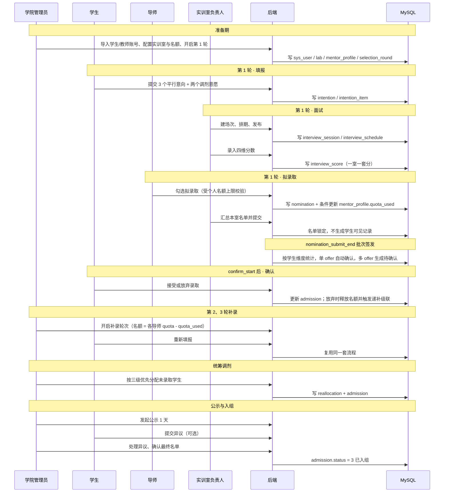

# Flow：全局流程

## 1. 场景概述

- 触发角色：学生、导师、实训室负责人、学院管理员
- 前置条件：学院管理员已导入学生与教师账号、配置实训室档案与导师名额、开启当前轮次
- 涉及表：`selection_round`、`intention`、`intention_item`、`interview_session`、`interview_schedule`、`interview_score`、`nomination`、`waitlist`、`admission`、`reallocation`、`publicity`、`dispute`
- 涉及接口：全部业务接口

## 2. 全局时序图

## 3. 流程阶段总览

| 阶段 | 线上化程度 | 系统内动作 |
|---|---|---|
| 1 集中宣讲 | 线下 | 公告栏发布时间、地点、注意事项 |
| 2 实训室开放日 | 线下 | 实训室档案展示开放日安排 |
| 3 意向填报 | 全线上 | 学生填报 ≤3 个平行导师意向 + 两个调剂意愿 |
| 4 导师初选与面试考核 | 全线上 | 负责人排期、录四维分、系统算总分 |
| 5 拟录取与学生确认 | 全线上 | 导师勾选 → 负责人汇总 → 批次签发（单 offer 自动确认）→ 学生限时确认 |
| 6 分轮补录 | 全线上 | 第 2、3 轮重跑填报—面试—确认 |
| 7 统筹调剂 | 全线上 | 管理员按三级优先手工分配 |
| 8 结果公示与正式入组 | 全线上 | 公示 1 天、异议工单、确认入组 |

## 4. 状态机

### 4.1 轮次状态 `selection_round.status`

| 当前状态 | 触发动作 | 目标状态 | 校验条件 | 失败反馈 |
|---|---|---|---|---|
| 1 未开始 | 管理员开启本轮 | 2 填报中 | 系统时间 ≥ apply_start，且无其他轮次处于进行中 | 「第 N 轮尚未开始」/「已有轮次正在进行」 |
| 2 填报中 | 到达 apply_end | 3 面试中 | 系统时间 ≥ apply_end | 自动流转，无需人工 |
| 3 面试中 | 到达 nomination_start 且本室录分完成 | 4 拟录取确认中 | 系统时间 ≥ nomination_start | 未录分则提示「仍有 X 人未评分」 |
| 4 拟录取确认中 | 到达 nomination_submit_end | 4 拟录取确认中 | 触发批次签发：按学生维度统计，单 offer 自动确认，多 offer 置待确认 | — |
| 4 拟录取确认中 | 到达 nomination_end | 5 已完成 | 系统时间 ≥ nomination_end | 自动流转 |
| 4 拟录取确认中 | 管理员强制结束 | 5 已完成 | 未确认记录批量置「逾期未确认」并释放名额 | — |
| 5 已完成 | 生成归档快照后锁定 | 6 已归档 | `snapshotType = 4` 存在且公示已确认 | 「归档快照未生成」 |
| 6 已归档 | 管理员解锁（密码二次验证） | 5 已完成 | 密码校验通过 | 「密码校验失败」 |
| 5 已完成 | 管理员开启下一轮 | 下一轮 2 填报中 | round_no 递增 | — |

### 4.2 学生录取状态 `admission.status`

| 当前状态 | 触发动作 | 目标状态 | 校验条件 | 失败反馈 |
|---|---|---|---|---|
| 1 待确认 | 学生接受 | 2 已确认 | 当前时间 ≤ confirm_deadline，且 `student_id = 当前用户` | 「已超过确认截止时间」 |
| 1 待确认 | 学生放弃 | 4 已放弃 | 同上 | 同上 |
| 1 待确认 | 到达 confirm_deadline | 5 逾期未确认 | 系统定时任务扫描 | 释放名额并触发递补 |
| 1 待确认（递补来源） | 通知后 30 分钟仍未响应 | 5 逾期未确认 | `confirm_deadline = max(nomination_end, 通知时刻 + 30min)` | 同上 |
| 2 已确认 | 公示确认 | 3 已入组 | 公示结束且无未处理异议 | — |
| 4 已放弃 | 下一轮重新录取 | 新记录 1 待确认 | 学生进入下一轮流程 | — |
| 5 逾期未确认 | 下一轮重新录取 | 新记录 1 待确认 | 同上 | — |

### 4.3 名额流转

| 事件 | `mentor_profile.quota_used` | 说明 |
|---|---|---|
| 导师提交拟录取 | +1 / 人 | 条件更新 `WHERE quota_used < quota` |
| 学生确认录取 | 不变 | 已占用，仅状态变化 |
| 学生放弃 / 逾期 | -1 / 人 | 释放名额，触发递补 |
| 递补录取 | +1 / 人 | 按顺位取 `waitlist` 中 `apply_status=1` 的第一条 |
| 管理员调剂 | +1 / 人 | 同样走条件更新 |
| 公示确认入组 | 不变 | 名额已终态占用 |

## 5. 三处一致性约定

| 项 | 唯一取值 | 出现位置 |
|---|---|---|
| 学生录取状态 | 1 待确认 / 2 已确认 / 3 已入组 / 4 已放弃 / 5 逾期未确认 | `admission.status`、API `admissionStatus`、前端文案 |
| 调剂级别 | 1 内部调剂 / 2 跨室调剂 / 3 座谈安置 | `reallocation.level`、API `level`、PRD 三级优先 |
| 意向数量 | 首轮 1–3 条、补录轮 1 条，平行不分先后 | `intention_item`、API `items`、PRD 志愿规则 |
| 批次锁定 | `locked` 0 未锁 / 1 已锁 | `selection_round.locked`、API `locked`、前端整站只读 |
| 终局有效标记 | `active_flag` 1 终局（status 2/3）/ NULL 其余 | `admission.active_flag`、`uk_round_student_active` |
| 待确认类型 | 1 拟录取多选一 / 2 递补待确认 / 3 异议调整待确认 / 4 内部调剂待确认，仅展示 | `admission.pending_type`、API `pendingType` |
| 调剂子窗 | `adjust_start` ~ `adjust_end` | `selection_round`、抢录门禁、API `phase = ADJUST` |

## 6. 异常与边界

| 场景 | 触发条件 | 服务端行为 | 错误码 | 前端反馈 |
|---|---|---|---|---|
| 重复提交 | 同一轮同一学生二次提交 | 覆盖更新 `intention` 与明细 | 200 | Toast「已更新填报」 |
| 名额超录 | 并发提交拟录取 | 条件更新失败回滚 | 400003 | Toast「超出个人名额上限」 |
| 填报超时 | 提交时已过 apply_end | 拒绝写入 | 400004 | Toast「填报已截止」并刷新为只读 |
| 学生重复录取 | 同轮已被其他导师确认 | 拒绝新建 `admission` | 400005 | 提示「本轮已有录取去向」 |
| 逾期未确认 | 定时任务扫描到超时 | 状态置 5，释放名额，触发递补 | — | 站内通知「已逾期，视为放弃」 |
| 递补无人可补 | 递补队列全为已失效 | 名额保留至下一轮 | — | 负责人端提示「本室仍有空缺」 |
| 公示期异议未处理 | 管理员确认最终名单 | 拒绝确认 | 400005 | 提示「仍有 N 条异议未处理」 |
| 账号首登未改密 | 访问业务接口 | 拦截 | 401004 | 强制跳转改密页 |

## 7. 测试要点

- 快乐路径：3 轮全流程走通，每名学生最终有唯一去向。
- 边界：3 个意向全部拟录取时，学生选 1 个，其余自动释放；0 个意向时不允许提交。
- 并发：同一导师名额 2 人，10 个请求同时提交拟录取，只有 2 条成功。
- 超时：确认截止后 1 秒，定时任务将记录置为逾期并释放名额。
- 补偿：放弃后递补学生自动进入待确认，并收到站内通知。
